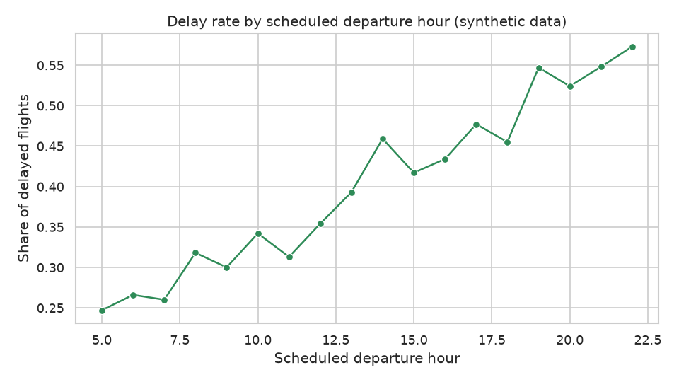
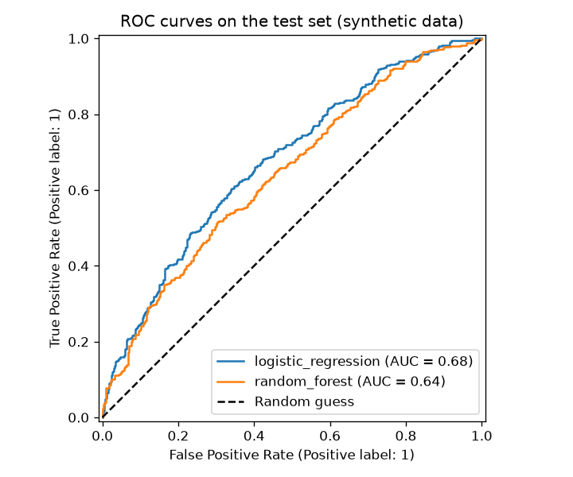
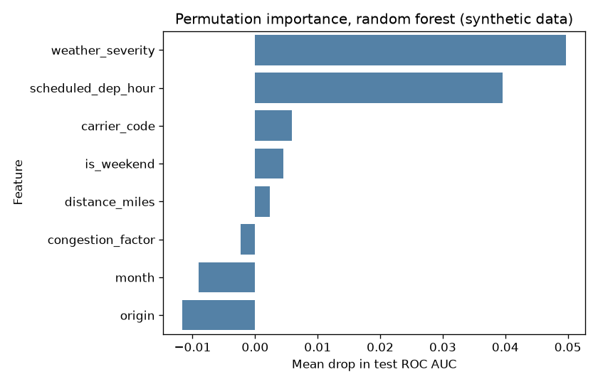

# Airline Delay Analysis

## Business question
Which airports, carriers and hours of the day are most associated with flight delays, and can we predict in advance whether a flight will arrive late?

## Goal
Describe delay patterns by airport, carrier and scheduled departure hour, and build a classifier that flags flights likely to be delayed (arrival delay of 15 minutes or more).

## Plan of the work
1. **Data generation** (`src/data_generator.py`): create a reproducible synthetic dataset (fixed seed 42).
2. **EDA** (`src/eda.py`): check data quality, distributions of delays, and delay rates by airport, carrier, hour, month and weather.
3. **Analysis / model** (`src/analysis.py`, helpers in `src/utils.py`): statistical comparison of groups and a delay classifier (baseline logistic regression and a tree-based model), evaluated on a held-out test set.
4. **SQL** (`sql/queries.sql`, `src/run_sql.py`): analytical queries on the same tables (delay rate by airport, carrier ranking, hourly profile and more).
5. **Tests** (`tests/`): pytest checks for the data generator and the helper functions in `src/utils.py`.

## Dataset (synthetic)
All data is **synthetic**. It is generated by this project's own code and does not describe real flights, airports' real performance or real airlines. Carrier names are fictional. Airport codes and coordinates are real-looking only to keep the project realistic.

Three tables are saved to `data/`:
- `airports.csv`: 12 airports with region, coordinates and a congestion factor.
- `carriers.csv`: 6 fictional carriers with a business type.
- `flights.csv`: 5,000 flights in 2025 with schedule, weather, delays and a delay flag.

See `data_description.md` for every column.

## How to run
From the project root:

```bash
pip install -r requirements.txt
python src/data_generator.py
python src/eda.py
python src/analysis.py
python src/run_sql.py
python -m pytest -q
```

The generator writes the CSV files to the `data/` folder (created automatically). The EDA script reads them and writes charts to `figures/`. The analysis script trains the models, writes charts to `figures/` and a metrics summary to `reports/metrics.json`. The SQL script prints the results of the queries in `sql/queries.sql`.

## Tests
Run the test suite from the project root:

```bash
python -m pytest -q
```

The tests live in `tests/` and finish in a few seconds:
- `tests/test_data_generator.py`: column names, row counts, value ranges, the 15-minute delay rule, foreign keys, reproducibility with the fixed seed, reference tables, the distance function and the CSV output of the generator (written to a temporary folder).
- `tests/test_utils.py`: feature preparation (no target leakage), classification metrics, the majority-class baseline, the chi-square helper (strong association vs. independence), model pipelines (fit and probability output) and CSV loading (carrier code `NA` is kept).

The tests build the synthetic data in memory, so they do not need the `data/` or `figures/` folders and can be run before any other script.

## Exploratory data analysis
`src/eda.py` loads the three tables and prints:
- shape, data types, missing values and duplicate rows for each table;
- descriptive statistics for the numeric flight columns, the overall delay rate and the skewness of arrival delay;
- delay rate, flight counts and mean arrival delay by origin airport, carrier (with name and type), scheduled departure hour, month and weather severity band.

It also saves four charts to `figures/`:
- `arrival_delay_distribution.png`: histogram of arrival delay with the 15-minute threshold;
- `delay_rate_by_airport.png`: delay rate per origin airport;
- `delay_rate_by_hour.png`: delay rate per scheduled departure hour;
- `delay_rate_by_month.png`: delay rate per month.

The findings should be read from the script output, since they come from synthetic data and describe only this generated dataset.

Note: the carrier code `NA` is a valid code, so the CSVs are read with `keep_default_na=False` to stop pandas from treating it as a missing value.

## Method (analysis and model)
`src/analysis.py` answers the business question in two parts. Reusable logic (loading, feature preparation, model pipelines, metrics, chi-square helper) lives in `src/utils.py`.

**1. Group comparison.** Chi-square tests of independence compare the delay flag across carriers, origin airports, scheduled departure hours and weekend vs. weekday. For each test the script prints the chi-square statistic, degrees of freedom, p-value and Cramer's V as an effect size, so that statistical significance is not confused with practical importance.

**2. Delay classifier.** The target is `is_delayed` (arrival delay of 15 minutes or more).
- *Features:* only information known before departure: scheduled departure hour, distance, weather severity, origin congestion factor, month, weekend flag, carrier code and origin airport. `dep_delay_min` and `arr_delay_min` are deliberately excluded because they would leak the outcome.
- *Split:* stratified 80/20 train/test split with `random_state=42`. All reported metrics are computed on the held-out test set only.
- *Models:* a logistic regression (baseline, scaled numeric features and one-hot encoded categories) and a random forest. Both use balanced class weights because delayed flights are the minority class.
- *Metrics:* accuracy, precision, recall, F1, ROC AUC and PR AUC for the delayed class, compared with a majority-class baseline accuracy.
- *Interpretation:* permutation importance of the random forest on the test set (drop in ROC AUC when a feature is shuffled).

**Outputs**
- `figures/roc_curves.png`: ROC curves of both models on the test set;
- `figures/feature_importance.png`: permutation importance by feature;
- `reports/metrics.json`: dataset size, test split settings, chi-square results, model metrics and feature importances.

Because the data is synthetic, conclusions describe the generating process of this dataset, not real airline performance.

## SQL analysis
The same three tables are queried with SQL (SQLite dialect).

- `sql/queries.sql` contains 8 commented queries. Each one is preceded by a comment line of the form `-- Q<n>: <question>`.
- `src/run_sql.py` loads `airports.csv`, `carriers.csv` and `flights.csv` into an in-memory SQLite database with `pandas.to_sql`, splits the query file into statements, runs each one and prints the question and the first rows of the result. No database file is created.

Questions covered:
1. Delay rate, flight count and mean arrival delay by origin airport (join with `airports`).
2. Carrier ranking by delay rate with name and type (join with `carriers`, `RANK()` window function).
3. Hourly profile of delays by scheduled departure hour.
4. Delay rate by carrier type and part of the day (`CASE` buckets).
5. Delay rate by weather severity band.
6. Monthly delay rate compared with the overall rate (CTE).
7. Airport and carrier combinations with the highest delay rate (`HAVING` on a minimum number of flights).
8. Routes with the highest mean arrival delay (self-style double join with `airports`).

Because statements are split on semicolons, comments inside `queries.sql` must not contain a semicolon.

## Results
All numbers below are taken from the output of the scripts (and `reports/metrics.json`) on the synthetic dataset of 5,000 flights.

### Delay patterns
- Overall delay rate (arrival delay of 15 minutes or more): **0.395**. Arrival delay is right-skewed (skewness 2.02).
- **Airports:** the delay rate ranges from **0.495 (ORD)** and 0.469 (JFK) at the top to **0.267 (PHX)** and 0.298 (MSP) at the bottom.
- **Carriers:** SkyJet (SJ) **0.453** and EconoFly (EC) 0.450 are highest; Pacific Wings (PW) is lowest at **0.322**.
- **Hour of day:** the delay rate rises from **0.247** for 05:00 departures to **0.573** for 22:00 departures.
- **Weather severity band:** the delay rate rises from **0.337** (band 0-1) to **0.636** (band 4-10).
- **Month:** the highest delay rate is in January (0.434), the lowest in October (0.337).
- **Time of day and carrier type (SQL Q4):** for each carrier type, the delay rate is higher in the evening than in the morning (legacy 0.474 vs. 0.262, low-cost 0.562 vs. 0.340, regional 0.476 vs. 0.292).

### Statistical tests (chi-square, delay flag vs. group)
| Group | Chi-square | dof | p-value | Cramer's V |
|---|---|---|---|---|
| Carrier | 45.43 | 5 | 1.187e-08 | 0.095 |
| Origin airport | 86.14 | 11 | 9.456e-14 | 0.131 |
| Scheduled departure hour | 191.62 | 17 | 1.376e-31 | 0.196 |
| Weekend vs. weekday | 12.85 | 1 | 0.0003382 | 0.051 |

### Delay classifier (held-out test set, 1,000 flights)
Majority-class baseline accuracy: **0.605**.

| Model | Accuracy | Precision | Recall | F1 | ROC AUC | PR AUC |
|---|---|---|---|---|---|---|
| Logistic regression | 0.633 | 0.530 | 0.618 | 0.571 | 0.676 | 0.573 |
| Random forest | 0.601 | 0.495 | 0.549 | 0.521 | 0.643 | 0.545 |

Permutation importance of the random forest (drop in test ROC AUC): weather_severity 0.0497, scheduled_dep_hour 0.0395, carrier_code 0.0059, is_weekend 0.0045, distance_miles 0.0024, congestion_factor -0.0023, month -0.0091, origin -0.0116.

### Figures
Delay rate by scheduled departure hour:



ROC curves of both models on the test set:



Permutation importance of the random forest:



## Conclusions
- In this dataset, delays are clearly more frequent later in the day: the delay rate grows from 0.247 (05:00) to 0.573 (22:00). Departure hour also has the largest Cramer's V of the four grouping variables tested (0.196).
- Weather severity is strongly associated with delays: the delay rate is 0.337 in the calmest band and 0.636 in the most severe one. Weather severity and departure hour are also the two most important features in the permutation importance (0.0497 and 0.0395).
- Airports and carriers differ (ORD 0.495 vs. PHX 0.267, SJ 0.453 vs. PW 0.322), and the chi-square tests are significant. The effect sizes are small (Cramer's V of 0.131 for airport and 0.095 for carrier), and the weekend effect is smaller still (0.051).
- The classifier has only modest predictive power. The logistic regression reaches ROC AUC 0.676 and accuracy 0.633, which is only slightly above the majority-class baseline accuracy of 0.605. The random forest is weaker (ROC AUC 0.643) and its accuracy of 0.601 is below the baseline. Accuracy alone is not a good yardstick here, so recall (0.618 for logistic regression) and ROC AUC are more informative.
- Origin, month and congestion factor have negative permutation importance for the random forest, meaning that shuffling them did not reduce test ROC AUC. This suggests they add little to the model beyond noise, even though origin airports differ in the raw delay rates.
- These are associations in a synthetic dataset and do not show causes.

## Limitations & next steps
**Limitations**
- The data is **synthetic**, generated by this project's own code. The patterns reflect the assumptions built into the generator, not real airline or airport performance, so no conclusion applies to real flights.
- The test set has 1,000 flights, so the metrics have some sampling noise. No confidence intervals or cross-validation are reported.
- Hyperparameters of the models were not tuned, and the chi-square tests do not adjust for other factors (for example, hour and weather together).
- Only pre-departure features are used. Information such as the inbound aircraft delay is not available.
- The weather bands in the EDA and in SQL Q5 use different cut-offs, so their flight counts and rates differ slightly and should not be compared directly.
- The data generator triggers a pandas deprecation warning (`DatetimeIndex.dayofweek`); it does not affect the results.

**Next steps**
- Use cross-validation and confidence intervals for the metrics, and tune the models (for example, gradient boosting and the decision threshold).
- Fit a multivariable model (logistic regression with interactions, such as hour and weather) to separate the effects of the factors.
- Replace `dayofweek` with `day_of_week` in the generator.
- Repeat the analysis on real public flight data, if available, to check which patterns hold outside the synthetic setting.

---

*This is a training project that uses synthetic data generated by AI.*
