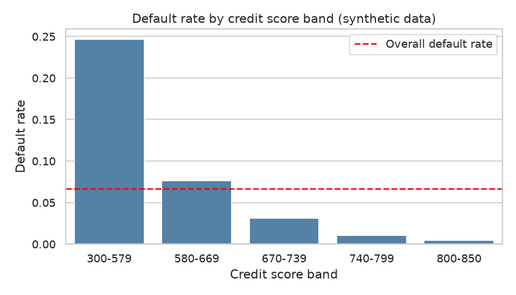
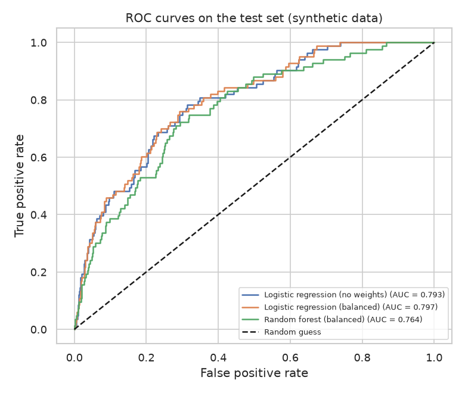
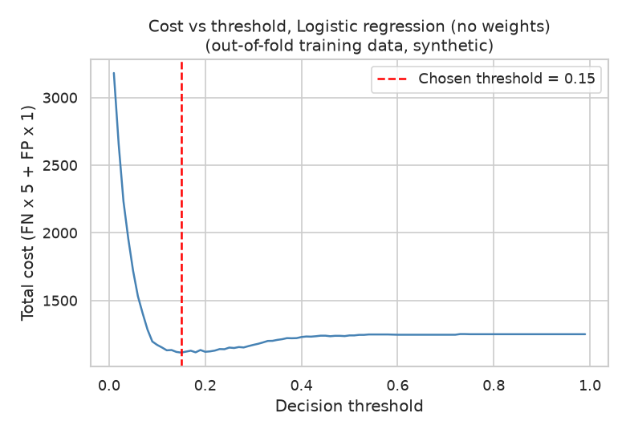

# Credit Default Risk

Loan default prediction with class imbalance handling and ROC analysis.

> **Note:** All data in this project is **synthetic**. It is generated by `src/data_generator.py` and does not describe real customers or real loans.

## Business question

Which loan applicants are most likely to default, and how can a lender use a risk model to approve or decline applications while keeping missed defaults and wrongly rejected good borrowers at an acceptable level?

## Goal

Build a reproducible pipeline that:

1. Explores the portfolio and the drivers of default.
2. Trains default-prediction models that handle a strongly imbalanced target (few defaults, many repaid loans).
3. Evaluates the models with ROC analysis and threshold-dependent metrics.
4. Supports portfolio-level questions with SQL.

## Plan of the work

1. **Data generation**: Create synthetic `customers` and `loans` tables with a fixed seed.
2. **EDA**: Data quality checks, default rate by segment, distributions of the key features, correlations.
3. **Analysis / model**: Baseline logistic regression, class-imbalance handling (class weights, threshold tuning), model comparison with ROC AUC, precision-recall and a cost-based threshold choice.
4. **SQL**: Portfolio queries (default rate by purpose, region, score band, etc.) on the generated tables.
5. **Tests**: Pytest checks for the data generator (columns, row counts, ranges, keys, reproducibility) and for the helper functions in `src/utils.py`.

All five steps are implemented.

## Dataset (synthetic)

Two linked CSV tables are written to `data/`:

| Table | Rows | Description |
|-------|------|-------------|
| `customers.csv` | 4000 | Borrower profile: demographics, income, credit score, existing debt |
| `loans.csv` | 5000 | Loan applications linked to customers via `customer_id`, with the binary target `default` |

The default flag is drawn from a logistic risk function of credit score, debt-to-income, past delinquencies, interest rate and other features, so that defaults are the minority class. See `data_description.md` for every column.

## How to run

Install dependencies and generate the synthetic data:

```bash
pip install -r requirements.txt
python src/data_generator.py
```

After running the data generator, you should see output like:

```
Saved customers.csv: 4000 rows, 9 columns
Saved loans.csv: 5000 rows, 10 columns
Default rate in generated loans: 0.0666
```

Then run the exploratory analysis, the model and the SQL queries:

```bash
python src/eda.py
python src/analysis.py
python src/run_sql.py
```

All scripts are run from the project root and work non-interactively. Generated CSV files are saved to the `data/` folder, charts to `figures/` and the metrics summary to `reports/`.

## Tests

Run the test suite from the project root:

```bash
python -m pytest -q
```

The tests are fast and self-contained: they generate small synthetic tables in memory (or in a temporary folder), so they do not need the files in `data/` or `figures/`. The latest run reported 12 passed.

- `tests/test_data_generator.py`: column names, row counts, value ranges, key integrity (every loan has a customer), chronological loan ids, the minority default class and reproducibility with the fixed seed.
- `tests/test_utils.py`: joining the tables, feature preparation, the model pipeline, the cost function, the cost curve, threshold selection and metrics checked against hand-computed values.

## Exploratory data analysis

`src/eda.py` loads both CSV files and:

- prints shape, data types, missing values and duplicate counts for each table;
- prints descriptive statistics for the numeric columns and checks that every loan has a matching customer;
- joins loans with customer attributes and prints the target balance and default rates by loan purpose, credit score band, number of delinquencies, region and home ownership, and loan term;
- saves four charts to `figures/`:
  - `default_rate_by_score_band.png`
  - `default_rate_by_purpose.png`
  - `dti_by_default.png`
  - `correlation_heatmap.png`

All numbers are produced by the script at run time; read them from its printed output.

## Method (modelling)

`src/analysis.py` (with helpers in `src/utils.py`) does the following:

1. **Data and features.** Loans are joined to customers (one row per loan). Features are 11 numeric columns (age, income, employment years, credit score, existing debt, number of credit lines, loan amount, term, interest rate, debt-to-income, delinquencies) and 3 categorical columns (home ownership, region, loan purpose). Identifiers and the application date are not used. Numeric features are standardised and categorical features one-hot encoded inside a scikit-learn pipeline, so preprocessing is fitted on training data only.
2. **Split.** Stratified 75/25 train/test split with `random_state=42`, so both parts keep the same default rate.
3. **Imbalance handling.** Three candidates are compared: a plain logistic regression (baseline), a logistic regression with `class_weight="balanced"` and a random forest with balanced class weights.
4. **Model selection.** Models are compared with 5-fold stratified cross-validated ROC AUC on the training set only. The model with the highest CV AUC is marked as selected.
5. **Threshold choice.** A default threshold of 0.5 is poor for rare defaults. For each model a decision threshold is chosen that minimises a simple cost function on out-of-fold training predictions: `cost = FN x 5 + FP x 1`. The 5:1 ratio is a **business assumption** (a missed default is more costly than a wrongly rejected good borrower), not something estimated from the data; change `COST_FN` and `COST_FP` in `src/analysis.py` to test other values.
6. **Evaluation on the test set.** ROC AUC, PR AUC (average precision), precision, recall, F1, confusion-matrix counts and total cost are reported at both the 0.5 threshold and the tuned threshold, together with the cost of the trivial strategies "approve all" and "reject all".

Outputs:

- `figures/roc_curves.png`: ROC curves of all models on the test set;
- `figures/cost_vs_threshold.png`: total cost against the decision threshold for the selected model;
- `reports/metrics.json`: all metrics, thresholds and the cost assumption.

All metric values are produced at run time; read them from the script output or `reports/metrics.json`.

## SQL analysis

`sql/queries.sql` contains 8 portfolio queries in the SQLite dialect. Each query is preceded by a comment line starting with `-- Q<n>:` that states the business question:

| Query | Question |
|-------|----------|
| Q1 | Size, default rate and average interest rate of the whole portfolio |
| Q2 | Default rate by loan purpose |
| Q3 | Default rate by credit score band (CASE expression inside a CTE) |
| Q4 | Default rate by region and home ownership (JOIN with `customers`, HAVING filter) |
| Q5 | Default rate by number of past delinquencies |
| Q6 | Repeat borrowers (2 or more loans) with the most defaults |
| Q7 | Default rate by application quarter |
| Q8 | Share of the defaulted amount by loan purpose (window function) |

`src/run_sql.py` loads `customers.csv` and `loans.csv` into an in-memory SQLite database with `pandas.to_sql`, splits `queries.sql` into statements, runs each one and prints the description together with the first rows of the result. Nothing is written to disk. The target column `default` is a reserved SQL word, so it is quoted in the queries. As everywhere else, the numbers come from the script output at run time.

## Results

All numbers below are copied from the program output of one run on the synthetic data (seed-fixed generator, `random_state=42`).

### Portfolio and drivers of default

- 5000 loans, 333 defaults, overall default rate **0.0666** (4667 repaid vs 333 defaulted). Average interest rate is 14.96.
- Default rate by credit score band falls steeply as the score rises:

| Score band | Loans | Default rate |
|------------|-------|--------------|
| 300-579 | 519 | 0.2466 |
| 580-669 | 1884 | 0.0764 |
| 670-739 | 1714 | 0.0309 |
| 740-799 | 676 | 0.0104 |
| 800-850 | 207 | 0.0048 |

- Default rate by past delinquencies (2 years): 0.0541 for 0, 0.1043 for 1, 0.2589 for 2 and 0.2500 for 3 or more (only 16 loans in the last group).
- Default rate by term: 0.0914 for 60 months (1444 loans) vs 0.0565 for 36 months (3556 loans).
- Default rate by loan purpose ranges from 0.0508 (car) to 0.0883 (small business).
- Debt consolidation accounts for 41.0% of the defaulted amount (1,452,163 of the defaulted total), followed by credit card with 18.5%.



### Model comparison

Split: 3750 train rows (default rate 0.0667) and 1250 test rows (default rate 0.0664).

| Model | CV ROC AUC (train) | Test ROC AUC | Test PR AUC |
|-------|--------------------|--------------|-------------|
| Logistic regression (no weights) | 0.7497 | 0.7933 | 0.2412 |
| Logistic regression (balanced) | 0.7441 | 0.7968 | 0.2413 |
| Random forest (balanced) | 0.7386 | 0.7637 | 0.2107 |

The plain logistic regression has the highest CV ROC AUC and is the selected model.



### Threshold and cost (test set, cost = FN x 5 + FP x 1)

| Model | Threshold | Precision | Recall | F1 | FN | FP | Total cost |
|-------|-----------|-----------|--------|----|----|----|------------|
| Logistic regression (no weights) | 0.50 | 0.500 | 0.012 | 0.024 | 82 | 1 | 411.0 |
| Logistic regression (no weights) | 0.15 (tuned) | 0.266 | 0.410 | 0.322 | 49 | 94 | 339.0 |
| Logistic regression (balanced) | 0.50 | 0.155 | 0.747 | 0.257 | 21 | 337 | 442.0 |
| Logistic regression (balanced) | 0.68 (tuned) | 0.236 | 0.458 | 0.311 | 45 | 123 | 348.0 |
| Random forest (balanced) | 0.50 | 0.193 | 0.386 | 0.257 | 51 | 134 | 389.0 |
| Random forest (balanced) | 0.55 (tuned) | 0.223 | 0.373 | 0.279 | 52 | 108 | 368.0 |

Reference costs: approve all loans = 415.0, reject all loans = 1167.0.



### SQL highlights

- Q7 (default rate by application quarter) ranges from 0.0514 (2022-Q2) to 0.0852 (2023-Q3); 2023-Q4 is 0.0593.
- Q6: the repeat borrowers with the most defaults have 3 defaults each (customer 1940 with 5 loans, customer 2327 with 5 loans, customer 1863 with 3 loans).

## Conclusions

- Credit score is a strong separator of risk in this dataset: the default rate is 0.2466 in the 300-579 band and 0.0048 in the 800-850 band. Delinquencies also matter (0.0541 with none vs 0.2589 with two).
- The models rank borrowers moderately well (test ROC AUC 0.7637 to 0.7968) but precision stays low because defaults are rare: at the tuned thresholds precision is between 0.223 and 0.266.
- At the default threshold of 0.5 the plain logistic regression finds only 1 of the defaults it should (recall 0.012, 82 missed), and its cost (411.0) is barely below "approve all" (415.0). Class imbalance makes 0.5 a poor cutoff for this model.
- Class weights change the operating point rather than the ranking: balanced logistic regression reaches recall 0.747 at 0.5 but with 337 false positives, giving the highest cost (442.0).
- Cost-based threshold tuning helped every model compared with 0.5 on the test set for the two logistic regressions (411.0 to 339.0 and 442.0 to 348.0) and the random forest (389.0 to 368.0). The lowest test cost, 339.0, comes from the selected plain logistic regression at threshold 0.15, compared with 415.0 for approving everyone. Rejecting everyone (1167.0) is clearly the worst strategy under this cost assumption.
- The two logistic regressions differ by only about 0.0035 in test ROC AUC and have almost identical PR AUC (0.2412 vs 0.2413), so the data does not show a meaningful ranking difference between them. The random forest is lower on all three AUC-type measures.
- The default rate varies between quarters (0.0514 to 0.0852), so the portfolio is not perfectly stable in time in this sample.

## Limitations & next steps

- **The data is synthetic.** It is produced by the project's own generator with a known logistic risk function, so the findings describe that generator, not real borrowers. Absolute numbers (AUC, costs, default rates) should not be transferred to a real lender.
- **Cost ratio is an assumption.** The 5:1 cost of a missed default vs a wrongly rejected good borrower is not estimated from data. Results, thresholds and the best strategy may change with other ratios.
- **Single split.** Test metrics come from one 75/25 split with 83 defaults in the test set (82 + 1 at threshold 0.5), so they are noisy. Repeated splits or confidence intervals would show how stable the comparison is.
- **Small groups.** Some segments are small (for example 16 loans with 3+ delinquencies), so their default rates are uncertain.
- **Next steps:** add probability calibration, test other models (for example gradient boosting) and resampling methods such as SMOTE, run a sensitivity analysis over several cost ratios, and check for time-based drift with a chronological train/test split.

## Project structure

```
credit-default-risk/
├── README.md
├── requirements.txt
├── data_description.md
├── data/            # generated CSV files
├── figures/         # EDA and model charts
├── reports/         # metrics.json
├── sql/
│   └── queries.sql
├── src/
│   ├── data_generator.py
│   ├── eda.py
│   ├── utils.py
│   ├── analysis.py
│   └── run_sql.py
└── tests/
    ├── test_data_generator.py
    └── test_utils.py
```

---

*This is a training project that uses synthetic data generated by AI.*
