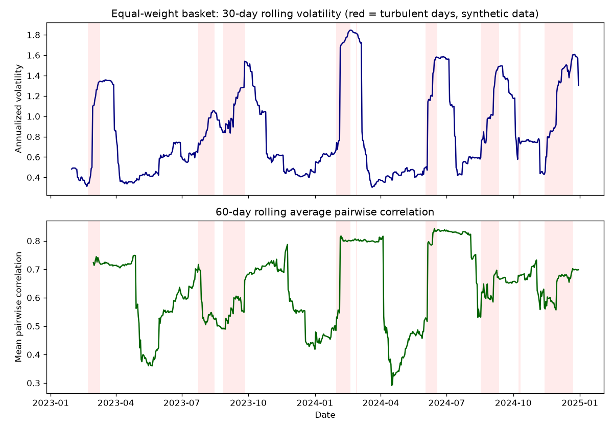
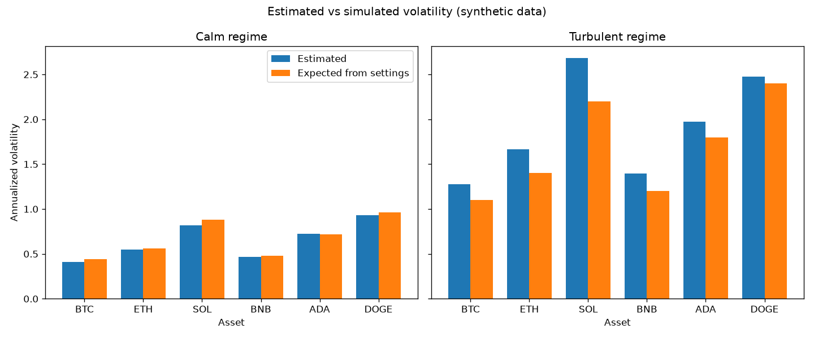
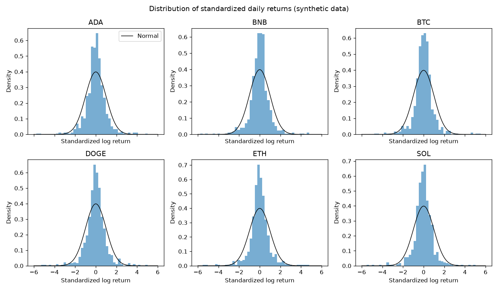

# Crypto Volatility Analysis

Returns distribution, rolling volatility and correlation on simulated prices.

> **Note:** all data in this project is **synthetic**. It is generated by `src/data_generator.py` with a fixed random seed. It is not real market data and must not be used for trading or investment decisions.

## Business question

How risky is a basket of crypto assets? Specifically: how heavy are the tails of daily returns, how much does volatility change over time, and how strongly do the assets move together, especially when the market is under stress?

## Goal

Build a reproducible analysis that quantifies:

- the shape of the daily returns distribution for each asset (skewness, excess kurtosis, tail events),
- rolling volatility and how it clusters into calm and turbulent periods,
- pairwise correlations and how they change over time and across regimes,

and that turns these findings into simple risk metrics (for example volatility and Value-at-Risk style measures).

## Plan of the work

1. **Data generation**: simulate correlated daily prices for several assets with fat-tailed shocks and regime-switching volatility.
2. **EDA**: price and return charts, summary statistics, distribution plots, normality checks, data quality checks.
3. **Analysis / model**: rolling volatility, volatility clustering, rolling and regime-conditional correlations, historical VaR and Expected Shortfall, and a comparison of the estimates with the known simulation settings.
4. **SQL**: analytical queries over the CSV tables, loaded into an in-memory SQLite database (standard library), for aggregations and window-function based volatility.
5. **Tests**: pytest tests for the data generator (columns, row counts, value ranges, reproducibility) and for the analysis functions in `src/utils.py`.
6. **Results**: summary of the findings, figures, conclusions and limitations (this step).

## Dataset (synthetic)

The generator creates three CSV tables in `data/`:

| Table | Description | Rows |
|---|---|---|
| `assets.csv` | Static information about the 6 simulated assets | 6 |
| `market_regimes.csv` | Daily market volatility regime (calm / turbulent) | 730 |
| `daily_prices.csv` | Daily close price, log return and traded volume per asset | 4380 |

How the prices are simulated:

- log returns follow a geometric-Brownian-motion-like process with asset-specific drift and base volatility,
- shocks are Student-t distributed (fat tails),
- a two-state Markov chain switches the whole market between calm and turbulent volatility regimes,
- assets share a common market factor, and the loading on that factor is higher in the turbulent regime,
- trading volume rises with the absolute size of the daily return.

The simulated period has 730 days: 555 calm days (76.03%) and 175 turbulent days (23.97%).

See `data_description.md` for every table and column.

## How to run

From the project root:

```bash
pip install -r requirements.txt
python src/data_generator.py
python src/eda.py
python src/analysis.py
python src/run_sql.py
python -m pytest -q
```

The generator writes the CSV files to the `data/` folder. The EDA, analysis and SQL scripts read those files, so run the generator first. The tests do not need the CSV files or figures.

## Results

All numbers below come from the output of `src/eda.py`, `src/analysis.py` and `src/run_sql.py` on the synthetic data. They describe the simulation, not real markets.

### Returns distribution

Daily log returns are far from normal for every asset (Jarque-Bera p-value 0.0000 for all six).

| Asset | Annualized vol (all days) | Skew | Excess kurtosis | Min daily return | Max daily return |
|---|---|---|---|---|---|
| ADA | 1.1506 | 0.1966 | 7.4689 | -0.3473 | 0.4073 |
| BNB | 0.7958 | 0.3439 | 10.0158 | -0.2402 | 0.3230 |
| BTC | 0.7192 | 0.5711 | 12.5628 | -0.2375 | 0.3063 |
| DOGE | 1.4578 | 0.2592 | 7.3210 | -0.3907 | 0.5231 |
| ETH | 0.9434 | 0.5400 | 11.2372 | -0.2738 | 0.4081 |
| SOL | 1.4924 | 1.0002 | 12.8961 | -0.4187 | 0.5957 |

### Rolling volatility and volatility regimes

The 30-day annualized volatility of the equal-weight basket (701 observations) has a mean of 0.8215, a median of 0.6437, a minimum of 0.3026 and a maximum of 1.8464.

Annualized volatility by regime, estimated vs expected from the simulation settings:

| Asset | Calm (est.) | Calm (exp.) | Turbulent (est.) | Turbulent (exp.) | Turbulent / calm (est.) |
|---|---|---|---|---|---|
| ADA | 0.7213 | 0.7200 | 1.9723 | 1.8000 | 2.7344 |
| BNB | 0.4686 | 0.4800 | 1.3966 | 1.2000 | 2.9804 |
| BTC | 0.4125 | 0.4400 | 1.2738 | 1.1000 | 3.0879 |
| DOGE | 0.9334 | 0.9600 | 2.4754 | 2.4000 | 2.6521 |
| ETH | 0.5462 | 0.5600 | 1.6669 | 1.4000 | 3.0520 |
| SOL | 0.8207 | 0.8800 | 2.6808 | 2.2000 | 3.2666 |

The estimated / expected ratio is between 0.9326 and 1.0018 on calm days and between 1.0314 and 1.2185 on turbulent days.

Volatility clustering: the lag-1 autocorrelation of absolute returns is between 0.1439 (ADA) and 0.2031 (ETH) for the assets and 0.1662 for the basket. The Ljung-Box p-value on squared returns is 0.0114 or lower for every asset and 0.0320 for the basket.





### Correlation

Mean pairwise correlation of daily log returns:

| Period | Estimated | Expected from settings |
|---|---|---|
| All days | 0.6754 | not computed |
| Calm | 0.5133 | 0.5117 |
| Turbulent | 0.7362 | 0.6650 |

The strongest pair in the full-sample correlation matrix is BTC-ETH (0.8244); the weakest is DOGE-SOL (0.5210).

### Risk metrics (daily, positive = loss, log-return units)

| Asset | VaR 95% | ES 95% | VaR 99% | ES 99% |
|---|---|---|---|---|
| ADA | 0.0930 | 0.1438 | 0.1793 | 0.2354 |
| BNB | 0.0646 | 0.1035 | 0.1168 | 0.1644 |
| BTC | 0.0565 | 0.0924 | 0.1042 | 0.1525 |
| DOGE | 0.1135 | 0.1855 | 0.2369 | 0.3017 |
| ETH | 0.0711 | 0.1207 | 0.1346 | 0.1992 |
| SOL | 0.1040 | 0.1774 | 0.2502 | 0.3086 |
| BASKET | 0.0705 | 0.1180 | 0.1311 | 0.2025 |

The basket has an excess kurtosis of 15.4207.

### Tail events and co-movement (SQL)

- Share of days with a loss larger than 5 percent, calm vs turbulent: BTC 0.0180 vs 0.1829, ETH 0.0414 vs 0.2400, BNB 0.0252 vs 0.2171, ADA 0.0973 vs 0.3314, DOGE 0.1477 vs 0.3371.
- The worst single day of each of the six assets fell in the turbulent regime. The largest drop was SOL on 2024-06-05 (-0.4187).
- Days on which all six assets fell: 0.1586 of calm days vs 0.2457 of turbulent days. Days on which all six rose: 0.1351 vs 0.1886.
- Relative trading volume rises with the size of the move: from 0.7448 in the smallest absolute-return quartile to 1.4360 in the largest (Q7).



## Conclusions

These conclusions are supported by the numbers above and hold for the simulated data only.

- **Tails are heavy.** All six assets have positive excess kurtosis (7.3210 to 12.8961) and reject normality (Jarque-Bera p-value 0.0000), so a normal model would understate tail risk in this dataset.
- **Volatility clusters and depends on the regime.** Volatility on turbulent days is about 2.7 to 3.3 times the volatility on calm days, and the autocorrelation of absolute returns is positive for every asset (0.1439 to 0.2031).
- **The methods recover the calm-regime settings well.** Estimated calm volatility is within about 7% of the expected value for every asset (ratios 0.9326 to 1.0018). On turbulent days the estimate is higher than expected for all assets (ratios 1.0314 to 1.2185).
- **Correlation rises under stress.** The mean pairwise correlation is 0.5133 on calm days and 0.7362 on turbulent days. The calm estimate is close to the simulation-implied 0.5117, while the turbulent estimate is above the implied 0.6650.
- **Stress concentrates losses.** Large daily losses (more than 5 percent) are several times more frequent in the turbulent regime for every asset, and the share of days when all assets fall together is higher (0.2457 vs 0.1586).
- **Risk ranking.** DOGE and SOL are the riskiest assets by volatility and VaR/ES at 95% (DOGE: VaR 0.1135, ES 0.1855; SOL: VaR 0.1040, ES 0.1774), and BTC is the least risky (VaR 0.0565, ES 0.0924). At 99% SOL has the highest VaR (0.2502) and DOGE the highest ES (0.3017).
- **Diversification is limited.** With a mean pairwise correlation of 0.6754 over all days, the basket does not remove much risk: its 95% VaR (0.0705) is close to that of ETH (0.0711) and above that of BTC (0.0565).

## Tests

Run the tests from the project root:

```bash
python -m pytest -q
```

The tests are fast (a few seconds at most) and build the synthetic tables in memory, so they do not read or write files in `data/`, `figures/` or `reports/`. The last run reported 13 passed.

| File | What it checks |
|---|---|
| `tests/test_data_generator.py` | Table columns and row counts, positive prices and volumes, valid regime labels, unique keys, reproducibility with the fixed seed, first close consistent with the start price and first return |
| `tests/test_utils.py` | Wide returns matrix and regime split, historical VaR and Expected Shortfall on a hand-computed series, annualized and rolling volatility, mean pairwise correlation (plain and rolling), and the correlation implied by the simulation settings (including the loading cap) |

## EDA

`src/eda.py` explores the generated tables. It:

- prints the shape, dtypes and missing values of each table,
- runs data quality checks (duplicate keys, non-positive prices and volumes, unknown assets, date coverage),
- prints descriptive statistics of close price, log return and volume,
- prints five aggregations: return distribution statistics per asset (volatility, skewness, excess kurtosis, Jarque-Bera test), return volatility by regime, days per regime, relative volume by size of the absolute return, and the correlation matrix of returns,
- saves four charts to `figures/`: `prices_rebased.png`, `return_distributions.png`, `rolling_volatility.png`, `return_correlation.png`.

## Method (analysis)

`src/analysis.py` uses the reusable functions in `src/utils.py` and works on the daily log returns (date x asset matrix). No model is trained, so there is no train/test split; the analysis is descriptive and the estimates are checked against the known simulation settings.

1. **Rolling volatility.** Rolling standard deviation of returns (30-day window), annualized with the square root of 365 days, computed for an equal-weight basket. The basket return is the daily mean of the asset log returns (a daily-rebalanced approximation).
2. **Volatility clustering.** For each asset and the basket: the lag-1 autocorrelation of absolute returns and the Ljung-Box test (10 lags, `statsmodels`) on squared returns. Positive autocorrelation and small p-values indicate clustering.
3. **Regime-conditional volatility.** Annualized volatility is estimated separately on calm and turbulent days using the regime labels from `market_regimes.csv`. It is compared with the volatility implied by the generator settings (base annual volatility times the regime multiplier), as an estimated / expected ratio. The turbulent / calm ratio shows how strongly stress raises risk.
4. **Correlation.** The average pairwise correlation is computed over all days, per regime, and on a rolling 60-day window. For each regime it is compared with the value implied by the one-factor simulation, where the correlation of two assets is the product of their market loadings (with the turbulent boost and the cap).
5. **Risk metrics.** Historical Value-at-Risk (95% and 99%) and Expected Shortfall per asset and for the basket, reported as positive daily losses in log-return units, together with excess kurtosis as a tail-heaviness indicator.

### Outputs

- Printed, labelled metric tables (run the script to see the values).
- `figures/rolling_vol_and_correlation.png`: basket rolling volatility and rolling average pairwise correlation, with turbulent days shaded.
- `figures/volatility_estimated_vs_expected.png`: estimated vs simulated annualized volatility per asset for each regime.
- `reports/metrics.json`: all metrics above in machine-readable form.

### Method limitations

- The data is simulated, so the findings only show that the methods recover the simulation settings; they say nothing about real markets.
- Historical VaR relies on a single simulated path of 730 days, so 99% estimates rest on few tail observations.
- Regime labels are taken from the generator (ground truth). With real data they would have to be estimated.

## SQL

`sql/queries.sql` contains 8 commented queries in the SQLite dialect. Each query is preceded by a comment line `-- Q<n>: <question>`. `src/run_sql.py` loads the three CSV tables into an in-memory SQLite database with `pandas.to_sql`, splits the file into statements, runs each one and prints the question and the first 10 rows of the result. Nothing is written to disk.

| Query | Question |
|---|---|
| Q1 | Return and annualized volatility per asset over the whole period (join with `assets`) |
| Q2 | Annualized volatility per asset on calm vs turbulent days (join with `market_regimes`) |
| Q3 | Worst single day of each asset and its regime (`ROW_NUMBER` window function) |
| Q4 | Days with the highest 30-day rolling annualized volatility of BTC (rolling window frame) |
| Q5 | Frequency of daily losses larger than 5 percent by asset and regime (conditional aggregation) |
| Q6 | Monthly equal-weight basket return and number of turbulent days (CTE, grouping by month) |
| Q7 | Relative trading volume by absolute-return quartile (`NTILE` and `AVG ... OVER`) |
| Q8 | Share of days on which all or none of the assets fell, by regime (co-movement under stress) |

Notes:

- SQLite has no standard deviation function, so volatility is computed as the population standard deviation `SQRT(AVG(r*r) - AVG(r)*AVG(r))`. It differs slightly from the sample standard deviation used by pandas in `src/analysis.py`.
- `SQRT` is registered from Python by `src/run_sql.py`, so the queries run the same way on any SQLite build. If you run `sql/queries.sql` in another SQLite client, you need a build with math functions.
- Window functions require SQLite 3.25 or newer, which ships with Python 3.11.
- The query results are printed when you run the script. The key ones are summarized in the Results section above.

## Limitations & next steps

**Limitations**

- **The data is synthetic.** It comes from the project's own generator with a fixed seed, so every result shows how well the methods recover the simulation settings, not how real crypto markets behave. Nothing here is evidence about real assets or a basis for trading decisions.
- **One simulated path.** All estimates rest on a single path of 730 days (175 turbulent days), so they carry sampling noise. For example, the estimated turbulent volatility is 3% to 22% above the expected value, and the turbulent correlation (0.7362) is above the implied 0.6650. This analysis does not establish whether the gap is noise or a systematic effect of the generator.
- **Known regimes.** Regime labels are taken from the generator. On real data they would be unknown and would have to be estimated.
- **Historical VaR/ES only.** The 99% figures depend on very few extreme days, and no backtest of the VaR estimates was run.
- **Simple basket.** The basket is equal-weight and daily-rebalanced, with no transaction costs or other portfolio constraints.

**Next steps**

- Repeat the simulation with many seeds to measure the spread of the estimates (volatility ratios, correlations, VaR/ES) and see whether the turbulent-regime gaps persist.
- Add parametric and filtered VaR (for example a GARCH-type model) and backtest the VaR exceedances.
- Estimate the regimes from returns (for example with a hidden Markov model) instead of using the generator labels.
- Apply the same pipeline to real market data, keeping the synthetic version as a validation benchmark.

---

*This is a training project that uses synthetic data generated by AI.*
