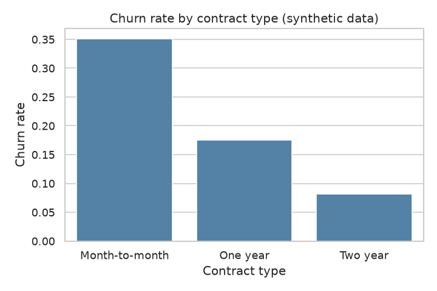
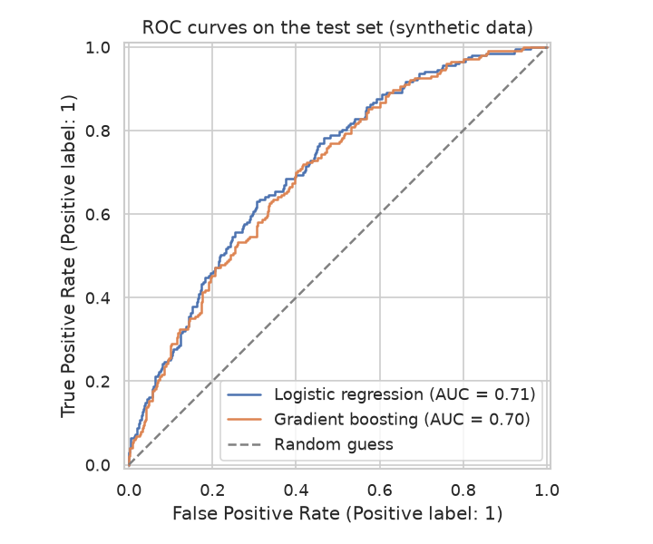
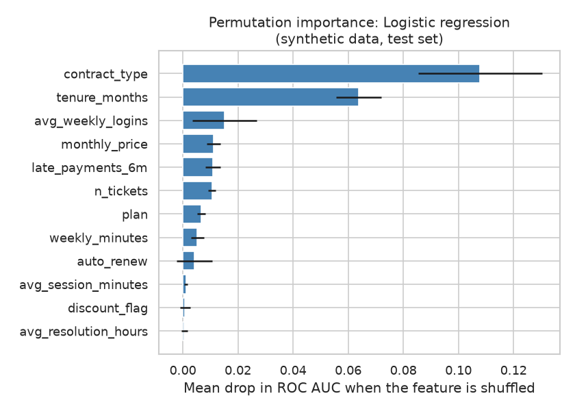

# Customer Churn Prediction

Classification model for subscription churn with feature importance.

> **Note:** all data in this project is **synthetic**. It is generated by `src/data_generator.py` with a fixed random seed. It does not describe real customers.

## Business question

Which subscribers are likely to cancel in the near future, and which customer characteristics (contract, usage, billing, support experience) drive that risk the most?

## Goal

Build and evaluate a classification model that predicts churn for a subscription service. Use feature importance to turn the predictions into retention actions the business can prioritise.

## Plan of the work

1. **Data generation** (done): create a synthetic customer table and a support ticket table.
2. **EDA** (done): data quality checks, churn rate, distributions, and churn by segment.
3. **Analysis / model** (done): feature engineering, baseline logistic regression, a gradient boosting model, cross-validated evaluation and feature importance.
4. **SQL** (done): analytical queries on the same data (churn by segment, ticket load vs. churn), run through the standard-library `sqlite3`.
5. **Tests** (done): `pytest` checks for data integrity, feature preparation and the reproducibility of the generator.
6. **Results and conclusions** (done): key numbers, figures, conclusions and limitations (see below).

## Dataset (synthetic)

Two tables are written to `data/` by the generator. They are not produced by any other script, so run the generator before the other scripts.

| File | Rows | Description |
|------|------|-------------|
| `customers.csv` | 4000 | One row per customer: contract, plan, billing, usage, and the `churned` target |
| `support_tickets.csv` | 4500 | One row per support ticket, linked to `customers.csv` by `customer_id` |

A full column-level description is in [data_description.md](data_description.md).

## Exploratory data analysis

`src/eda.py` loads both CSV files, prints data quality checks, descriptive statistics and five churn aggregations (contract type, plan, tenure band, late payments, ticket count), and saves four charts to `figures/` (`churn_by_contract.png`, `tenure_by_churn.png`, `logins_by_churn.png`, `correlation_heatmap.png`). All numbers appear in the script output; none are hard-coded.

## Method

`src/analysis.py` (with reusable logic in `src/utils.py`) does the following:

1. **Features.** Support tickets are aggregated per customer: ticket count, billing ticket count, mean resolution hours and mean satisfaction score. These are joined to the customer table, and one engineered feature is added, `weekly_minutes` (weekly logins multiplied by average session minutes). `customer_id` and `signup_date` are dropped. Customers without tickets get a ticket count of 0; other missing values are median-imputed.
2. **Preprocessing.** Numeric columns are imputed and standardised; categorical columns (country, contract type, plan, payment method) are one-hot encoded. This is done inside a scikit-learn `Pipeline`, so it is fitted on training data only.
3. **Split.** Stratified 80/20 train/test split with `random_state=42`. The test set is not used for model selection.
4. **Models.** A logistic regression baseline and a histogram-based gradient boosting classifier (shallow trees, fixed random state).
5. **Evaluation.** 5-fold stratified cross-validated ROC AUC on the training set, then test-set metrics: ROC AUC, average precision, and accuracy, precision, recall and F1 at a 0.5 threshold. The best model is chosen by cross-validated ROC AUC.
6. **Feature importance.** Permutation importance of the selected model on the test set, measured as the mean drop in ROC AUC when a raw input feature is shuffled (10 repeats). It is computed on the original features, so one-hot columns of the same variable are grouped.

Outputs:

- `figures/roc_curves.png` - ROC curves of both models on the test set
- `figures/feature_importance.png` - top features by permutation importance
- `reports/metrics.json` - cross-validation and test metrics for both models, the selected model and the full importance table

All results are printed when the script runs and written to `reports/metrics.json`; none are hard-coded in the code or this README. Because the data is synthetic and generated from a known churn formula, the results show how the workflow behaves and do not say anything about real customers. Permutation importance shows how much the model relies on a feature, not a causal effect of changing it. The 0.5 decision threshold is a default; a real retention campaign would choose it from the cost of an offer versus the value of a saved customer.

## SQL analysis

`sql/queries.sql` contains eight commented queries in the SQLite dialect. Each one is preceded by a `-- Q<n>:` line that states the question:

| Query | Question |
|-------|----------|
| Q1 | Customer count and churn rate by contract type |
| Q2 | Churn rate and average price by plan and discount flag |
| Q3 | Churn rate by tenure band (`CASE` expression) |
| Q4 | Ticket load vs. churn (CTE + `LEFT JOIN`) |
| Q5 | Customers with and without a Billing ticket (CTE + `LEFT JOIN`) |
| Q6 | Resolution time and satisfaction of tickets, split by the customer's churn status (`JOIN`) |
| Q7 | Churn rate of a high-risk segment (month-to-month, no auto-renew, 2+ late payments) vs. all others |
| Q8 | Countries ranked by churn rate with the difference to the overall rate (CTE + window function `RANK`) |

`src/run_sql.py` loads both CSV files into an in-memory SQLite database with `pandas.to_sql`, splits `queries.sql` into statements, runs each query and prints its description and the first rows of the result. Nothing is written to disk and all numbers come from the query output. The queries describe associations in synthetic data and do not show causal effects.

## Results

All numbers below are copied from the output of `src/eda.py`, `src/analysis.py` and `src/run_sql.py` (and `reports/metrics.json`) on the synthetic data. They are not real customer results.

### Data and churn rate

- 4000 customers and 4500 support tickets; overall churn rate **0.253** (1013 churned, 2987 retained).
- 15.7% of the satisfaction scores in the ticket table are missing (0.157 in the generator output).
- The feature matrix has 17 columns; the split is 3200 training rows and 800 test rows.

### Churn by segment (EDA and SQL)

| Segment | Customers | Churn rate |
|---------|-----------|------------|
| Month-to-month contract | 2185 | 0.351 |
| One year contract | 1046 | 0.175 |
| Two year contract | 769 | 0.082 |
| Tenure 7-12 months (highest band) | 683 | 0.354 |
| Tenure 37-60 months (lowest band) | 750 | 0.131 |
| 0 support tickets | 1577 | 0.231 |
| 3+ support tickets | 524 | 0.323 |
| 0 late payments (6 months) | 2736 | 0.231 |
| 2 late payments (6 months) | 199 | 0.342 |

Other SQL findings:

- Customers with at least one Billing ticket: churn rate 0.279 (1055 customers) vs. 0.244 without one (2945 customers).
- Risk segment (month-to-month, no auto-renew, 2+ late payments): 35 customers, churn rate 0.400, vs. 0.252 for all other customers.
- Country churn rates range from 0.235 (France) to 0.271 (Canada).



### Model performance

| Model | CV ROC AUC (5-fold, train) | Test ROC AUC | Test average precision | Test accuracy | Test precision | Test recall | Test F1 |
|-------|----------------------------|--------------|------------------------|---------------|----------------|-------------|---------|
| Logistic regression | 0.738 +/- 0.022 | 0.712 | 0.453 | 0.750 | 0.521 | 0.187 | 0.275 |
| Gradient boosting | 0.723 +/- 0.029 | 0.701 | 0.432 | 0.745 | 0.494 | 0.187 | 0.271 |

The best model by cross-validated ROC AUC is **logistic regression**. Metrics at the 0.5 threshold.



### Feature importance (logistic regression, drop in test ROC AUC)

| Feature | Mean drop in ROC AUC | Std |
|---------|----------------------|-----|
| contract_type | 0.1078 | 0.0225 |
| tenure_months | 0.0639 | 0.0083 |
| avg_weekly_logins | 0.0151 | 0.0116 |
| monthly_price | 0.0112 | 0.0025 |
| late_payments_6m | 0.0109 | 0.0028 |
| n_tickets | 0.0105 | 0.0013 |

All remaining features have a mean drop of 0.0067 or less; for `payment_method`, `n_billing_tickets` and `country` the mean is slightly negative (down to -0.0033), and `age` is -0.0000. The full table is in `reports/metrics.json`.



## Conclusions

- **Contract type and tenure matter most.** They have by far the largest permutation importance (0.1078 and 0.0639; the next feature is 0.0151). This matches the segment tables: churn is 0.351 for month-to-month vs. 0.082 for two-year contracts, and 0.131 for the longest tenure band.
- **Support load and late payments go together with higher churn.** Churn rises from 0.231 with no tickets to 0.323 with 3+ tickets, and from 0.231 with no late payments to 0.342 with two. Both features have small but positive importance (0.0105 and 0.0109). These are associations in synthetic data, not proof that tickets or late payments cause churn.
- **The model has moderate ranking power.** Test ROC AUC is 0.712 for logistic regression. The model is not strong enough to separate churners cleanly.
- **At the 0.5 threshold the model finds few churners.** Recall is 0.187 and precision 0.521, so about 19% of churners are flagged and roughly half of the flagged customers actually churn. A lower threshold would be needed for a campaign that aims to reach more at-risk customers.
- **The complex model did not beat the simple one here.** Logistic regression has a higher CV ROC AUC (0.738 vs. 0.723) and test ROC AUC (0.712 vs. 0.701). The 0.015 CV gap is smaller than the fold standard deviations (0.022 and 0.029), so the two models should not be regarded as clearly different.
- **Several features show no useful signal.** `country`, `payment_method`, `n_billing_tickets` and `age` have mean importance at or below zero, and country churn rates differ by only a few percentage points (0.235 to 0.271).
- **A practical priority list.** For retention efforts, the numbers point first to month-to-month customers and customers in their first year (tenure 7-12 months has the highest churn, 0.354). The small risk segment (35 customers, churn 0.400) is above average but too small to base decisions on.

## Limitations & next steps

**Limitations**

- **The data is synthetic.** It comes from a known formula in `src/data_generator.py`, so the patterns, the importance ranking and the model scores reflect that formula and not real customer behaviour. None of the findings can be transferred to a real business.
- Permutation importance and segment tables show associations, not causal effects. For example, they do not show that switching a customer to a longer contract would reduce churn.
- The importance values for `avg_weekly_logins` (0.0151, std 0.0116) and `auto_renew` (0.0043, std 0.0064) are noisy relative to their means, so their ranks are uncertain.
- Evaluation uses a single 80/20 split (800 test rows), so test metrics carry sampling noise. The risk segment in Q7 has only 35 customers.
- The 0.5 threshold is a default, not one chosen from business costs. Recall at this threshold is low (0.187).
- The data has no time dimension in the model, so it does not show whether predictions would hold for future periods.

**Next steps**

- Choose the decision threshold from the cost of a retention offer and the value of a saved customer, and report precision and recall at that threshold.
- Tune the hyperparameters of both models and compare them with repeated cross-validation to see whether the gap between them is real.
- Add probability calibration and a lift or gains analysis to rank customers for a campaign.
- Test the workflow on real, properly anonymised data with a time-based split, and add features such as usage trends over time.
- Drop or regroup features with no signal (such as `country`) and check whether the metrics change.

## Tests

The `tests/` folder contains `pytest` tests that run in a few seconds (12 tests pass):

| File | What it checks |
|------|----------------|
| `tests/test_data_generator.py` | Column names, row counts, value ranges and categories of both synthetic tables, the price rule (plan price and discount), valid customer references in tickets, and that the same seed gives identical tables |
| `tests/test_utils.py` | Ticket aggregation per customer (including customers without tickets and missing scores), feature building (dropped columns, `weekly_minutes`), the preprocessor (no missing values, unseen categories) and `compute_metrics` (perfect predictions, threshold handling) |

The tests generate data in memory or use small hand-made tables. They do not need the files in `data/` or `figures/`, and they do not write any files.

```bash
python -m pytest -q
```

## Project structure

```
customer-churn-prediction/
├── README.md
├── requirements.txt
├── data_description.md
├── sql/
│   └── queries.sql
├── src/
│   ├── data_generator.py
│   ├── eda.py
│   ├── utils.py
│   ├── analysis.py
│   └── run_sql.py
├── tests/
│   ├── test_data_generator.py
│   └── test_utils.py
├── data/                # created by the generator
├── figures/             # created by the EDA and analysis scripts
└── reports/             # created by the analysis script (metrics.json)
```

## How to run

Requires Python 3.11. From the project root, install the dependencies and run the scripts in this order:

```bash
pip install -r requirements.txt
python src/data_generator.py   # 1. creates data/customers.csv and data/support_tickets.csv
python src/eda.py              # 2. needs the CSV files from step 1
python src/analysis.py         # 3. needs the CSV files; writes figures/ and reports/
python src/run_sql.py          # 4. needs the CSV files; prints query results only
python -m pytest -q            # 5. runs the tests (independent of steps 1-4)
```

All scripts run non-interactively and do not need network access. The generator creates `data/` if it is missing; the seed is fixed (42), so repeated runs produce identical files. The EDA and analysis scripts create `figures/` and `reports/` as needed. If a script reports that the data files are missing, run `src/data_generator.py` first.

---

*This is a training project that uses synthetic data generated by AI.*
