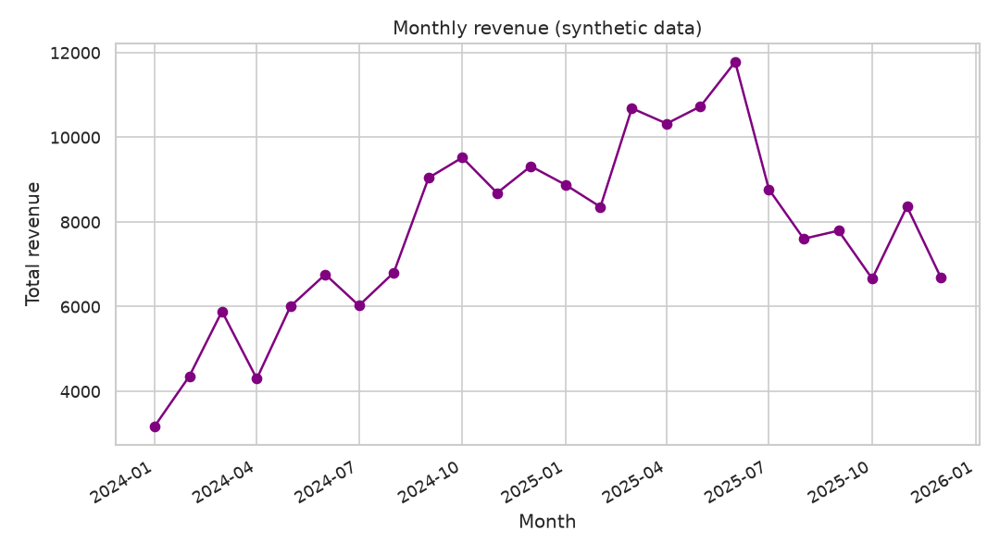
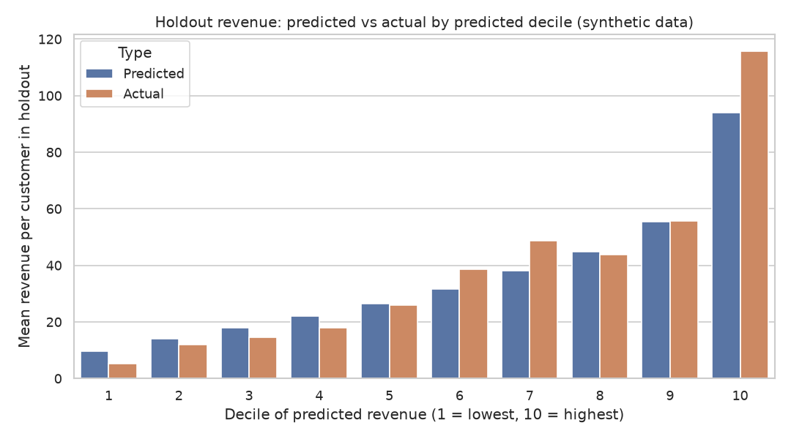
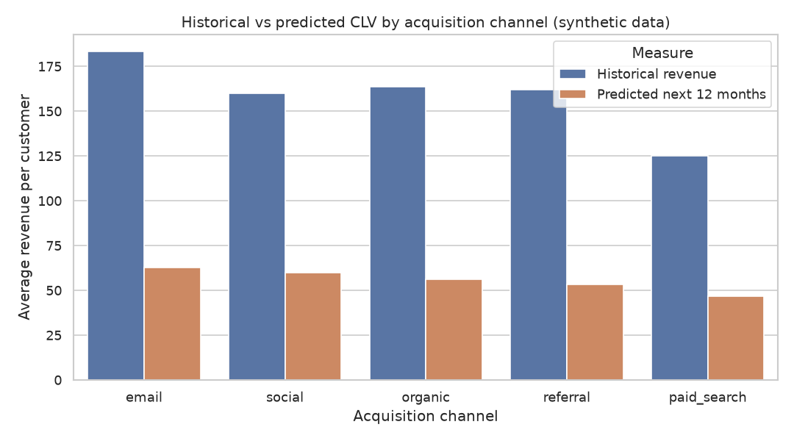

# Customer Lifetime Value (CLV)

Historical and predictive customer lifetime value with a simple BG/NBD-style approximation.

> **Note:** all data in this project is **synthetic**. It is generated by `src/data_generator.py` and does not describe real customers.

## Business question

How much revenue can we expect from each customer over the next 12 months, and which customers are the most valuable to retain and acquire?

## Goal

- Compute **historical CLV** (revenue observed so far per customer and per segment).
- Build a **predictive CLV** estimate using a simple BG/NBD-style approximation (purchase frequency plus a probability that the customer is still "alive") combined with average order value.
- Compare segments (acquisition channel, country, acquisition cohort) and identify high-value customers.

## Plan of the work

1. **Data generation**: create synthetic customers and transactions (implemented in `src/data_generator.py`).
2. **EDA**: distributions of orders per customer, order values, inter-purchase times, cohort behavior, and segment differences (implemented in `src/eda.py`).
3. **Analysis / model** (implemented in `src/analysis.py` and `src/utils.py`)
   - RFM-style summary per customer (frequency, recency, age *T*, monetary value).
   - Historical CLV by customer and segment.
   - BG/NBD model fitted with `scipy` (no specialized CLV libraries), with an average order value component for predictive CLV.
   - Validation with a holdout period.
4. **SQL**: queries for totals, segments, cohorts, monthly revenue, and top customers (in `sql/queries.sql`, run by `src/run_sql.py`).
5. **Tests**: `pytest` tests for data integrity and for the core functions (in `tests/`).

## Dataset (synthetic)

Two CSV tables are written to `data/`:

| File | Description | Rows |
|------|-------------|------|
| `data/customers.csv` | One row per customer: acquisition date, channel, country | 1,200 |
| `data/transactions.csv` | One row per order: customer, date, order value | 3,852 (at most 5,000 by design) |

Customers are acquired between 2024-01-01 and 2025-06-30, and the observation window ends on 2025-12-31. Purchase behavior follows a BG/NBD-like process: each customer has their own purchase rate and a probability of becoming inactive after each purchase. Full column descriptions are in [`data_description.md`](data_description.md).

## How to run

Requirements: Python 3.11 and the packages listed in `requirements.txt`. No network access or user input is needed.

From the project root:

```bash
pip install -r requirements.txt
python src/data_generator.py
python src/eda.py
python src/analysis.py
python src/run_sql.py
python -m pytest -q
```

The data generator:

- uses a fixed random seed (42), so re-running it produces the same files;
- creates the `data/` folder if it does not exist;
- overwrites `data/customers.csv` and `data/transactions.csv` if they already exist;
- prints the number of rows saved to each file.

Run the scripts from any directory with `python /path/to/customer-lifetime-value/src/<name>.py`; the paths are resolved relative to the project, not the current directory.

## Exploratory data analysis

`src/eda.py` reads the two CSV files from `data/` (run the generator first) and:

- prints the shape, data types, missing values per column and descriptive statistics of both tables;
- builds a customer-level summary (orders, revenue, average order value, days observed, acquisition quarter);
- prints aggregations: orders per customer (including the share of one-time buyers), revenue concentration among the top 10% of customers, segment comparisons by acquisition channel and by country, acquisition cohorts by quarter, and inter-purchase times;
- saves four charts to `figures/` (the folder is created automatically):
  - `orders_per_customer.png`: number of customers by number of orders;
  - `order_value_distribution.png`: histogram of order values;
  - `revenue_by_channel.png`: average revenue per customer by acquisition channel;
  - `monthly_revenue.png`: total revenue per calendar month.

All numbers appear in the script output when it is run. Because customers acquired later have been observed for a shorter time, raw revenue comparisons between cohorts are not like-for-like; this is the motivation for the predictive model.

## Method

`src/analysis.py` runs the full analysis; reusable functions (feature preparation, the BG/NBD model, metrics) live in `src/utils.py`.

### 1. Customer features (RFM-style)

For a chosen cutoff date, each customer is summarized by:

- **frequency**: number of repeat orders (orders minus one);
- **recency**: weeks between the first and the last order;
- **T**: weeks between the first order and the cutoff (how long the customer has been observable);
- **average order value** and total revenue to date (**historical CLV**).

### 2. BG/NBD model

The model follows the BG/NBD idea (Fader, Hardie and Lee, 2005), implemented directly with `numpy`/`scipy`:

- while active, a customer buys at a customer-specific rate, with rates varying across customers following a Gamma distribution (parameters `r`, `alpha`);
- after each purchase, a customer becomes inactive with a customer-specific probability, varying across customers following a Beta distribution (parameters `a`, `b`);
- the four parameters are estimated by maximum likelihood (`scipy.optimize.minimize`, L-BFGS-B) from each customer's frequency, recency and *T*;
- from the fitted model, the script computes each customer's **probability of being alive** and the **expected number of purchases** in a future period.

Practical choices: time is measured in weeks, and `a` is kept slightly above 1 because the expected-purchases formula requires `a > 1`.

### 3. Predictive CLV

Predicted CLV for the next 12 months (365 days) is:

`expected purchases in the next 365 days x average order value`

The average order value is shrunk toward the global mean with weight `n / (n + 5)`, where `n` is the customer's number of orders. This simple heuristic limits noise for customers with few orders; the constant 5 is a choice, not a fitted value.

### 4. Validation

The split is **by time**, not random, because the task is forecasting: the model is fitted on orders up to 182 days before the end of the observation window and its predictions are compared with the orders that actually occurred in those final 182 days. It is compared with a **naive baseline** that extrapolates each customer's observed purchase rate and ignores churn. Reported metrics (customer-level MAE, RMSE, R-squared, total predicted vs actual, Spearman rank correlation, and the share of actual holdout revenue captured by the top 10% of customers ranked by predicted revenue) are printed by the script and saved to `reports/metrics.json`. The numbers from one run are listed in the Results section below.

Because the data is synthetic and generated by a similar process, good agreement is expected and does not show how the method would perform on real customers.

### 5. Final model and outputs

The model is refitted on all data to forecast the next 12 months. The script prints historical vs predicted CLV by acquisition channel and country, and the top 10 customers by predicted revenue.

Outputs:

- `figures/holdout_calibration.png`: mean predicted vs actual holdout revenue per decile of predicted revenue;
- `figures/clv_by_channel.png`: average historical revenue vs predicted next-12-month revenue by channel;
- `reports/metrics.json`: validation metrics, fitted parameters and final-model summary.

## Results

All numbers below are copied from the script output (`src/data_generator.py`, `src/eda.py`, `src/analysis.py`, `src/run_sql.py`) and from `reports/metrics.json`. The data is synthetic, so they describe the simulated customers only.

### Data and historical CLV

- 1,200 customers and 3,852 orders; total historical revenue is 186,499.26, and the mean order value is 48.42.
- 31.2% of customers placed exactly one order; the median customer placed 2 orders and the maximum is 25.
- The top 10% of customers (120) generate 33.4% of total revenue.
- Average historical revenue per customer by channel: email 183.46, organic 163.68, referral 161.78, social 159.85, paid_search 124.83.
- Average revenue per customer by acquisition quarter falls from 207.40 (2024Q1) to 118.48 (2025Q2), while average observed days fall from 681.23 to 229.52.



### Holdout validation

The model was fitted on data up to 2025-07-02 and evaluated on the following 182 days (1,200 customers). Fitted parameters (weeks): r=0.8186, alpha=16.3233, a=5.6303, b=36.2863 (optimizer converged).

| Metric (per customer) | BG/NBD | Naive rate |
|-----------------------|--------|------------|
| Orders: MAE | 0.805 | 1.028 |
| Orders: RMSE | 1.187 | 2.374 |
| Orders: R-squared | 0.185 | -2.262 |
| Orders: total predicted (actual 915) | 882.721 | 1265.668 |
| Orders: total error | -3.528% | 38.324% |
| Revenue: MAE | 41.031 | 52.106 |
| Revenue: RMSE | 69.456 | 125.817 |
| Revenue: R-squared | 0.177 | -1.701 |
| Revenue: total predicted (actual 45,352.69) | 42,487.15 | 61,032.07 |
| Revenue: total error | -6.318% | 34.572% |
| Spearman correlation (revenue) | 0.406 | 0.282 |
| Share of holdout revenue from top 10% by predicted revenue | 30.6% | 27.8% |

The best possible share for the top 10% of customers is 56.9%.



### Final model: forecast for the next 12 months

- Fitted parameters (weeks): r=0.7463, alpha=14.8545, a=2.7266, b=18.5931 (converged).
- Predicted revenue for the next 365 days across all customers: 65,942.26.
- Mean probability of being alive: 0.742.
- The top 10% of customers (120) account for 33.4% of predicted 12-month revenue.

| Channel | Customers | Avg historical revenue | Avg P(alive) | Avg predicted 12m revenue |
|---------|-----------|------------------------|--------------|---------------------------|
| email | 130 | 183.46 | 0.74 | 62.58 |
| organic | 423 | 163.68 | 0.72 | 56.18 |
| paid_search | 293 | 124.83 | 0.76 | 46.85 |
| referral | 129 | 161.78 | 0.70 | 53.10 |
| social | 225 | 159.85 | 0.79 | 59.85 |

By country, the average predicted 12-month revenue ranges from 51.86 (DE) to 60.24 (ES).

The customer with the highest predicted 12-month revenue is customer 1153 (social, US): 12 orders, P(alive) 0.89, predicted revenue 497.66. The customer with the highest historical revenue is customer 123 (organic, US): 2,020.71 from 16 orders, with a predicted 12-month revenue of 381.09 and P(alive) 0.62.



## Conclusions

Each conclusion below is limited to what the numbers above show.

- **The BG/NBD approximation beat the naive baseline on this holdout.** It had lower MAE and RMSE for both orders and revenue, and its total predicted revenue was 6.3% below the actual total, against 34.6% above for the naive rate. This is consistent with the idea that ignoring churn overstates future purchases.
- **Individual-level accuracy is modest.** Customer-level R-squared for revenue is 0.177 and the Spearman correlation is 0.406. The model is better at the aggregate level than at predicting what a single customer will spend.
- **Ranking is only partly useful.** The top 10% of customers by predicted revenue captured 30.6% of actual holdout revenue, slightly above the naive 27.8% but far below the best possible 56.9%.
- **Paid search has the lowest value in this dataset.** It has the lowest average historical revenue per customer (124.83) and the lowest predicted 12-month revenue (46.85). Email has the highest on both measures (183.46 and 62.58).
- **Revenue is moderately concentrated.** The top 10% of customers account for 33.4% of historical revenue and 33.4% of predicted 12-month revenue.
- **Cohorts cannot be compared on raw revenue.** Revenue per customer decreases for later cohorts, but so do their observed days, so this pattern alone does not show that newer cohorts are worth less.
- **Historical and predicted revenue are not directly comparable.** The historical figure (186,499.26) covers the whole observation window, while the prediction (65,942.26) covers only the next 365 days.

## Limitations & next steps

**Limitations**

- **The data is synthetic.** It was generated by this project's own code with a BG/NBD-like process, so good agreement between model and data is expected. The results do not show how the method would perform on real customers.
- Only one holdout split (the last 182 days) was evaluated, so the metrics have no confidence intervals and may change with a different cutoff.
- The model uses only frequency, recency and *T*. Channel, country and cohort are not model inputs; they are used only to summarize predictions.
- Order values are modeled by a shrunk average with a fixed constant (5), not a fitted value, and no relationship between purchase frequency and order value is modeled.
- The predicted revenue is not discounted, and no margin or acquisition cost is included, so it is revenue, not profit.

**Next steps**

- Evaluate several cutoff dates (rolling-origin validation) and add uncertainty estimates, for example with bootstrap.
- Fit the model separately by channel or add covariates, and check whether the segment differences remain.
- Replace the shrinkage heuristic with a model for order value (for example Gamma-Gamma) and compare the results.
- Add discounting and margin to move from revenue to a profit-based CLV.
- Apply the pipeline to real transaction data, if available, and check calibration again.

## SQL analysis

`sql/queries.sql` contains 8 queries in the SQLite dialect over the two CSV tables. Each query is preceded by a comment line of the form `-- Q<n>: <question>`. Dates are stored as `YYYY-MM-DD` text.

| Query | Question |
|-------|----------|
| Q1 | Overall totals: customers, orders, revenue, average order value |
| Q2 | Distribution of customers by number of orders |
| Q3 | Channel comparison: orders and revenue per customer |
| Q4 | Revenue per acquisition cohort (quarter) |
| Q5 | Repeat-purchase rate by country |
| Q6 | Monthly revenue with a running total (window function) |
| Q7 | Top 10 customers by historical revenue and days since last order |
| Q8 | Share of revenue from the top 10% of customers |

`src/run_sql.py` loads the CSV files into an in-memory SQLite database with `pandas.to_sql`, splits `queries.sql` into statements, runs each one, and prints the question and the first rows of the result. It needs the data files, so run the generator first. Results appear in the script output. The window-function queries (Q6, Q8) need SQLite 3.25 or newer, which ships with current Python 3.11 builds.

## Tests

The `tests/` folder contains 8 `pytest` tests. Run them from the project root:

```bash
python -m pytest -q
```

- `tests/test_data_generator.py` (3 tests): generates the tables in memory with the project's own functions and checks column names, row counts, value ranges (dates, order values, channels, countries), the customer/transaction relationship, and reproducibility with the fixed seed.
- `tests/test_utils.py` (5 tests): checks the functions in `src/utils.py`: the RFM features and the holdout actuals on a tiny hand-made table with values computed by hand, the shrunk average order value, basic properties of the BG/NBD predictions (probabilities between 0 and 1, non-negative expected purchases that grow with the horizon), a model fit on freshly generated synthetic data, and the evaluation metrics and the naive baseline.

The tests do not read the CSV files in `data/`, do not use the figures, and need no network access, so they can run before any other script. They are fast (a few seconds). Each test file adds `src/` to `sys.path` at the top so the modules can be imported without installing the project.

## Project structure

```
customer-lifetime-value/
├── README.md
├── requirements.txt
├── data_description.md
├── src/
│   ├── data_generator.py
│   ├── eda.py
│   ├── utils.py
│   ├── analysis.py
│   └── run_sql.py
├── sql/
│   └── queries.sql
├── tests/
│   ├── test_data_generator.py
│   └── test_utils.py
├── data/               # created by the generator
│   ├── customers.csv
│   └── transactions.csv
├── figures/            # created by the EDA and analysis scripts
│   ├── orders_per_customer.png
│   ├── order_value_distribution.png
│   ├── revenue_by_channel.png
│   ├── monthly_revenue.png
│   ├── holdout_calibration.png
│   └── clv_by_channel.png
└── reports/            # created by the analysis script
    └── metrics.json
```

---

*This is a training project that uses synthetic data generated by AI.*
