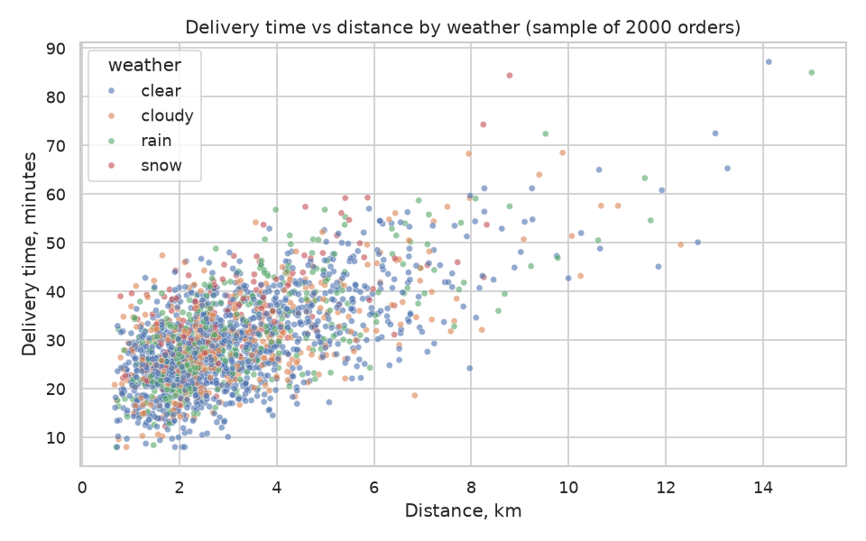
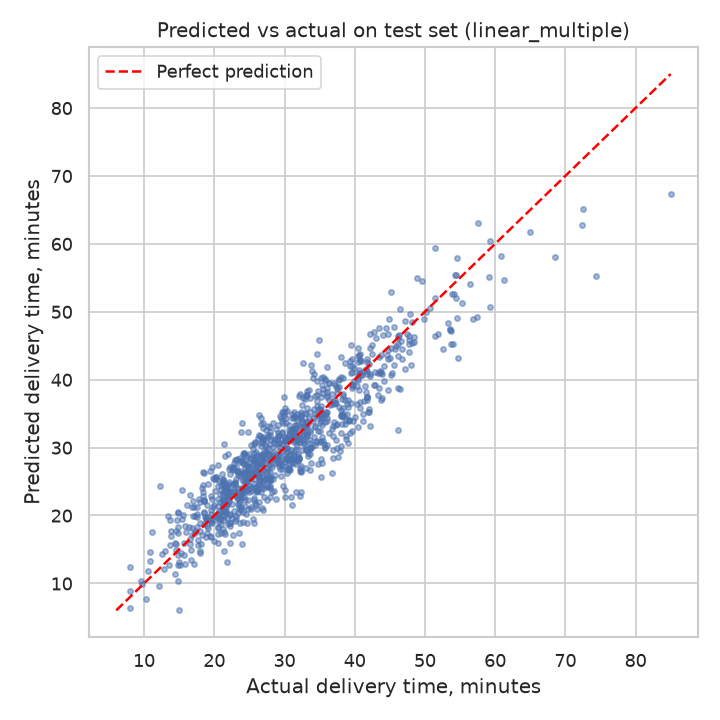
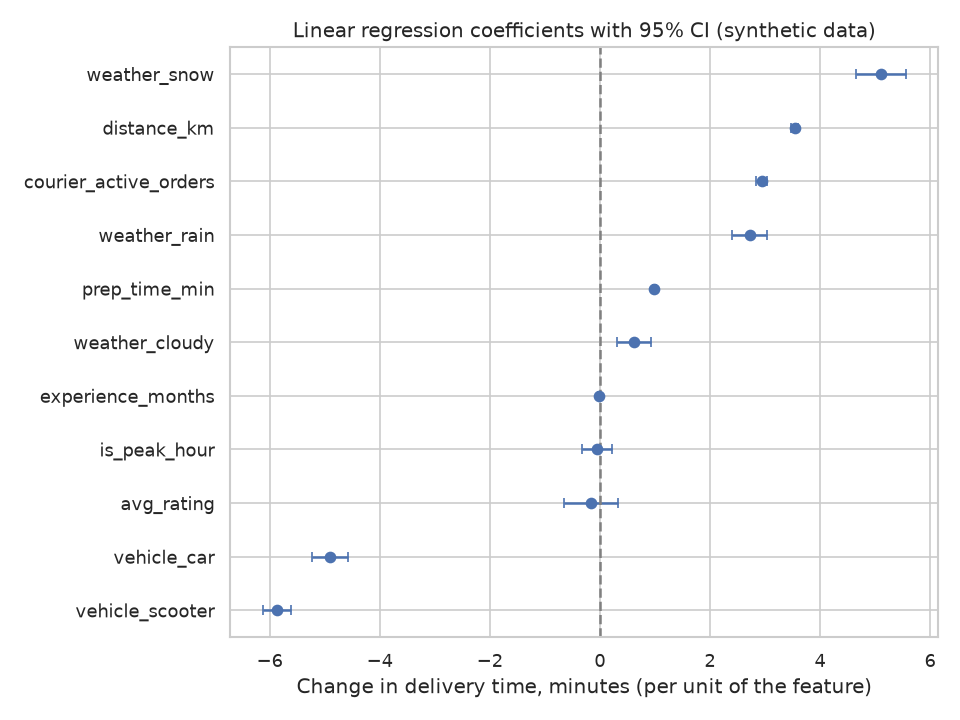

# Delivery Time Analysis

## Business question
Which factors drive food delivery times, and how much extra time do long distances, bad weather and a heavily loaded courier add? Can we predict the delivery time of an order well enough to give customers a realistic ETA?

## Goal
Quantify the effect of distance, weather and courier load on delivery time, and build a regression model that predicts delivery time (in minutes) for a new order.

## Plan of the work
1. **Data generation** – create a synthetic dataset of couriers and orders (`src/data_generator.py`).
2. **EDA** – check data quality, distributions and relationships between delivery time and distance, weather, courier load and time of day (`src/eda.py`).
3. **Analysis / model** – baseline and multiple linear regression (plus a comparison with a tree-based model), validated on a hold-out set (`src/analysis.py`, helpers in `src/utils.py`).
4. **SQL** – analytical queries on the order and courier tables (average delivery time by weather, by load, by vehicle, etc.) in `sql/queries.sql`, executed by `src/run_sql.py`.
5. **Tests** – pytest checks for the data generator and the helper functions in `src/utils.py` (`tests/`).

## Dataset (synthetic)
All data is **synthetic**. It is produced by `src/data_generator.py` with `numpy` and a fixed random seed (42). It does not describe any real company, courier or customer. Relationships in the data (for example, rain slows delivery down) are assumptions written into the generator, not real-world findings.

Two tables are saved to `data/`:
- `couriers.csv` – one row per courier (300 rows).
- `orders.csv` – one row per order (5000 rows).

Full column descriptions are in [data_description.md](data_description.md).

## Exploratory data analysis
`src/eda.py` loads both CSV files from `data/` and:
- prints the shape, data types, missing values and duplicate count of each table;
- prints descriptive statistics for the numeric columns;
- prints aggregations of delivery time (order count, mean, median) by weather, courier load, vehicle type, distance band and peak-hour flag, plus the correlation of numeric features with delivery time;
- saves charts to `figures/`:
  - `delivery_time_distribution.png` – histogram of the target;
  - `delivery_vs_distance.png` – delivery time vs distance, colored by weather;
  - `delivery_by_weather_and_load.png` – boxplots by weather and by courier load;
  - `delivery_by_hour.png` – mean delivery time by hour of day.

Because the data is synthetic, any patterns seen in the output reflect the assumptions coded in the generator, not real-world behavior. Findings should be read from the actual output of the script.

## Method
`src/analysis.py` joins orders with courier attributes and predicts `delivery_time_min`.

- **Features:** distance, courier load (active orders), preparation time, peak-hour flag, courier experience, courier rating, one-hot weather (reference: `clear`) and one-hot vehicle type (reference: `bike`). Feature preparation lives in `src/utils.py`.
- **Split:** 80% train / 20% test, `random_state=42`. All reported metrics are computed on the untouched test set.
- **Models compared:**
  1. mean baseline (predicts the training mean);
  2. simple linear regression on distance only;
  3. multiple linear regression on all features;
  4. random forest (200 trees, `min_samples_leaf=5`) to capture non-linear effects and interactions.
- **Metrics:** MAE and RMSE (minutes) and R². The multiple linear model also gets a 5-fold cross-validated R² on the training set.
- **Effect sizes:** an OLS fit (statsmodels) on the training set gives coefficients with 95% confidence intervals, read as extra minutes per km of distance, per additional active order, and for rain/snow compared with clear weather. Random forest feature importances are printed as a second view.
- **Outputs:**
  - console report with all metrics, labelled;
  - `reports/metrics.json` – metrics summary, OLS effects and feature importances;
  - `figures/model_coefficients.png` – OLS coefficients with confidence intervals;
  - `figures/predicted_vs_actual.png` – hold-out predictions of the best model (lowest test RMSE) vs actual values.

**Caveats.**
- The data is synthetic, so the estimated effects mostly recover assumptions written into the generator; they are not evidence about real delivery operations.
- The weather effect in the generator multiplies travel time, so it grows with distance. A purely additive linear model can only approximate this, which is one reason the tree-based model is included.
- `prep_time_min` is used as a feature; in a real ETA system it would have to be known (or estimated) at the moment the ETA is shown.

Actual numbers should be read from the script output and `reports/metrics.json`.

## SQL analysis
`sql/queries.sql` contains 8 analytical queries in the SQLite dialect over the `orders` and `couriers` tables. Each query is preceded by a comment line `-- Q<n>: ...` with the question it answers:

| Query | Question |
|---|---|
| Q1 | Orders and average delivery time by weather |
| Q2 | Average delivery time by courier load |
| Q3 | Delivery time and minutes per km by vehicle type (join) |
| Q4 | Average delivery time by distance band |
| Q5 | Weather effect in peak vs off-peak hours |
| Q6 | Share of slow orders (over 45 minutes) by weather |
| Q7 | Delivery time by courier experience band (join) |
| Q8 | Ten couriers with the highest average delivery time (CTE, at least 20 orders) |

`src/run_sql.py` loads both CSV files into an in-memory SQLite database with `pandas.to_sql`, splits `queries.sql` into statements, runs each one and prints its description and the first rows of the result. No database file is created. As with the rest of the project, the results come from synthetic data and reflect generator assumptions; read them from the script output.

## Tests
The `tests/` folder contains pytest checks that run in a few seconds and do not need `data/` or `figures/`:
- `tests/test_data_generator.py` – generates both tables in memory with the fixed seed and checks column names, row counts, unique keys, value ranges, foreign keys, the peak-hour flag and reproducibility;
- `tests/test_utils.py` – checks feature preparation (one-hot columns, unknown categories), the MAE / RMSE / R² functions on hand-computed values, and data loading with small temporary CSV files.

Run them from the project root:

```bash
python -m pytest -q
```

## How to run
From the project root:

```bash
pip install -r requirements.txt
python src/data_generator.py
python src/eda.py
python src/analysis.py
python src/run_sql.py
python -m pytest -q
```

All scripts are non-interactive. The generator writes `data/couriers.csv` and `data/orders.csv`; the EDA script prints its report and writes PNG files to `figures/`; the analysis script prints the model metrics, writes two more charts to `figures/` and creates `reports/metrics.json`; the SQL script prints the result of each query; pytest runs the tests.

## Results
All numbers below come from the script output of the synthetic dataset (5000 orders, 300 couriers). The 14 pytest tests pass.

### Descriptive findings (EDA)
- Mean delivery time is 30.18 min (std 10.02, min 8.00, max 87.20).
- By weather (mean delivery, minutes): clear 29.34, cloudy 29.61, rain 31.53, snow 34.23.
- By courier load (active orders 1 to 6): 24.81, 28.18, 30.61, 34.11, 35.68, 39.71.
- By distance band: 0-2 km 24.05, 2-4 km 29.04, 4-6 km 35.91, 6-8 km 42.97, 8+ km 53.02.
- By vehicle: bike 33.62, scooter 27.62, car 28.31.
- Peak hour: 32.16 min vs 27.86 min off-peak.
- Pearson correlation with delivery time: distance 0.646, active orders 0.420, prep time 0.392, peak hour 0.214, rating 0.004, experience -0.033.
- SQL Q6: share of orders over 45 minutes is 14.25% in snow, 9.58% in rain, 6.89% in cloudy and 6.16% in clear weather.



### Model comparison (hold-out test set, 1000 orders)

| Model | MAE (min) | RMSE (min) | R² |
|---|---|---|---|
| Mean baseline | 7.589 | 9.841 | -0.000 |
| Linear, distance only | 6.079 | 7.549 | 0.412 |
| Linear, multiple | 2.926 | 3.741 | 0.855 |
| Random forest | 3.111 | 4.030 | 0.832 |

The multiple linear model has a 5-fold CV R² on the training set of 0.858 (std 0.012). It is the best model by test RMSE.



### Effect sizes (OLS on the training set, minutes, 95% CI)

| Feature | Coefficient | 95% CI |
|---|---|---|
| distance_km (per km) | 3.539 | 3.476 to 3.602 |
| courier_active_orders (per order) | 2.938 | 2.845 to 3.031 |
| prep_time_min (per minute) | 0.991 | 0.961 to 1.020 |
| weather_cloudy (vs clear) | 0.625 | 0.315 to 0.935 |
| weather_rain (vs clear) | 2.720 | 2.403 to 3.036 |
| weather_snow (vs clear) | 5.114 | 4.661 to 5.567 |
| vehicle_scooter (vs bike) | -5.870 | -6.129 to -5.610 |
| vehicle_car (vs bike) | -4.907 | -5.236 to -4.579 |
| experience_months (per month) | -0.022 | -0.028 to -0.016 |
| is_peak_hour | -0.044 | -0.317 to 0.230 (p = 0.754) |
| avg_rating | -0.167 | -0.655 to 0.321 (p = 0.503) |

Random forest feature importances: distance 0.484, active orders 0.193, prep time 0.192, scooter 0.060, car 0.029; every other feature is at or below 0.014.



## Conclusions
- **Distance is the strongest driver.** It has the highest correlation with delivery time (0.646) and the highest random forest importance (0.484). In the linear model each extra km adds about 3.54 min (CI 3.476 to 3.602). Average delivery time rises from 24.05 min (0-2 km) to 53.02 min (8+ km).
- **Courier load matters.** Each additional active order adds about 2.94 min (CI 2.845 to 3.031). Mean delivery time goes from 24.81 min with 1 active order to 39.71 min with 6.
- **Bad weather adds time compared with clear weather.** Rain adds about 2.72 min and snow about 5.11 min after adjusting for the other features. Snow orders also have the highest share of deliveries over 45 minutes (14.25% vs 6.16% in clear weather).
- **Vehicle type is a large factor.** Scooters (-5.87 min) and cars (-4.91 min) are faster than bikes. In Q3 bikes take 12.55 min per km, against 10.73 for scooters and 10.64 for cars.
- **Peak hour has no clear independent effect in the model.** Raw means differ (32.16 vs 27.86 min), but the OLS coefficient for the peak-hour flag is -0.044 with a CI that includes zero. The output alone does not show why the raw gap disappears.
- **Rating shows no clear effect.** Its OLS CI includes zero. Experience has a very small negative coefficient (-0.022 min per month, p about 1e-12).
- **The model can support an ETA.** The multiple linear regression reaches R² 0.855, MAE 2.93 min and RMSE 3.74 min on the hold-out set, against an MAE of 7.59 min for the mean baseline. Distance alone explains only R² 0.412, so load, preparation time and vehicle type add a lot.
- **Linear regression beat the random forest here.** Its test RMSE was 3.741 vs 4.030, so the extra flexibility of the forest did not help on this dataset.

## Limitations & next steps
- **The data is synthetic.** It was generated by the project's own code, so the effects found mostly recover assumptions written into the generator. They are not findings about real deliveries, and the accuracy figures should not be expected to carry over to real data.
- **`prep_time_min` is a feature.** In a real ETA system it would have to be known or estimated when the ETA is shown, so the reported accuracy may be optimistic for that use.
- **Weather is modeled additively in the linear model.** The generator multiplies travel time by weather, so interactions with distance are only approximated. Adding distance × weather terms would be a natural next step.
- **Single split and one data sample.** Results come from one 80/20 split with seed 42 (plus the 5-fold CV for the linear model). Repeating with other seeds, or tuning the random forest and trying gradient boosting, would show how stable the comparison is.
- **Next steps with real data:** validate on actual order logs, add features such as traffic, restaurant and time-of-day patterns, and check prediction intervals so customers get a range rather than a single ETA.

---

*This is a training project that uses synthetic data generated by AI.*
