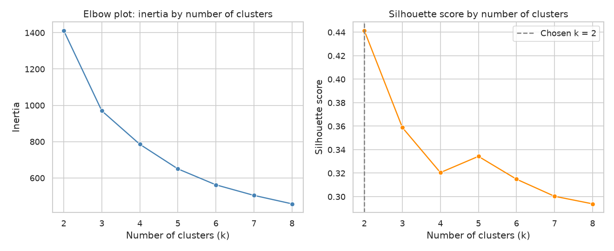
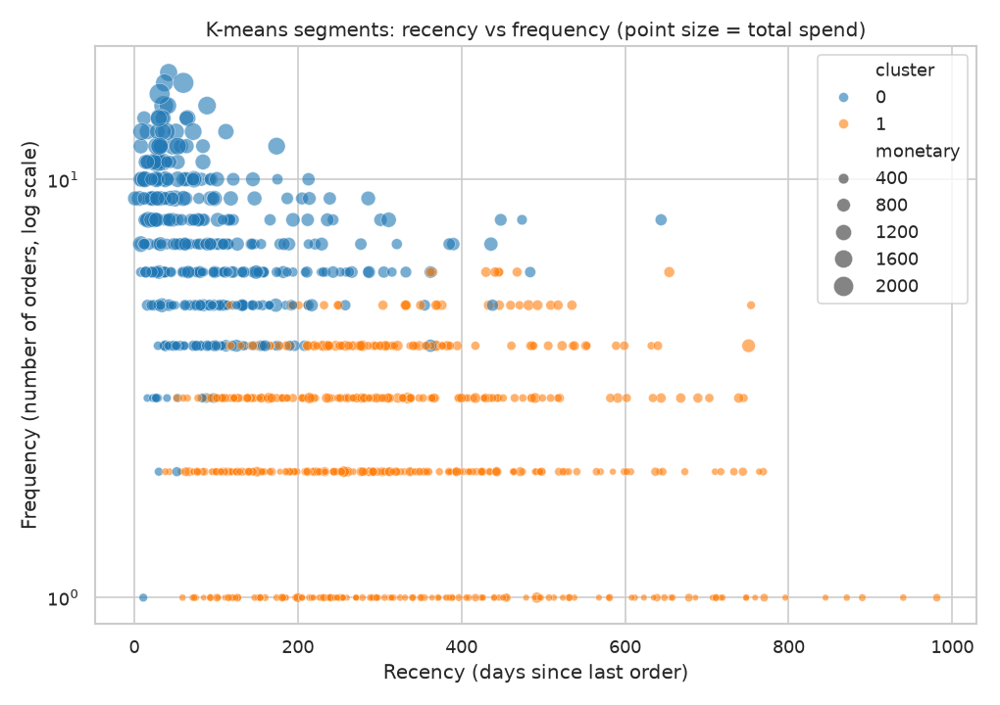
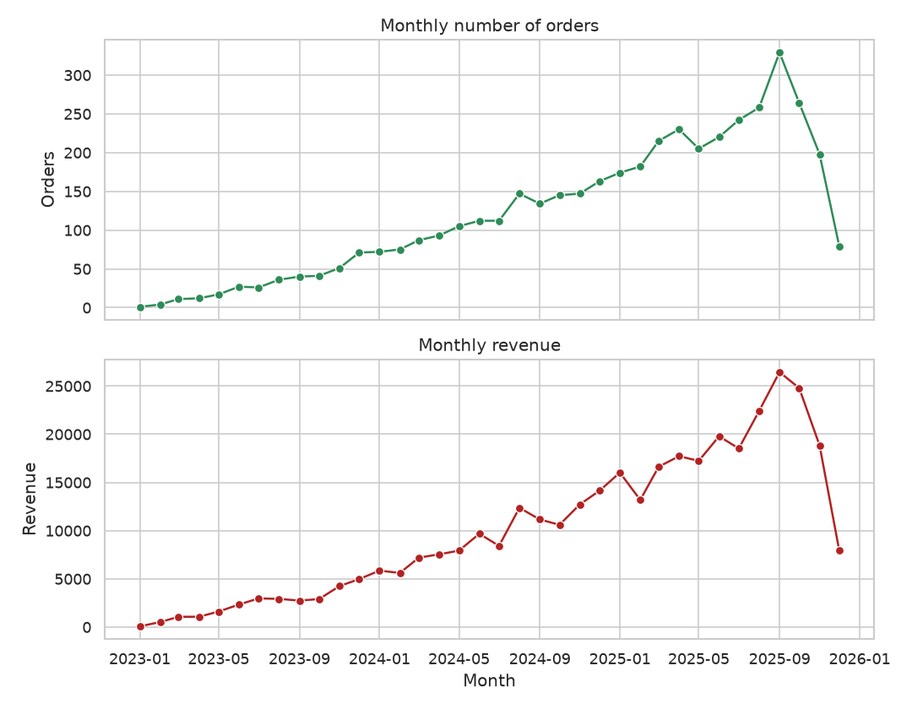

# E-Commerce Customer Segmentation

RFM analysis and k-means segmentation of online store customers.

## Business question

Which groups of customers does the online store have, and how should marketing treat each group differently (retain top buyers, win back lapsed ones, nurture occasional ones)?

## Goal

Build interpretable customer segments from purchase behavior using Recency, Frequency and Monetary (RFM) features, compare rule-based RFM scoring with k-means clustering, and describe each segment in business terms.

## Plan of the work

1. **Data generation** (`src/data_generator.py`): create synthetic customer and order tables with a fixed random seed.
2. **EDA** (`src/eda.py`): check data quality, distributions of order values and frequencies, activity over time, and differences between countries and acquisition channels.
3. **Analysis / model** (`src/analysis.py`, `src/utils.py`): compute RFM features, build RFM scores, scale features, choose the number of clusters for k-means (elbow and silhouette), and profile the resulting segments.
4. **SQL** (`sql/queries.sql`, `src/run_sql.py`): queries that reproduce the RFM table and segment summaries.
5. **Tests** (`tests/`): pytest checks for the data generator and the feature calculations.

## Dataset (synthetic)

All data is **synthetic**. It is generated by this project's own code (`src/data_generator.py`) with `numpy` and a fixed seed (42). It does not describe real customers or a real store.

Two tables are saved to `data/`:

- `customers.csv`: one row per customer (profile and acquisition information), 1000 rows.
- `orders.csv`: one row per order (date, value, items, payment, discount), 4325 rows.

Full column descriptions are in [data_description.md](data_description.md).

## Exploratory data analysis

`src/eda.py` loads both CSV files and prints the results to the console:

- **Data quality:** shape, dtypes, missing values, duplicates, and integrity checks (unknown customer IDs, customers without orders, orders dated before signup).
- **Descriptive statistics:** numeric summaries of customer and order columns, plus the skewness of order value.
- **Aggregations:** orders per customer (frequency), spend concentration among the top 20% of customers, comparison of countries and acquisition channels, discount / payment method / newsletter effects, and monthly activity.

It also saves four charts to `figures/`:

- `order_value_distribution.png`: histogram of order value (log scale).
- `orders_per_customer.png`: distribution of purchase frequency.
- `monthly_activity.png`: monthly orders and revenue.
- `spend_by_channel.png`: average total spend per customer by acquisition channel.

## Method

`src/analysis.py` runs the segmentation; reusable functions live in `src/utils.py`.

1. **RFM features.** The snapshot date is one day after the last order in the data. For each customer:
   - *Recency* = days between the last order and the snapshot date,
   - *Frequency* = number of orders,
   - *Monetary* = total order value.
2. **Rule-based segments.** Each of R, F and M is scored 1-5 by quintile (for recency the scale is reversed, so recent buyers score higher). Ties are broken by row order so that every quintile exists even when many customers have the same number of orders. Named segments (Champions, Loyal, At Risk, Lapsed, New / Promising, Occasional) are assigned from simple rules on the R and F scores.
3. **K-means.** RFM values are right-skewed, so they are transformed with `log(1 + x)` and standardised. K-means is fitted for k = 2 to 8 (`n_init=10`, `random_state=42`). The number of clusters is chosen by the highest silhouette score, with the elbow plot of inertia as a visual cross-check.
4. **Evaluation.** Clustering quality is measured with the silhouette score and the Davies-Bouldin index. Clusters are numbered by mean spend (cluster 0 = highest). Each cluster is profiled by size, revenue share and mean RFM values.
5. **Comparison.** The k-means clusters are compared with the rule-based segments using the Adjusted Rand Index and a cross-tabulation.

The task is unsupervised, so there is no train/test split. All randomness uses `random_state=42`.

### Outputs

- Console: RFM summary, segment profiles, k-selection table, quality metrics and the comparison.
- `figures/k_selection.png`: elbow and silhouette curves.
- `figures/kmeans_segments.png`: recency vs frequency scatter coloured by cluster.
- `reports/metrics.json`: chosen k, quality metrics, segment profiles and the Adjusted Rand Index.

## Results

All numbers below are copied from the console output and `reports/metrics.json` of this project's scripts, run on the synthetic data (snapshot date 2025-12-29, 1000 customers).

### RFM overview

| Metric | Mean | Median (50%) | Min | Max |
|---|---|---|---|---|
| Recency (days) | 231.50 | 188.50 | 1 | 981 |
| Frequency (orders) | 4.32 | 4 | 1 | 18 |
| Monetary (total spend) | 359.92 | 246.92 | 11.39 | 2206.28 |

The top 20% of customers (200) account for 51.2% of total revenue.

### Rule-based RFM segments

| Segment | Customers | Customer share | Avg recency | Avg frequency | Avg monetary | Revenue share |
|---|---|---|---|---|---|---|
| Champions | 267 | 0.27 | 61.07 | 7.89 | 740.43 | 0.55 |
| Loyal | 170 | 0.17 | 154.56 | 4.69 | 369.71 | 0.17 |
| At Risk | 163 | 0.16 | 382.44 | 4.31 | 311.69 | 0.14 |
| New / Promising | 76 | 0.08 | 94.96 | 1.95 | 126.88 | 0.03 |
| Lapsed | 237 | 0.24 | 432.03 | 1.74 | 121.99 | 0.08 |
| Occasional | 87 | 0.09 | 195.11 | 1.79 | 115.09 | 0.03 |

### K-means

Choice of k (features: log-transformed and standardised RFM):

| k | Inertia | Silhouette |
|---|---|---|
| 2 | 1411.4595 | 0.4414 |
| 3 | 969.6267 | 0.3588 |
| 4 | 785.2436 | 0.3205 |
| 5 | 649.8216 | 0.3343 |
| 6 | 561.9369 | 0.3149 |
| 7 | 503.7463 | 0.3003 |
| 8 | 457.1973 | 0.2939 |

The highest silhouette is at **k = 2**. Quality of the chosen solution: silhouette 0.4414, Davies-Bouldin index 0.8401.

| Cluster | Customers | Avg recency | Avg frequency | Avg monetary | Customer share | Revenue share |
|---|---|---|---|---|---|---|
| 0 (higher spend) | 399 | 100.744 | 7.105 | 656.532 | 0.399 | 0.728 |
| 1 (lower spend) | 601 | 318.313 | 2.479 | 162.997 | 0.601 | 0.272 |





### K-means vs rule-based segments

The Adjusted Rand Index is **0.2773**. Cross-tabulation (rows: rule-based segment, columns: k-means cluster):

| Rule-based segment | Cluster 0 | Cluster 1 |
|---|---|---|
| At Risk | 26 | 137 |
| Champions | 266 | 1 |
| Lapsed | 0 | 237 |
| Loyal | 99 | 71 |
| New / Promising | 8 | 68 |
| Occasional | 0 | 87 |

### Other findings from EDA and SQL

- Revenue per customer by acquisition channel ranges from 341.20 (organic_search) to 380.74 (referral). Orders per customer range from 4.06 (organic_search) to 4.64 (social_media).
- Average orders per customer: 4.32 for non-subscribers and 4.33 for newsletter subscribers; total spend 359.24 vs 360.86.
- SQL query Q5 (spend quintiles) shows the top quintile (200 customers, average spend 921.59) bringing 0.512 of revenue and the bottom quintile bringing 0.032.
- Monthly activity (Q7) grows from 1 order in 2023-01 to 329 orders in 2025-09; the last month in the data, 2025-12, has 79 orders and 7910.92 revenue. Cumulative revenue at the end is 359917.51.



## SQL analysis

`sql/queries.sql` contains 7 commented queries in the SQLite dialect. Each query is preceded by a comment line of the form `-- Q<n>: <question>`.

| Query | Question |
|---|---|
| Q1 | Row counts, distinct customers and date ranges of both tables |
| Q2 | RFM table for the 10 highest-spending customers |
| Q3 | Quintile scores (R, F, M) and rule-based segment per customer, using `NTILE(5)` |
| Q4 | Size, average RFM values and revenue share of each rule-based segment |
| Q5 | Revenue concentration by customer spend quintile |
| Q6 | Orders and revenue per customer by acquisition channel |
| Q7 | Monthly orders, active customers, revenue and running revenue total |

`src/run_sql.py` loads the two CSV files into an in-memory SQLite database (`pandas.to_sql`, with dates stored as `YYYY-MM-DD` text), splits `queries.sql` into statements, runs each one and prints its description and the first 10 result rows. No database file is created.

The SQL scoring mirrors the Python logic in `src/utils.py` (same snapshot date, quintiles with ties broken by `customer_id`, same segment rules). Small differences from the Python tie-breaking are possible, so use the console output of each script as the source of numbers. In this run, the SQL segment table (Q4) gives the same customer counts and averages as the Python table.

## Conclusions

These statements are limited to what the numbers above show on the synthetic data.

- **Revenue is concentrated.** The top 20% of customers bring 51.2% of revenue, and the Champions segment (26.7% of customers) brings 54.9%. Retaining this group matters most for revenue.
- **K-means finds a simple high/low split.** The silhouette score is highest at k = 2 (0.4414), and it falls for larger k (0.3588 at k = 3). The two clusters are: 399 frequent, recent, higher-spending customers (72.8% of revenue) and 601 less active, lower-spending ones (27.2% of revenue). There is no clear evidence in the silhouette values for more than two natural groups in this data.
- **Rule-based segments are more detailed for marketing.** They separate groups that k-means merges, for example Lapsed (avg recency 432.03 days) and At Risk (382.44 days, but avg frequency 4.31 and avg spend 311.69) from the active groups. At Risk customers have bought often in the past (4.31 orders on average) yet have not bought for a long time, which makes them a candidate group for win-back campaigns.
- **The two methods agree only partly.** The Adjusted Rand Index is 0.2773, which is expected because the two methods have different numbers of groups. They agree on the extremes: 266 of 267 Champions are in cluster 0, and all Lapsed (237) and Occasional (87) customers are in cluster 1. Loyal customers are split (99 vs 71).
- **Acquisition channel and newsletter show small differences.** Revenue per customer is between 341.20 and 380.74 across channels, and newsletter subscribers behave almost the same as non-subscribers (4.33 vs 4.32 orders per customer). No significance tests were run, so these differences should not be treated as proven effects.
- **Suggested treatment (a hypothesis, not a tested result):** retain and reward Champions and Loyal customers, run win-back offers for At Risk and Lapsed customers, and nurture New / Promising and Occasional customers towards a second and third order.

## Limitations & next steps

**Limitations**

- **The data is synthetic.** It is generated by this project's code, so the segments, revenue shares and channel differences describe the generator, not real customer behavior. No business conclusion about a real store can be drawn from them.
- The RFM snapshot is based on the last order in the data, and the last month (2025-12) may not be a full month of activity; recency values depend on this choice.
- The segment rules (R and F score thresholds) are simple and chosen by hand; other thresholds would give different segment sizes.
- K-means with k = 2 is stable by silhouette but coarse for marketing use. The silhouette of 0.4414 is moderate, not a sign of strongly separated groups.
- Only RFM features are used. Country, channel, discounts and payment method are not part of the clustering.
- Channel and country comparisons are descriptive; no statistical tests or confidence intervals were computed.

**Next steps**

- Test the stability of the clusters (different seeds, bootstrap samples) and compare with other methods (e.g. Gaussian mixtures or hierarchical clustering).
- Try k = 4-6 with additional features (average order value, discount usage, product variety) to get more actionable clusters, and compare them with the rule-based segments.
- Add statistical tests (e.g. ANOVA or bootstrap intervals) for differences between channels and countries.
- Add a simple customer lifetime value or churn-probability model on top of the segments.
- Replace the synthetic data with real, properly anonymised transaction data and repeat the analysis.

## Tests

The `tests/` folder contains pytest checks:

- `tests/test_data_generator.py`: columns, row counts, value ranges, referential integrity (every customer has orders, none dated before signup) and reproducibility of the synthetic data.
- `tests/test_utils.py`: RFM calculation on a small hand-made table, quintile scoring with ties, rule-based segments, feature scaling, choice of k, cluster relabelling and segment profiles.

The tests generate or build their own small tables in memory, so they do not need the files in `data/` or `figures/` and run in a few seconds (12 passed in the last run).

```bash
python -m pytest -q
```

## How to run

From the project root:

```bash
pip install -r requirements.txt
python src/data_generator.py
python src/eda.py
python src/analysis.py
python src/run_sql.py
python -m pytest -q
```

The first script creates `data/customers.csv` and `data/orders.csv`; the second prints the EDA summary and creates the EDA charts in `figures/`; the third runs the segmentation, prints the metrics, saves two more charts and writes `reports/metrics.json`; the fourth runs the SQL queries and prints their results; the last command runs the test suite.

---

*This is a training project that uses synthetic data generated by AI.*
