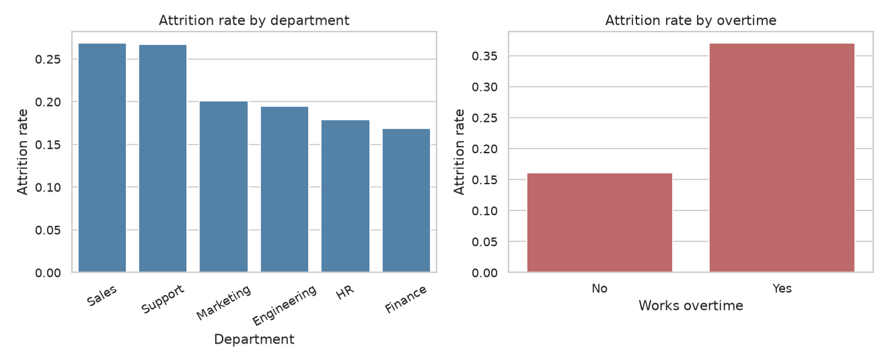
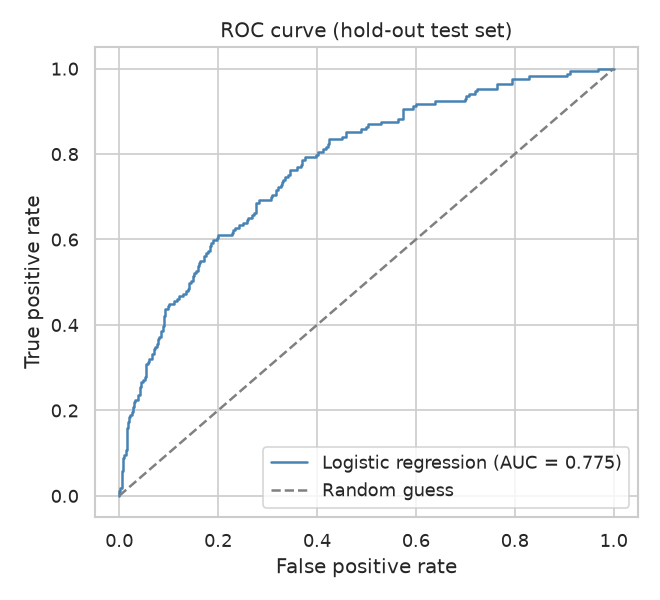
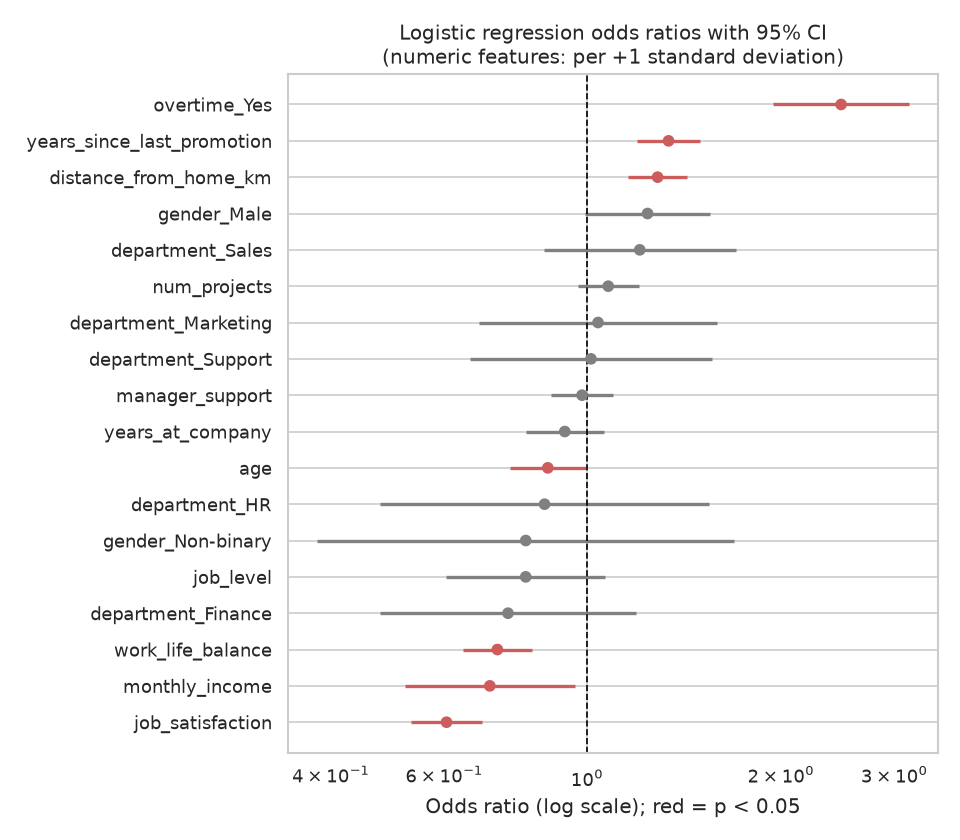

# Employee Attrition Analysis

HR analytics project: which factors drive employee attrition, and can a logistic regression model help predict who is likely to leave?

> **Note:** all data in this project is **synthetic**. It is generated by `src/data_generator.py` with a fixed random seed. It does not describe real people or a real company.

## Business question

Which employee and workplace characteristics (overtime, compensation, satisfaction, tenure, time since last promotion, and others) are associated with a higher probability of leaving the company, and where should HR focus its retention efforts?

## Goal

1. Quantify how attrition differs across departments, job levels, and employee groups.
2. Build an interpretable logistic regression model for the probability of attrition.
3. Turn the findings into practical, evidence-based retention recommendations.

## Plan of the work

1. **Data generation** (done): create reproducible synthetic tables in `data/`.
2. **EDA** (done): check data quality and missing values, look at distributions, and compare attrition rates across groups.
3. **Analysis and model** (done): statistical tests for key drivers, then a logistic regression with evaluation on a hold-out set and interpretation of odds ratios.
4. **SQL** (done): analytical queries (attrition by department, level, tenure, income and survey scores) run against the CSV data loaded into SQLite, stored in `sql/`.
5. **Tests** (done): `pytest` checks for the data generator and the helper functions in `src/utils.py`, stored in `tests/`.
6. **Results and conclusions** (done): key numbers, figures, conclusions and limitations summarised in this README.

## Dataset (synthetic)

Two tables are saved to `data/`:

| File | Grain | Rows |
|------|-------|------|
| `employees.csv` | one row per employee, includes the target `attrition` | 3000 |
| `satisfaction_surveys.csv` | one row per employee who answered the survey (some employees did not) | 2740 |

The tables are linked by `employee_id`. Attrition depends on the other columns through a hidden logistic relationship defined in the generator, plus random noise. The full column list with types, meanings and value ranges is in [data_description.md](data_description.md).

## How to run

Requirements: Python 3.11. Optionally create a virtual environment first, then install the dependencies:

```bash
pip install -r requirements.txt
```

Run everything from the project root, in this order. Each script creates the folders it writes to (`data/`, `figures/`, `reports/`). `analysis.py` and `run_sql.py` read the CSV files created in step 1, so generate the data first:

```bash
python src/data_generator.py   # creates data/employees.csv and data/satisfaction_surveys.csv (seed 42)
python src/eda.py              # exploratory analysis, charts in figures/
python src/analysis.py         # statistical tests, model, metrics, charts, reports/metrics.json
python src/run_sql.py          # runs the queries in sql/queries.sql on the CSV data (in-memory SQLite)
python -m pytest -q            # runs the automated tests
```

Running the generator again reproduces identical files, because the random seed is fixed.

## Tests

Run the tests from the project root:

```bash
python -m pytest -q
```

The tests live in `tests/` and take only a few seconds. They build small synthetic tables in memory with fixed seeds, so they do not need the CSV files in `data/`, the charts in `figures/` or any other output of the other scripts. In the last run, 11 tests passed.

| File | What it checks |
|------|----------------|
| `tests/test_data_generator.py` | employee and survey columns, row counts, unique IDs, value ranges (age, job level, income, tenure, survey scores 1-4, promotion gap not above tenure), binary `attrition`, reproducibility with the same seed |
| `tests/test_utils.py` | left join keeps employees without a survey, duplicate IDs are rejected, feature/target split, `compute_metrics` on a hand-checked example, `best_f1_threshold` on separable data, the model pipeline and the odds ratio table |

## Exploratory data analysis

`src/eda.py` loads both CSV files and prints its findings to the console. It:

- reports shape, data types, missing values and duplicate IDs for each table;
- measures survey coverage, i.e. how many employees have no survey response (these become missing values after a left join);
- prints descriptive statistics for numeric columns and value shares for categorical columns, plus the overall attrition rate;
- aggregates the attrition rate by department, overtime, job level and tenure band, and compares mean feature values for employees who stayed vs left.

It also saves three charts to `figures/`:

| File | Content |
|------|---------|
| `attrition_by_group.png` | attrition rate by department and by overtime |
| `income_distribution.png` | monthly income distribution for employees who stayed vs left |
| `correlation_heatmap.png` | correlation matrix of numeric features, survey scores and attrition |

## Method: analysis and model

`src/analysis.py` runs the core analysis; reusable logic (data joining, preprocessing pipeline, metric functions, odds ratio table) is in `src/utils.py` so it can be unit-tested.

1. **Data preparation.** Employees are left-joined with survey responses. Employees without a survey keep missing survey scores, which are imputed with the training-set median.
2. **Univariate tests.** Each feature is tested against attrition on its own: Mann-Whitney U for numeric features and a chi-square test of independence for categorical ones. These tests are exploratory and p-values are not adjusted for multiple comparisons.
3. **Train/test split.** A stratified 75/25 split with `random_state=42`. All fitted steps (imputation, scaling, encoding, the model) learn from the training set only, so the test set stays a clean hold-out.
4. **Model.** An unpenalised logistic regression in a scikit-learn pipeline. Numeric features are standardised, so coefficients are per +1 standard deviation; categorical features are one-hot encoded with the first category as the reference. Features: demographics, job level, tenure, income, commute, projects, promotion gap, the three survey scores, department and overtime.
5. **Evaluation.** 5-fold cross-validated ROC AUC on the training set, plus hold-out accuracy, precision, recall, F1, ROC AUC and average precision. Because attrition is the minority class, results are shown at the default 0.5 threshold and at a threshold that maximises F1 on the training set (then applied unchanged to the test set). The majority-class accuracy is printed as a baseline.
6. **Interpretation.** The same design matrix is fitted with `statsmodels` Logit to obtain odds ratios, 95% confidence intervals and p-values on the training set.

### Outputs

| File | Content |
|------|---------|
| `figures/roc_curve.png` | ROC curve on the hold-out set |
| `figures/odds_ratios.png` | forest plot of odds ratios with 95% CI (log scale) |
| `reports/metrics.json` | split settings, cross-validation AUC, hold-out metrics at both thresholds, odds ratios |

Because the data is generated from a known logistic relationship (see `data_description.md`), the model recovering similar directions of effect is expected and says nothing about real employees. The association found is not proof of causation.

## SQL analysis

The queries in `sql/queries.sql` (SQLite dialect) answer the same business questions as the EDA, but in SQL. `src/run_sql.py` loads both CSV files into an in-memory SQLite database with `pandas.to_sql` (tables `employees` and `satisfaction_surveys`), splits the query file into statements, runs each one and prints its description and the first rows of the result. Nothing is written to disk and no database server is needed.

Each query is preceded by a comment line of the form `-- Q<n>: <question>`, which the runner uses as its description.

| Query | Question | SQL features |
|-------|----------|--------------|
| Q1 | Overall headcount, leavers and attrition rate | aggregates |
| Q2 | Attrition by department | `GROUP BY`, `ORDER BY` |
| Q3 | Attrition and average income with vs without overtime | `GROUP BY`, `AVG` |
| Q4 | Attrition and average income by job level | `GROUP BY` |
| Q5 | Attrition by tenure band | `CASE` |
| Q6 | Attrition by job satisfaction, including survey non-respondents | `LEFT JOIN`, `COALESCE` |
| Q7 | Highest-attrition department and overtime combinations (at least 30 employees) | `HAVING`, `LIMIT` |
| Q8 | Attrition by income quartile | CTE, `NTILE` window function |

Since `attrition` is coded 0/1, `AVG(attrition)` is the attrition rate. As in the EDA, differences between groups are descriptive associations, not proof of causation.

## Results

All numbers below come from the program output of a run on the synthetic data (seed 42). Rates are shares, e.g. 0.225 = 22.5%.

### Attrition in the data

- Overall: **676 of 3000** employees left, an attrition rate of **0.225**.
- **Overtime:** 0.370 with overtime (927 employees) vs 0.161 without (2073 employees).
- **Job level:** 0.379 at level 1 (692 employees), 0.229 at level 2, 0.112 at level 3 and 0.071 at level 4 (113 employees). Level 5 has a single employee, so its rate (0.000) is not informative.
- **Income quartile (SQL Q8):** 0.376 in the lowest quartile, then 0.245, 0.183, and 0.097 in the highest.
- **Job satisfaction (SQL Q6):** 0.399 for score 1, 0.236 for 2, 0.145 for 3 and 0.069 for 4. The 260 employees with no survey response have a rate of 0.212.
- **Department:** highest in Sales (0.268) and Support (0.267), lowest in Finance (0.169) and HR (0.179).
- **Department and overtime (SQL Q7):** Sales with overtime is the highest group at 0.443 (280 employees).
- **Tenure band (EDA):** 0.276 for 0-2 years, 0.226 for 2-5, 0.221 for 5-10 and 0.149 for 10+ years.



### Logistic regression (hold-out set of 750 employees)

- Split: 2250 training and 750 test rows (stratified, `random_state=42`).
- 5-fold cross-validated ROC AUC on the training set: **0.772** (std 0.031).
- Hold-out ROC AUC: **0.775**; average precision: **0.515**.
- Majority-class baseline accuracy on the test set: **0.775**.

| Metric (test set) | Threshold 0.5 | Tuned threshold (0.244) |
|-------------------|---------------|-------------------------|
| Accuracy | 0.799 | 0.711 |
| Precision | 0.636 | 0.412 |
| Recall | 0.249 | 0.669 |
| F1 | 0.357 | 0.510 |
| True positives / false negatives | 42 / 127 | 113 / 56 |
| False positives / true negatives | 24 / 557 | 161 / 420 |

The tuned threshold was chosen to maximise F1 on the training set and then applied unchanged to the test set.



### Odds ratios (statsmodels Logit, training set)

Numeric features are standardised, so their odds ratios are per +1 standard deviation. The values below are those visible in the program output; the full table is in `reports/metrics.json`.

| Feature | Odds ratio | 95% CI | p-value |
|---------|-----------|--------|---------|
| `overtime_Yes` (vs No) | 2.48 | 1.95 - 3.16 | 2.0e-13 |
| `job_satisfaction` | 0.60 | 0.53 - 0.69 | 3.8e-15 |
| `work_life_balance` | 0.73 | 0.64 - 0.82 | 2.6e-07 |
| `monthly_income` | 0.71 | 0.52 - 0.96 | 0.024 |
| `years_since_last_promotion` | 1.34 | 1.20 - 1.50 | 3.4e-07 |
| `distance_from_home_km` | 1.29 | 1.16 - 1.43 | 3.5e-06 |
| `job_level` | 0.80 | 0.60 - 1.07 | 0.130 |



## Conclusions

These conclusions describe associations in synthetic data only.

- **Overtime is the strongest single signal.** Attrition is 0.370 with overtime vs 0.161 without, and in the model overtime has the largest odds ratio (2.48, CI 1.95 - 3.16).
- **Lower satisfaction goes with higher attrition.** The rate falls from 0.399 (score 1) to 0.069 (score 4), and both job satisfaction (OR 0.60) and work-life balance (OR 0.73) have odds ratios below 1 in the model.
- **Junior and lower-paid employees leave more often.** Attrition is 0.379 at job level 1 vs 0.071 at level 4, and 0.376 in the lowest income quartile vs 0.097 in the highest. In the model, income keeps an odds ratio below 1 (0.71), while job level's interval includes 1 (0.60 - 1.07). The two may carry overlapping information, since average income rises with job level (SQL Q4), but this was not tested directly.
- **A longer gap since the last promotion and a longer commute go with higher odds of leaving** (OR 1.34 and 1.29 per +1 SD).
- **Retention efforts could start with overtime-heavy groups,** for example Sales employees with overtime (0.443, 280 employees), and with low-satisfaction and early-career employees.
- **The model ranks leavers moderately well but is not a precise predictor.** Hold-out ROC AUC is 0.775. At the default 0.5 threshold, accuracy (0.799) is only slightly above the majority-class baseline (0.775) and recall is 0.249, so most leavers are missed. At the tuned threshold, recall rises to 0.669 at the cost of precision (0.412).

## Limitations & next steps

**Limitations**

- **The data is synthetic.** It comes from a hidden logistic relationship in the generator, so the model finding the same drivers is expected. Nothing here shows how a real company behaves.
- **Associations, not causes.** Group differences and odds ratios do not show that changing a factor (for example removing overtime) would reduce attrition.
- **Single split.** Hold-out metrics come from one 75/25 split; cross-validation (AUC std 0.031) suggests some variation between folds.
- **Exploratory tests.** Univariate p-values are not adjusted for multiple comparisons.
- **Small groups.** Job level 5 has one employee, and some department and overtime groups are small, so their rates are unstable.
- **Survey non-response.** 260 employees have no survey answers; their missing scores are imputed with the training median.
- **Library warning.** `analysis.py` currently triggers a scikit-learn `FutureWarning` about the deprecated `penalty` argument of `LogisticRegression`. It does not change the results here, but the call should be updated for newer scikit-learn versions.

**Next steps**

- Try regularised logistic regression and tree-based models, and compare them using cross-validation.
- Check calibration of predicted probabilities and choose a decision threshold based on the relative cost of missing a leaver vs a false alarm.
- Test interactions such as overtime by department, and check collinearity between income and job level.
- Validate the approach on real, anonymised HR data (with permission) before drawing any business conclusions.

## Project structure

```
employee-attrition-analysis/
├── README.md
├── requirements.txt
├── data_description.md
├── data/            # generated CSV files
├── figures/         # charts (created by src/eda.py and src/analysis.py)
├── reports/         # metrics.json (created by src/analysis.py)
├── src/             # Python scripts (data_generator, eda, analysis, utils, run_sql)
├── sql/             # SQL queries (queries.sql)
└── tests/           # pytest tests (test_data_generator.py, test_utils.py)
```

---

*This is a training project that uses synthetic data generated by AI.*
