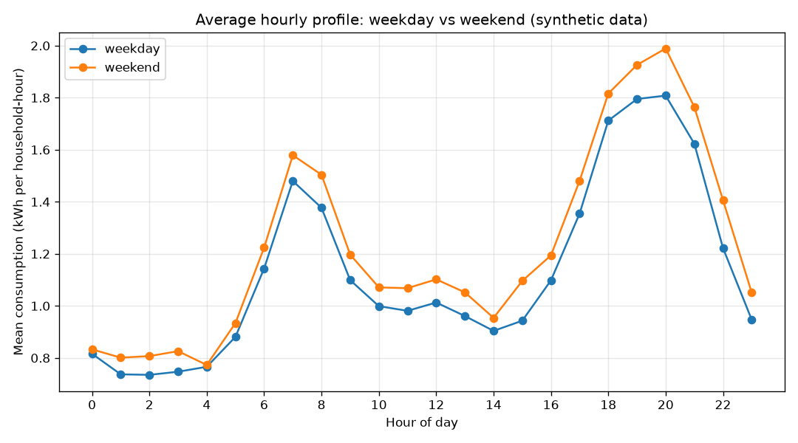
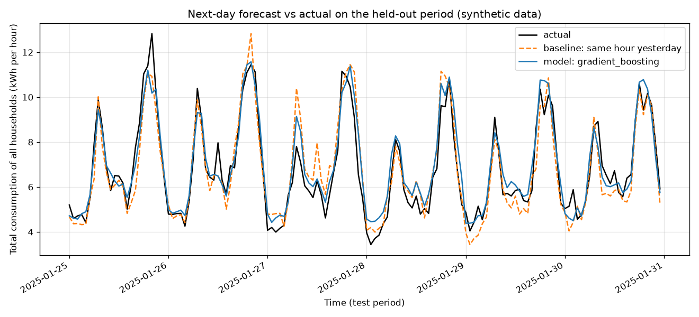
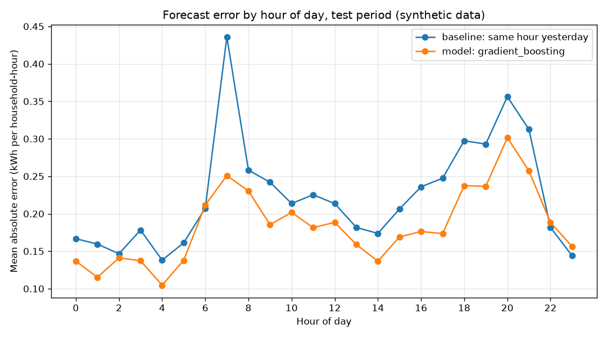

# Energy Consumption Forecast

Hourly household energy usage patterns and next-day forecast.

> **Note:** All data in this project is **synthetic**. It is generated by `src/data_generator.py` and is not real meter data.

## Business question

When during the day and week do households use the most electricity, and how well can we predict tomorrow's hourly consumption from past usage, calendar effects and temperature?

## Goal

1. Describe hourly consumption patterns (daily and weekly cycles, effect of temperature, differences between households).
2. Build a next-day (24 hours ahead) forecast and compare it with a simple baseline.

## Plan of the work

1. **Data generation** (done): create synthetic tables with a fixed seed.
2. **EDA** (done): data quality checks, daily and weekly profiles, temperature relationship, household comparison.
3. **Analysis / model** (done): baselines versus regression models, evaluated on a held-out final period.
4. **SQL** (done): aggregation queries (peak hours, daily totals, household rankings) over the generated tables.
5. **Tests** (done): pytest checks for the data generator (shape, ranges, reproducibility) and for the helper functions in `src/utils.py`.
6. **Results and conclusions** (current step): key numbers, figures, conclusions and limitations.

## Dataset (synthetic)

Three CSV tables are written to `data/`:

| Table | Description | Rows |
|---|---|---|
| `households.csv` | One row per household (dwelling type, residents, area, heating type) | 6 |
| `weather_hourly.csv` | Hourly outdoor temperature for the whole period | 720 |
| `energy_hourly.csv` | Hourly electricity use per household (kWh) | 4320 |

The period covers 30 days starting 2025-01-01 (winter, so heating matters). Consumption is built from a household base load, a daily profile with morning and evening peaks, a weekend effect, temperature-driven electric heating and random noise.

See `data_description.md` for every column.

## How to run

**Requirements:** Python 3.11 and the packages listed in `requirements.txt`.

From the project root:

```bash
pip install -r requirements.txt
python src/data_generator.py
python src/eda.py
python src/analysis.py
python src/run_sql.py
python -m pytest -q
```

All scripts are non-interactive and need no network access. `data_generator.py` recreates the CSV files in `data/` on every run (the folder is created automatically). The fixed seed (42) makes the output reproducible. `eda.py`, `analysis.py` and `run_sql.py` must be run after the generator because they read those files.

A successful generator run prints one line per table:

```
households: 6 rows, 5 columns -> data/households.csv
weather_hourly: 720 rows, 2 columns -> data/weather_hourly.csv
energy_hourly: 4320 rows, 3 columns -> data/energy_hourly.csv
```

## Exploratory data analysis

`src/eda.py` loads the three CSV files, joins them and adds calendar features (hour, day of week, weekday/weekend). It then:

- **Checks data quality:** prints shape, dtypes, missing values and duplicated rows for each table, plus integrity checks (unknown household ids, timestamps without weather, duplicate household-hour pairs, rows per household).
- **Prints descriptive statistics** for `kwh` and `temperature_c`.
- **Prints five aggregations:**
  1. mean kWh by hour of day, weekday vs weekend;
  2. consumption by day of week;
  3. household comparison (mean, maximum, total kWh and peak hour);
  4. mean kWh by temperature band and heating type;
  5. correlation between temperature and kWh by heating type.
- **Saves four charts** to `figures/` (created automatically):
  - `hourly_profile.png` - average daily profile, weekday vs weekend;
  - `heatmap_day_hour.png` - mean kWh by day of week and hour;
  - `temperature_vs_kwh.png` - temperature against consumption, split by heating type;
  - `household_comparison.png` - mean hourly consumption per household.

All findings should be read from the script output and the charts; since the data is synthetic, patterns reflect the generator's design rather than real household behaviour.

## Method: next-day forecast

`src/analysis.py` (with reusable logic in `src/utils.py`) forecasts the consumption of each household for every hour of the next day.

**Features** (built in `utils.add_features`):

- lags: consumption at the same hour one day earlier (`lag_24`) and one week earlier (`lag_168`), and the previous day's mean (`prev_day_mean`);
- calendar: hour, cyclic hour encoding (sine/cosine), day of week, weekend flag;
- temperature: outdoor temperature, degrees below a 16 °C heating threshold, and that value multiplied by the electric-heating flag;
- household attributes: number of residents, floor area, electric heating flag.

The temperature of the predicted hour is used as if it were a weather forecast for the next day. In practice a forecast would be slightly less accurate than the observed value, so the results are somewhat optimistic in that respect.

**Validation:** a chronological split, not a random one, so the model never sees the future. The first 7 days are dropped because the weekly lag does not exist yet; the last 6 days are the test set and everything between is the training set. All random components use `random_state=42`.

**Compared approaches:**

1. baseline: same hour yesterday;
2. baseline: same hour last week;
3. Ridge regression (standardised features);
4. gradient boosting regressor.

**Metrics** (on the test set, per household-hour): MAE, RMSE, WAPE (total absolute error divided by total actual consumption) and R². The script also reports the percentage reduction in MAE and RMSE of the best model compared with the best baseline.

**Outputs:**

- `reports/metrics.json` - split description, feature list, all metrics, best baseline and model, feature importance;
- `figures/forecast_vs_actual.png` - total consumption of all households on the test period: actual, baseline and best model;
- `figures/error_by_hour.png` - mean absolute error by hour of day, baseline vs best model.

**Limitations:** the dataset is small (6 households, 30 days) and synthetic, so the results show how the method behaves on generated data and say nothing about real households. The test period is only 6 days, so metrics may vary with the choice of period.

## SQL analysis

`sql/queries.sql` holds eight commented queries in the SQLite dialect. Each one is preceded by a `-- Q<n>:` line that states the business question:

| Query | Question |
|---|---|
| Q1 | Which five hours of the day have the highest mean consumption? |
| Q2 | Which ten days had the highest total consumption, and what was the mean temperature? |
| Q3 | How do households rank by total consumption and consumption per square metre? |
| Q4 | How do weekday and weekend consumption compare for each household? |
| Q5 | What is mean consumption by temperature band and heating type? |
| Q6 | What share of each household's consumption falls into the evening peak (18:00-21:59)? |
| Q7 | Which five household-hours had the highest consumption? |
| Q8 | Which days had the largest increase in total consumption versus the previous day? |

The queries use joins across the three tables, `GROUP BY` aggregation, `CASE` expressions, SQLite date functions (`strftime`, `date`), common table expressions and window functions (`RANK`, `LAG`).

`src/run_sql.py` loads the three CSV files into an in-memory SQLite database with `pandas.to_sql`, splits `queries.sql` into statements, runs each one and prints its description and the first rows of the result. It writes no files. Because statements are split on the semicolon character, comments in `queries.sql` must not contain one.

```bash
python src/run_sql.py
```

## Tests

The `tests/` folder contains pytest checks. Run them from the project root:

```bash
python -m pytest -q
```

| File | What it checks |
|---|---|
| `tests/test_data_generator.py` | Column names and row counts of the three tables, value ranges (residents, floor area, heating flag, `kwh` clipping), unique household-hour keys, weather coverage, reproducibility with the fixed seed, and that `main()` writes the CSV files (to a temporary folder). |
| `tests/test_utils.py` | Metric functions on hand-computed values (MAE, RMSE, WAPE, R²), errors for undefined cases, `improvement_pct`, lag and calendar features from `add_features`, `drop_incomplete` (first week removed) and the chronological split (no overlap between train and test). |

The tests build the synthetic data in memory with the generator's own functions, so they do not need the files in `data/` and do not depend on the charts in `figures/`. They run in a few seconds. The last run reported 13 passed.

## Results

All numbers below come from the actual output of the scripts (`eda.py`, `analysis.py`, `run_sql.py`) and `reports/metrics.json`. The data is synthetic, so they describe the generator's design, not real households.

### Data quality

- 4320 hourly rows (6 households x 720 hours), no missing values, no duplicated rows.
- No unknown household ids, no energy timestamps missing in the weather table, no duplicated (household, timestamp) pairs.
- `kwh` ranges from 0.210 to 3.969 (mean 1.157); outdoor temperature ranges from -3.1 to 11.1 °C (mean 3.437).

### Consumption patterns

- Peak hour is **20:00** on both weekdays and weekends: mean 1.808 kWh on weekdays and 1.989 kWh on weekends.
- There is a morning peak at 07:00 (1.480 weekday, 1.579 weekend) and a low point at night (weekday minimum 0.735 kWh at 02:00).
- Mean hourly consumption by day of week ranges from 1.095 (Mon) to 1.249 (Sat); Sunday is 1.205.
- Household totals over the 30 days range from 480.697 kWh (H005) to 1327.272 kWh (H003). All three electrically heated households (H001, H003, H006) have higher mean hourly consumption than the households without electric heating.
- Share of consumption in the evening peak (18:00-21:59): highest for H004 (28.9%), lowest for H006 (23.5%).
- All five highest household-hours belong to H003; the maximum is 3.969 kWh on 2025-01-18 at 20:00.



### Temperature

| Temperature band (SQL Q5) | Electric heating, mean kWh | No electric heating, mean kWh |
|---|---|---|
| below 0 C | 1.301 | 0.483 |
| 0 to 5 C | 1.566 | 0.826 |
| 5 C and above | 1.502 | 0.928 |

Correlation of temperature with kWh on hourly rows: 0.075 for electric heating, 0.372 for no electric heating.

### Next-day forecast (test set: 2025-01-25 to 2025-01-30, 864 rows)

| Approach | MAE | RMSE | WAPE | R² |
|---|---|---|---|---|
| Baseline: same hour yesterday | 0.2240 | 0.3090 | 0.1978 | 0.6863 |
| Baseline: same hour last week | 0.2432 | 0.3507 | 0.2148 | 0.5958 |
| Ridge | 0.1911 | 0.2590 | 0.1688 | 0.7797 |
| Gradient boosting | 0.1839 | 0.2551 | 0.1625 | 0.7861 |

- Best baseline: same hour yesterday. Best model: gradient boosting.
- Gradient boosting reduces MAE by **17.9%** and RMSE by **17.4%** compared with the best baseline.
- Top feature importances of gradient boosting: `lag_24` 0.5200, `lag_168` 0.3270, `prev_day_mean` 0.0604, `hour` 0.0274.





## Conclusions

- **Daily cycle:** in this dataset consumption has a clear evening peak at 20:00 and a smaller morning peak at 07:00, with the lowest values at night. Weekends are higher than weekdays at 20:00 (1.989 vs 1.808 kWh) and at 07:00 (1.579 vs 1.480 kWh).
- **Weekly pattern:** Saturday has the highest mean hourly consumption (1.249 kWh) and Monday the lowest (1.095 kWh). Five of six households use more on weekends; only H006 uses slightly less (weekend-to-weekday ratio 0.969). Daily totals by weekday should not be compared directly, because Wednesday and Thursday occur five times in this 30-day period and the other weekdays four times; the mean values are the fair comparison.
- **Households:** electrically heated households use more per hour than the others (for example 1.843 kWh mean for H003 vs 0.668 kWh for H005). Dwelling size and heating type differ between households, so the data does not allow separating their effects on its own.
- **Temperature:** within the observed range (-3.1 to 11.1 °C) the data does not show consumption rising steadily as it gets colder. The electrically heated group is lowest in the coldest band (1.301 kWh below 0 C) and highest in the 0 to 5 C band (1.566 kWh), and the correlation with temperature is positive for households without electric heating (0.372). These raw averages are not controlled for hour of day or day of the week, so they should not be read as a causal effect of temperature.
- **Forecast:** both regression models beat both baselines on the 6-day test set. Gradient boosting has the lowest MAE (0.1839 vs 0.2240 for the best baseline, a 17.9% reduction) and the highest R² (0.7861). Ridge is close (MAE 0.1911), so the extra complexity of gradient boosting brings only a small gain here.
- **What drives the forecast:** the model relies mostly on past consumption. `lag_24` and `lag_168` together account for about 0.85 of the gradient boosting importance (0.5200 + 0.3270), while temperature features have small importances (for example `temperature_c` 0.0023).

## Limitations & next steps

**Limitations**

- **The data is synthetic.** It is generated by this project's own code, so every pattern and every forecast metric reflects how the generator was designed. None of it says anything about real households or real meters.
- The dataset is small: 6 households and 30 days in one winter month. Seasonal effects cannot be studied.
- The test set is only 6 days, so the metrics may change with a different test period. No confidence intervals or repeated validation windows were computed.
- Observed temperature of the predicted hour is used as if it were a forecast, which makes the results somewhat optimistic.
- The temperature comparison uses raw group averages without controlling for hour or weekday, so no causal claim is made.
- No hyperparameter tuning was done for the models.

**Next steps**

- Use rolling-origin (several consecutive test windows) validation to measure how stable the metrics are.
- Replace observed temperature with a simulated forecast containing realistic error, to check how much accuracy is lost.
- Fit a model of consumption against temperature that also includes hour and weekday, to examine the heating effect properly.
- Add longer periods and more households to the generator, and tune the models with time-series cross-validation.
- Replace the deprecated `Series.dt.dayofweek` with `Series.dt.day_of_week` in `src/eda.py` and `src/utils.py` to remove the pandas deprecation warning seen in the script and test output.

---

*This is a training project that uses synthetic data generated by AI.*
