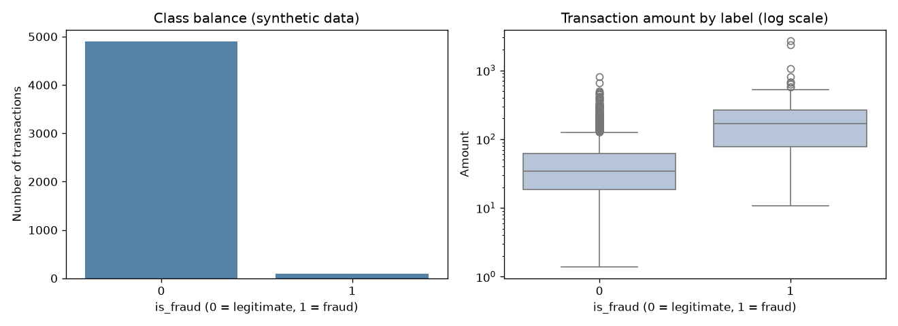
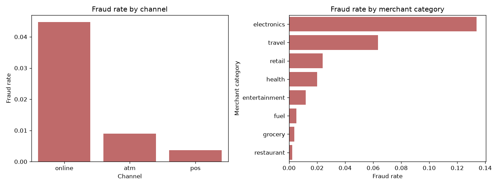
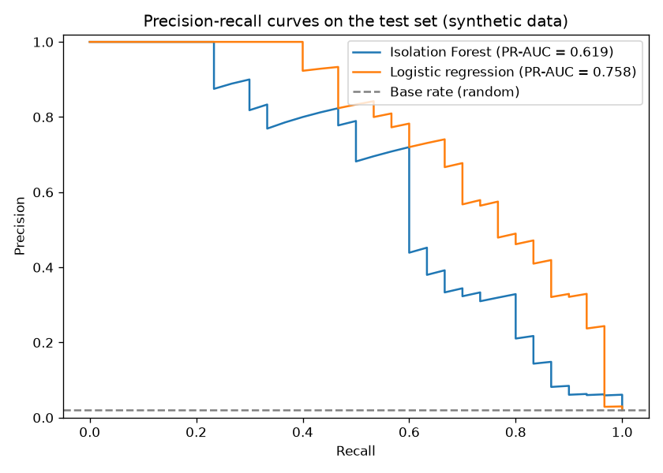

# Fraud Transaction Detection

Anomaly detection with Isolation Forest and a supervised baseline, built on **synthetic** card transaction data.

## Business question

Can we flag suspicious card transactions early enough to stop losses, without overwhelming the fraud-review team with false alarms?

## Goal

- Explore how fraudulent transactions differ from legitimate ones (amount, time of day, channel, location, device).
- Build an unsupervised anomaly detector (Isolation Forest) that does not need labels.
- Build a supervised baseline (logistic regression) that uses the fraud label.
- Compare both approaches with metrics suited to highly imbalanced data (precision, recall, PR-AUC).

## Plan of the work

1. **Data generation**: create reproducible synthetic customers and transactions (`src/data_generator.py`).
2. **EDA**: class balance, distributions by fraud label, time patterns, categorical breakdowns (`src/eda.py`).
3. **Analysis / model**: feature engineering, Isolation Forest, supervised baseline, comparison (`src/analysis.py`, `src/utils.py`).
4. **SQL**: analytical queries on the same tables (`sql/queries.sql`, run with `src/run_sql.py`).
5. **Tests**: pytest checks for the data generator and the helper functions (`tests/`).

## Dataset (synthetic)

All data is **synthetic** and produced by this project's own code with a fixed random seed (42). It does not describe real customers or real transactions. Two tables are saved to `data/`:

| File | Rows | Description |
|------|------|-------------|
| `data/customers.csv` | 1,000 | One row per customer: demographics, income, credit limit |
| `data/transactions.csv` | 5,000 | One row per card transaction, with an `is_fraud` label |

The fraud label is assigned by the generator, and fraudulent transactions are given different distributions (larger amounts, more night-time, more online and foreign activity, longer distances from home). Column details are in [data_description.md](data_description.md).

## Exploratory data analysis

`src/eda.py` loads both CSV files and:

- prints the shape, data types, missing values and descriptive statistics of each table;
- prints five aggregations: class balance, amount statistics by label, and fraud rate by channel, by merchant category, and by night-time / foreign flags;
- saves three charts to `figures/`:
  - `class_balance_and_amount.png`: class balance and amount distribution by label;
  - `fraud_by_hour.png`: hour-of-day profile of each class;
  - `fraud_rate_by_segment.png`: fraud rate by channel and merchant category.

All numbers appear in the script's printed output and are computed from the synthetic data. Because the fraud patterns are built in by the generator, the differences seen in the EDA reflect the simulation design, not real-world behaviour.

## Method

`src/analysis.py` compares two detectors. Reusable logic (feature building and metrics) lives in `src/utils.py`.

**Features** (`build_features`): transactions are joined to customer attributes. Features are log amount, amount relative to the credit limit, log distance from home, hour of day, a night-time flag, foreign flag, new-device flag, customer age, account age, and one-hot encoded channel and merchant category. The label is never used as a feature.

**Split**: stratified 70/30 train/test split with `random_state=42`, so both sets keep the same fraud share. All metrics are computed on the test set only.

**Models**
- *Isolation Forest* (unsupervised): fitted on the training features without labels; the anomaly score (higher = more unusual) ranks test transactions.
- *Logistic regression* (supervised baseline): standardised features, `class_weight="balanced"` to handle the 2% fraud share; the predicted fraud probability ranks test transactions.

**Metrics**: with so few frauds, accuracy is misleading, so the comparison uses
- PR-AUC (average precision) and ROC-AUC, which evaluate the full ranking;
- precision, recall and F1 at a fixed **alert budget**: the top 2% of transactions by score are flagged, which mimics a review team that can only check a limited number of cases.

**Outputs**
- `figures/pr_curves.png`: precision-recall curves of both models with the random baseline;
- `figures/logistic_coefficients.png`: largest standardised coefficients of the logistic regression;
- `reports/metrics.json`: all metrics and the run configuration.

## Results

All numbers below come from the scripts' printed output on the **synthetic** data (seed 42) and from `reports/metrics.json`.

### Data and EDA

- 5,000 transactions, of which 100 are fraudulent (2%); 4,900 are legitimate (98%).
- Mean amount: 254.52 for fraud vs 50.81 for legitimate transactions (medians: 166.56 vs 33.86).
- Fraud rate by channel: online 4.48% (87 of 1,944), ATM 0.90% (3 of 335), POS 0.37% (10 of 2,721).
- Highest fraud rate by merchant category: electronics 13.38% (40 of 299), then travel 6.35% (20 of 315). Lowest: restaurant 0.23% (2 of 885).
- Night and foreign combined: fraud rate 57.14% (28 of 49), compared with 0.52% (22 of 4,240) for daytime domestic transactions.
- Monthly fraud rate ranges from 1.70% (April) to 2.73% (February).





### Model comparison (test set: 1,500 rows, 30 frauds, base rate 0.0200)

| Metric | Isolation Forest (unsupervised) | Logistic regression (supervised) |
|--------|--------------------------------|----------------------------------|
| PR-AUC | 0.6188 | 0.7582 |
| ROC-AUC | 0.9519 | 0.9696 |
| True positives at 2% alert budget (30 flagged) | 18 | 20 |
| Precision at 2% alert budget | 0.6000 | 0.6667 |
| Recall at 2% alert budget | 0.6000 | 0.6667 |
| F1 at 2% alert budget | 0.6000 | 0.6667 |



## Conclusions

- Fraud in this synthetic dataset is concentrated in specific segments: online channel, electronics and travel categories, night-time and foreign transactions. The combination of night and foreign had a fraud rate of 57.14%.
- Both models rank fraud far better than chance: PR-AUC of 0.6188 (Isolation Forest) and 0.7582 (logistic regression) compared with a base rate of 0.0200.
- The supervised baseline scored higher on every reported metric (PR-AUC 0.7582 vs 0.6188, ROC-AUC 0.9696 vs 0.9519), and caught 20 of 30 frauds against 18 of 30 within the 30-transaction alert budget.
- Isolation Forest, which uses no labels, still caught 18 of 30 frauds (precision and recall 0.6000) in the alert budget, so it is a reasonable option when labels are not available.
- With only 30 frauds in the test set, a difference of two caught frauds is small, so the gap at the alert budget should not be over-interpreted.

## Limitations & next steps

- **The data is synthetic.** The fraud patterns were built in by the generator, so the results show how the methods behave on this simulated setup, not on real transactions or real fraudsters.
- Only 100 frauds in total (30 in the test set) make the metrics noisy; a single train/test split gives no uncertainty estimate.
- Next steps: repeat the evaluation with cross-validation or several seeds and report intervals; tune Isolation Forest (for example the contamination and number of trees); try gradient-boosted trees or other supervised models; test other alert budgets; add cost-based evaluation (fraud loss vs review effort); and check how the models behave when fraud patterns shift over time.

## SQL analysis

`sql/queries.sql` holds eight commented queries in the SQLite dialect. Each query is preceded by a comment line of the form `-- Q<n>: <question>` and ends with a semicolon. They cover:

| Query | Question |
|-------|----------|
| Q1 | Class balance (share of fraudulent transactions) |
| Q2 | Fraud rate by channel |
| Q3 | Fraud rate by merchant category (categories with at least 50 transactions) |
| Q4 | Amount and distance statistics by fraud label |
| Q5 | Fraud rate by night/day and foreign/domestic (`CASE`, `strftime`) |
| Q6 | Monthly number of frauds and fraud rate |
| Q7 | Customers with the most frauds (join with `customers`, customer-level aggregate) |
| Q8 | Fraud rate by customer home country, ranked with a CTE and a window function |

`src/run_sql.py` loads both CSV files into an in-memory SQLite database with `pandas.to_sql`, splits `queries.sql` into statements, runs each one and prints its description together with the first rows of the result. Nothing is written to disk. The numbers appear only in the script's printed output and come from the synthetic data, so they reflect the simulation design rather than real-world behaviour.

## Tests

The `tests/` folder contains pytest checks that run in a few seconds. They generate the synthetic tables in memory with the generator's own seed, so they need neither the CSV files in `data/` nor any figures.

| File | What it checks |
|------|----------------|
| `tests/test_data_generator.py` | Column names, row counts, exact number of fraud rows, value ranges, valid categories, timestamp range and ordering, foreign keys, reproducibility with the same seed |
| `tests/test_data_integrity.py` | `load_data` (missing files, timestamp parsing), `build_features` on generated data (no missing values, one-hot columns, no label leakage), metric edge cases |
| `tests/test_utils.py` | Feature values and the ranking metrics on small hand-made examples |

Run them from the project root:

```bash
python -m pytest -q
```

## Project structure

```
fraud-transaction-detection/
├── README.md
├── requirements.txt
├── data_description.md
├── data/            # created by the generator
├── figures/         # created by the EDA and analysis scripts
├── reports/         # metrics.json, created by the analysis script
├── src/
│   ├── data_generator.py
│   ├── eda.py
│   ├── utils.py
│   ├── analysis.py
│   └── run_sql.py
├── sql/
│   └── queries.sql
└── tests/
    ├── test_data_generator.py
    ├── test_data_integrity.py
    └── test_utils.py
```

## How to run

From the project root:

```bash
pip install -r requirements.txt
python src/data_generator.py
python src/eda.py
python src/analysis.py
python src/run_sql.py
python -m pytest -q
```

The generator writes `data/customers.csv` and `data/transactions.csv` and prints a short summary. Running it again reproduces the same files. The EDA script prints the analysis and writes charts to `figures/`. The analysis script trains both models, prints the test-set metrics, saves two charts and writes `reports/metrics.json`. The SQL script runs the queries from `sql/queries.sql` and prints the results. The tests can be run at any time, also before the data files exist.

---

*This is a training project that uses synthetic data generated by AI.*
