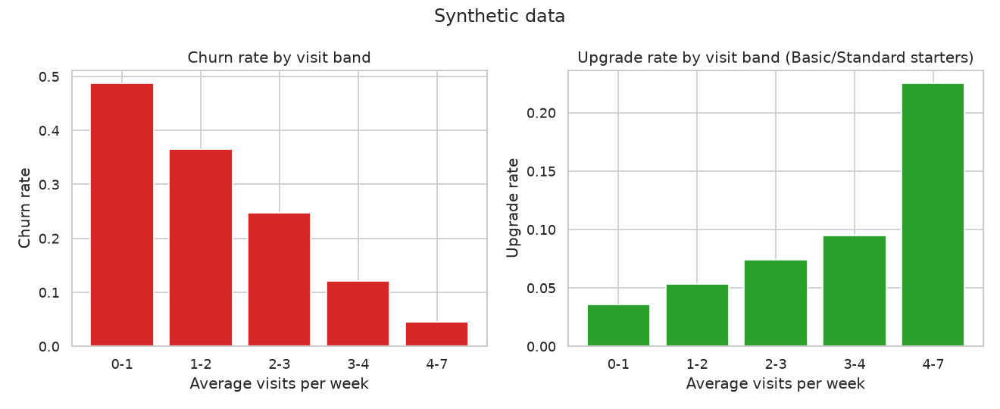
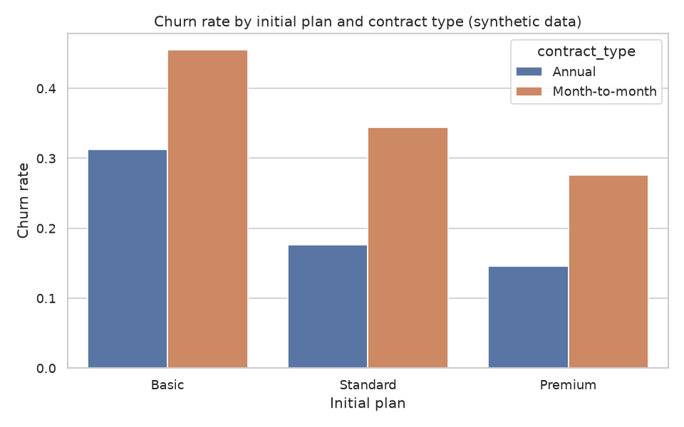
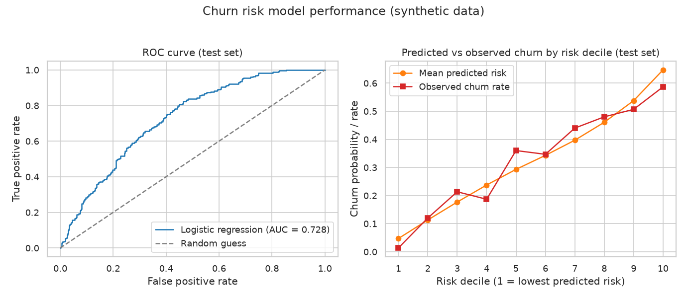

# Gym Membership Analysis

Visit frequency, membership upgrades and churn risk scoring on a **synthetic** gym dataset.

## Business question

Which members are most likely to cancel their membership, and which visit and plan patterns are linked to upgrading to a higher plan?

## Goal

- Describe how visit frequency differs across plans and between churned and active members.
- Identify the behaviours that precede a plan upgrade.
- Build an interpretable churn risk score so the retention team can prioritise outreach.

## Plan of the work

1. **Data generation** – create a reproducible synthetic dataset (`src/data_generator.py`).
2. **EDA** – distributions, missing values, visit frequency by plan, churn and upgrade rates by segment (`src/eda.py`).
3. **Analysis / model** – statistical tests on upgrade drivers and a churn risk model with a risk score per member (`src/analysis.py`, helpers in `src/utils.py`).
4. **SQL** – queries for churn rate by segment, upgrade funnel and at-risk member lists (`sql/queries.sql`, `src/run_sql.py`).
5. **Tests** – pytest checks of data generation and helper functions (`tests/`).

## Dataset (synthetic)

All data is generated by the project's own code with a fixed random seed (42). It does **not** describe real people or a real gym. Snapshot date: 2026-10-31.

| Table | Rows | Description |
|-------|------|-------------|
| `data/members.csv` | 3000 (18 columns) | One row per member: demographics, plan, behaviour, churn status |
| `data/upgrades.csv` | 173 (7 columns) | One row per plan upgrade event |

See `data_description.md` for every column.

## How to run

From the project root:

```bash
pip install -r requirements.txt
python src/data_generator.py
python src/eda.py
python src/analysis.py
python src/run_sql.py
python -m pytest -q
```

The CSV files are written to the `data/` folder, the charts to `figures/` and the metrics to `reports/`.

## Tests

Run all tests from the project root:

```bash
python -m pytest -q
```

The tests live in `tests/` and finish in a few seconds. They generate the synthetic data in memory with the project seed, so they do not need the CSV files, the charts or the reports.

| File | What it checks |
|------|----------------|
| `tests/test_data_generator.py` | Column names and row counts, unique IDs, value ranges (age, visits, distance, fees), churn dates present only for churned members and within the allowed window, upgrades consistent with the members table (plan path, fees, at least 60 days after sign-up) |
| `tests/test_utils.py` | `upgrade_eligible` rules, risk tier thresholds, classification metrics and the risk decile table on small hand-made examples, and the churn model pipeline (no leakage columns, valid probabilities, coefficient table, negative visits coefficient) |

## Exploratory data analysis

`src/eda.py` loads both CSV files and prints to the console:

- shape, dtypes and missing values of each table (an empty `churn_date` is expected for active members);
- descriptive statistics for numeric and categorical columns of `members`;
- five aggregations: visit frequency and churn by current plan, churned vs active behaviour, churn rate by initial plan and contract type, churn rate by visit-frequency band, and upgrade rate by initial plan and visit band.

It also saves four charts to `figures/`:

| File | Content |
|------|---------|
| `visits_by_churn_status.png` | Distribution of weekly visits, active vs churned |
| `visits_by_plan.png` | Visit frequency by current plan |
| `churn_upgrade_by_visit_band.png` | Churn and upgrade rates by visit band |
| `churn_by_plan_contract.png` | Churn rate by initial plan and contract type |

## Method

`src/analysis.py` has two parts. Reusable logic (feature preparation, model construction, metric functions, risk tiers, eligibility rules) lives in `src/utils.py`.

### 1. Churn risk model

- **Target:** `is_churned`.
- **Features:** weekly visits, days since last visit, distance to the gym, age, personal trainer and group class flags, initial plan, contract type and payment method.
- **Excluded to avoid leakage:** `tenure_months` and `churn_date` (derived from the outcome), and `current_plan` / `monthly_fee` (affected by upgrades).
- **Model:** logistic regression, chosen because its coefficients are easy to explain to a retention team. Numeric features are standardised and categorical features are one-hot encoded (first level is the reference).
- **Evaluation:** stratified 75/25 train/test split with `random_state=42`; 5-fold cross-validated ROC AUC on the training set; test-set ROC AUC, average precision, accuracy, precision, recall, F1 (threshold 0.5) and Brier score. A single-feature baseline (fewer visits = higher risk) is reported for comparison, and a calibration table shows observed churn per predicted risk decile.
- **Risk score:** the predicted churn probability for each active member, grouped into Low (< 0.25), Medium (0.25 to 0.50) and High (>= 0.50) tiers. The 50 highest-risk active members are saved to `reports/at_risk_members.csv`.

### 2. Upgrade drivers

- **Population:** members who did not start on Premium and had at least 90 days of membership (the same rule the generator uses for eligibility).
- **Tests:** Mann-Whitney U test for visits of upgraders vs non-upgraders; chi-square tests of independence for personal trainer, group classes, contract type and initial plan.
- **Model:** multivariable logistic regression (statsmodels) reporting odds ratios with 95% confidence intervals.

### Outputs

| File | Content |
|------|---------|
| `figures/churn_model_performance.png` | ROC curve and predicted vs observed churn by risk decile (test set) |
| `figures/churn_model_coefficients.png` | Churn model coefficients (log-odds) |
| `reports/metrics.json` | All metrics, coefficients, test results and risk tier counts |
| `reports/at_risk_members.csv` | Top 50 active members by churn risk |

All numbers are produced by running the script; see the console output and `reports/metrics.json` for the actual values.

## SQL analysis

`sql/queries.sql` contains eight queries in the SQLite dialect. Each query is preceded by a comment line of the form `-- Q<n>: question`.

| Query | Question |
|-------|----------|
| Q1 | Churn rate by initial plan and contract type |
| Q2 | Churn rate and days since last visit by visit-frequency band (CTE with `CASE`) |
| Q3 | Upgrade funnel: eligible vs upgraded members by initial plan (`LEFT JOIN`, date arithmetic with `julianday`) |
| Q4 | Upgrade paths with count and added monthly revenue |
| Q5 | Days from sign-up to upgrade and visit frequency by upgrade path (`JOIN`) |
| Q6 | Rule-based list of at-risk active members (low visits, long gap, month-to-month contract) |
| Q7 | Cities ranked by churn rate (window function `RANK`) |
| Q8 | Churn rate and visits by sign-up year cohort |

`src/run_sql.py` loads both CSV files into an in-memory SQLite database with `pandas.to_sql`, splits `queries.sql` into statements, runs each one and prints the description and the first 10 rows of the result. Nothing is written to disk. The at-risk list in Q6 is a simple business rule, not the model score; the model-based list is `reports/at_risk_members.csv`.

## Results

All numbers below come from the program output of the scripts in this project, run on the synthetic dataset (seed 42). They describe the generated data, not a real gym.

### Dataset overview

- 3000 members, of which 978 churned and 2022 are still active.
- 173 upgrade events: 139 Basic to Standard and 34 Standard to Premium (SQL Q4).

### Visit behaviour and churn (EDA)

- Churned members visited less: mean 1.35 visits per week vs 2.17 for active members. Their mean days since last visit was 3.84 vs 2.19.
- Churn rate falls as visit frequency rises: 0.487 in the 0-1 visits band, 0.365 (1-2), 0.247 (2-3), 0.121 (3-4) and 0.045 (4-7).
- Churn rate by current plan: Basic 0.412, Standard 0.277, Premium 0.218.
- Month-to-month contracts churn more than annual ones in every initial plan. For example, Basic: 0.456 vs 0.312; Premium: 0.276 vs 0.146.





### Churn risk model (logistic regression)

| Metric | Value |
|--------|-------|
| Train / test rows | 2250 / 750 |
| Cross-validated ROC AUC (5-fold, train) | 0.731 (std 0.043) |
| Test ROC AUC | 0.728 |
| Baseline ROC AUC (visits only) | 0.671 |
| Test average precision | 0.514 |
| Test accuracy (threshold 0.5) | 0.695 |
| Test precision / recall / F1 (threshold 0.5) | 0.550 / 0.336 / 0.417 |
| Test Brier score | 0.190 |

- Largest coefficients (odds ratios): month-to-month contract 2.448, weekly visits 0.450 (per standardised unit), initial plan Premium 0.546 and initial plan Standard 0.590 (vs Basic).
- Calibration on the test set: the lowest-risk decile had 0.013 observed churn (mean predicted 0.047) and the highest-risk decile 0.587 (mean predicted 0.647).
- Risk tiers for the 2022 active members: High 254, Medium 782, Low 986.



### Upgrade drivers

- Eligible members (not Premium at sign-up, at least 90 days of membership): 2374. Upgrade rate: 0.073.
- Mean visits per week: 2.75 for upgraders vs 1.82 for non-upgraders (Mann-Whitney U p = 3.864e-13).
- Upgrade rate by initial plan: Basic 0.102, Standard 0.034 (chi-square p = 3.214e-10; SQL Q3 gives the same counts: 139 of 1360 and 34 of 1014).
- No evidence of association with personal trainer (p = 0.874), group classes (p = 0.9023) or contract type (p = 0.5831).
- Multivariable model odds ratios (95% CI): weekly visits 1.588 (1.430 to 1.763); initial plan Standard vs Basic 0.266 (0.177 to 0.399). Personal trainer, group classes and month-to-month contract have confidence intervals that include 1.
- Average days from sign-up to upgrade: 383 for Basic to Standard and 361 for Standard to Premium (SQL Q5). The added monthly revenue is 2780.0 and 1020.0 respectively (SQL Q4).

## Conclusions

- In this synthetic data, lower visit frequency goes together with higher churn: the churn rate drops from 0.487 in the lowest visit band to 0.045 in the highest, and churned members visited less (1.35 vs 2.17 per week).
- Month-to-month contracts are the strongest churn factor in the model (odds ratio 2.448), and starting on a higher plan is associated with lower churn (odds ratios 0.590 for Standard and 0.546 for Premium vs Basic).
- The logistic regression ranks members reasonably (test ROC AUC 0.728, above the visits-only baseline of 0.671), and observed churn rises across predicted risk deciles from 0.013 to 0.587. At the 0.5 threshold it finds only about a third of churners (recall 0.336), so the tiers are better used for ranking outreach than for a hard yes/no decision.
- Members who upgrade visit more (2.75 vs 1.82 per week), and each additional weekly visit is associated with higher odds of upgrading (odds ratio 1.588). Basic starters upgraded more often than Standard starters (0.102 vs 0.034).
- Personal trainer, group classes and contract type show no detectable association with upgrading in this dataset.
- These are associations in generated data. They show that the analysis pipeline works, not what drives behaviour at a real gym.

## Limitations & next steps

**Limitations**

- The data is synthetic, so the patterns reflect the rules written into the generator, not real member behaviour. Results show that the method works, not what a real gym would see.
- `avg_visits_per_week` and `days_since_last_visit` are measured at the end of membership (or at the snapshot), so for churned members they describe the period right before cancelling. The model describes association, not a validated early-warning signal.
- Upgrade associations are not causal: visit frequency is not measured specifically before the upgrade date.
- The risk score for active members is computed with a model trained on the training split, so members in the training split are scored in-sample.
- Recall at the 0.5 threshold is low (0.336), and cross-validated AUC varies between folds (std 0.043).
- Some EDA tables use slightly different group definitions than the analysis and SQL (for example, the EDA upgrade table counts 1456 + 1077 eligible members, while the analysis and SQL Q3 use 2374), so numbers across scripts are not always directly comparable.

**Next steps**

- Align the eligibility rule and the visit-band edges across `eda.py`, `analysis.py` and the SQL queries.
- Choose a decision threshold from outreach cost and capacity, and compare with a tree-based model.
- Generate visit data over time (for example monthly visits before cancelling or upgrading) to test real early-warning signals.
- Validate the approach on real, anonymised membership data before any business use.

---

*This is a training project that uses synthetic data generated by AI.*
