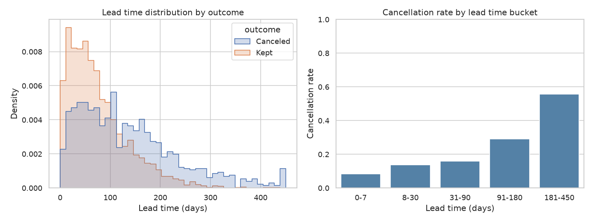
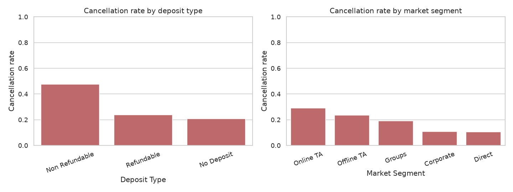
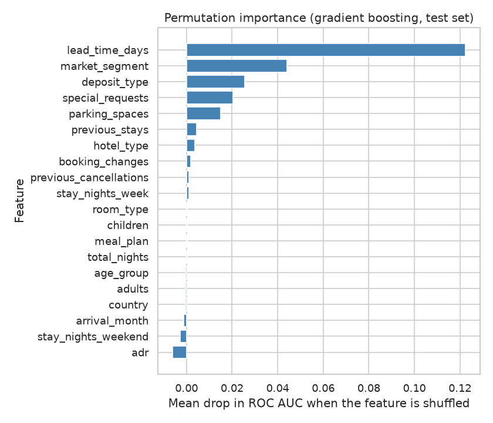

# Hotel Booking Cancellations

Cancellation drivers and a gradient boosting classifier, built on a synthetic hotel bookings dataset.

## Business question

Which booking characteristics make a reservation more likely to be canceled, and can we predict cancellations early enough for the hotel to act (for example by overbooking carefully, requesting deposits, or contacting risky guests)?

## Goal

1. Quantify the main drivers of cancellations (lead time, deposit type, market segment, guest history, special requests, and so on).
2. Train a gradient boosting classifier that predicts `is_canceled` and evaluate it with appropriate metrics.
3. Turn the findings into practical recommendations for revenue management.

## Plan of the work

1. **Data generation** (`src/data_generator.py`): create the synthetic tables with a fixed seed.
2. **EDA** (`src/eda.py`): data quality checks, distributions, cancellation rate by segment, lead time, deposit type, season, and so on.
3. **Analysis / model** (`src/analysis.py`, `src/utils.py`): baseline logistic regression and a gradient boosting classifier, with a train/test split, cross-validation, feature importance and error analysis.
4. **SQL** (`sql/queries.sql`, `src/run_sql.py`): analytical queries (cancellation rate by deposit, segment, lead time, month, country, guest history).
5. **Tests** (`tests/`): `pytest` checks for the data generator and for the helper functions in `src/utils.py`.

## Dataset (synthetic)

All data is **synthetic**. It is generated by `src/data_generator.py` with numpy (seed 42) and does not come from any real hotel. Cancellation behavior is produced by a hand-designed probabilistic model, so any patterns found reflect that design and not real-world guest behavior.

Tables saved to `data/`:

- `guests.csv`: one row per guest (3,500 rows): country, age group, previous stays and cancellations.
- `bookings.csv`: one row per booking (5,000 rows): hotel, dates, stay length, party, price, deposit, requests and the target `is_canceled`.

See `data_description.md` for every column.

Because the seed is fixed, running the generator again produces the same two CSV files.

## Exploratory data analysis

`src/eda.py` loads both CSV files from `data/` and:

- prints data quality checks for each table: shape, dtypes, missing values, duplicate rows, and whether every booking links to a known guest;
- prints descriptive statistics for the numeric columns and the overall cancellation rate;
- prints five aggregations of the cancellation rate: by deposit type, market segment, lead time bucket, hotel type combined with number of special requests, and number of earlier cancellations by the guest;
- saves three charts to `figures/`:
  - `lead_time_vs_cancellation.png`: lead time distribution by outcome and cancellation rate by lead time bucket;
  - `cancellation_by_deposit_and_segment.png`: cancellation rate by deposit type and by market segment;
  - `monthly_bookings_and_cancellations.png`: booking volume and cancellation rate by arrival month.

All figures and tables come from the synthetic data, so the patterns reflect the simulator's design and not real guest behavior. Run the script to see the actual numbers.

## Method

`src/analysis.py` (with reusable helpers in `src/utils.py`) does the following:

1. **Data preparation.** Bookings are joined to guest history on `guest_id`, and `total_nights` is derived. Identifiers (`booking_id`, `guest_id`) and the raw `arrival_date` are not used as predictors. All remaining columns are information that would be known at booking time: 13 numeric and 7 categorical features.
2. **Split.** A stratified 80/20 train/test split with `random_state=42`. The test set is used only for the final evaluation, permutation importance and error analysis.
3. **Models.**
   - Baseline: logistic regression with standardized numeric features and one-hot encoded categoricals.
   - Main model: scikit-learn `HistGradientBoostingClassifier` (a gradient boosting classifier) with modest depth and L2 regularization, on one-hot encoded categoricals.
4. **Cross-validation.** Stratified 5-fold cross-validation on the training set only, scored by ROC AUC.
5. **Test metrics.** Accuracy, precision, recall, F1 (at a 0.5 threshold), ROC AUC, average precision, Brier score and the confusion matrix. Because cancellations are the class of interest, precision and recall are reported alongside accuracy.
6. **Lift.** Cancellation rate among the 10% of test bookings with the highest predicted risk, compared with the overall test rate. This shows how useful the model is for targeting actions at a limited number of bookings.
7. **Drivers.** Permutation importance on the test set (drop in ROC AUC when one feature is shuffled), computed on the raw features so one-hot columns of the same variable are grouped.
8. **Error analysis.** Misclassification, false positive and false negative shares by deposit type and lead time bucket.

Outputs:

- `reports/metrics.json`: cross-validation scores, test metrics, lift and permutation importances for both models.
- `figures/roc_curves.png`: ROC curves of both models on the test set.
- `figures/feature_importance.png`: permutation importance of the gradient boosting model.

The script prints every metric with a label. The key numbers are summarized in the Results section below, and all of them come from the program output. Since the labels come from a hand-designed logistic model, a well-fitted model is expected to recover that structure, and the scores say nothing about how well such a model would work on real hotel data. The strong effect given to non-refundable bookings is a simulator design choice, so any recommendation about deposits should be validated on real data before use.

## SQL analysis

`sql/queries.sql` holds eight commented queries in the SQLite dialect. Each query is preceded by a `-- Q<n>:` comment line that states the question. They cover:

- Q1: overall cancellation rate;
- Q2: cancellation rate by deposit type;
- Q3: market segment by hotel type;
- Q4: lead time buckets (`CASE` expression);
- Q5: guest cancellation history (join of `bookings` and `guests`);
- Q6: arrival month;
- Q7: guest country, with a common table expression (CTE) and a minimum of 100 bookings;
- Q8: ranking of deposit types within each hotel type (window function).

`src/run_sql.py` loads `data/guests.csv` and `data/bookings.csv` into an in-memory SQLite database (tables `guests` and `bookings`, created with `pandas.to_sql`), splits `queries.sql` into statements, runs each one and prints its description and the first rows of the result. Nothing is written to disk. The queries are written so that comments contain no semicolons, because the runner splits statements on that character.

The SQL results come from the same synthetic data as the rest of the project, so they show the simulator's design and not real guest behavior. The SQL output matches the EDA aggregations (for example the same deposit type, lead time bucket and guest history rates).

## Results

All numbers below are copied from the output of the scripts and from `reports/metrics.json`. The data is synthetic, so they describe the simulator and not real guests.

### Cancellation rates (EDA and SQL)

Overall: 1,169 of 5,000 bookings were canceled (**23.4%**).

| Deposit type | Bookings | Cancel rate |
|---|---:|---:|
| No Deposit | 4,395 | 0.206 |
| Refundable | 93 | 0.237 |
| Non Refundable | 512 | 0.475 |

| Lead time bucket (days) | Bookings | Cancel rate |
|---|---:|---:|
| 0-7 | 178 | 0.084 |
| 8-30 | 890 | 0.137 |
| 31-90 | 2,001 | 0.160 |
| 91-180 | 1,359 | 0.290 |
| 181-450 | 572 | 0.556 |

| Market segment | Bookings | Cancel rate |
|---|---:|---:|
| Online TA | 2,489 | 0.290 |
| Offline TA | 1,057 | 0.235 |
| Groups | 514 | 0.191 |
| Corporate | 355 | 0.107 |
| Direct | 585 | 0.106 |

Other patterns from the aggregations:

- Special requests: for City Hotel the rate falls from 0.299 (0 requests) to 0.125 (4 requests). For Resort Hotel it falls from 0.247 to 0.100.
- Guest history: 0.233 for guests with no previous cancellations, 0.242 with 1, and 0.412 with 2+ (only 17 bookings).
- Arrival month: monthly rates range between 0.197 (May) and 0.269 (July) among the months shown in the SQL output (Q6 shows ten of twelve months).
- Country: rates range from 0.214 (Netherlands) to 0.263 (Spain) among countries with at least 100 bookings.





### Models (4,000 training rows, 1,000 test rows)

5-fold cross-validation on the training set (ROC AUC):

| Model | Mean | Std |
|---|---:|---:|
| Logistic regression | 0.786 | 0.012 |
| Gradient boosting | 0.780 | 0.018 |

Test set metrics (threshold 0.50):

| Metric | Logistic regression | Gradient boosting |
|---|---:|---:|
| Accuracy | 0.787 | 0.785 |
| Precision | 0.596 | 0.594 |
| Recall | 0.278 | 0.256 |
| F1 | 0.379 | 0.358 |
| ROC AUC | 0.751 | 0.742 |
| Average precision | 0.517 | 0.508 |
| Brier score | 0.151 | 0.152 |
| Confusion matrix (TN / FP / FN / TP) | 722 / 44 / 169 / 65 | 725 / 41 / 174 / 60 |

Lift in the highest-risk 10% of test bookings (100 bookings): the cancellation rate is 0.590 versus a base rate of 0.234, a lift of 2.52, for both models.

Permutation importance of the gradient boosting model (drop in ROC AUC), top five: `lead_time_days` 0.1225, `market_segment` 0.0441, `deposit_type` 0.0256, `special_requests` 0.0205, `parking_spaces` 0.0151. `adr` (-0.0062), `stay_nights_weekend` (-0.0028) and `arrival_month` (-0.0011) have negative values.



Error analysis (gradient boosting, test set):

- By deposit type, the error rate is 0.198 for No Deposit (885 bookings), 0.362 for Non Refundable (94) and 0.286 for Refundable (21).
- By lead time bucket, the error rate is 0.068 for 0-7 days, 0.154 for 31-90, 0.167 for 8-30, 0.307 for 91-180 and 0.343 for 181-450.
- The false positive rate is 0.170 for Non Refundable bookings and 0.206 for the 181-450 day bucket, versus 0.027 for No Deposit.

## Conclusions

These conclusions are supported by the numbers above and apply to the synthetic data only.

- **Lead time is the strongest signal.** The cancellation rate rises from 0.084 (0-7 days) to 0.556 (181-450 days), and lead time has by far the largest permutation importance (0.1225, almost three times the next feature).
- **Deposit type and market segment matter.** Non Refundable bookings cancel at 0.475 versus 0.206 for No Deposit, and Online TA bookings cancel at 0.290 versus about 0.106 for Corporate and Direct. Both rank in the top three features by permutation importance.
- **More special requests go with fewer cancellations** in both hotel types.
- **Guest history shows little effect in this data.** The rate is 0.233 versus 0.242 for 0 and 1 previous cancellations. The 2+ group (0.412) has only 17 bookings, which is too few to draw a firm conclusion.
- **Gradient boosting did not beat the logistic regression baseline.** Cross-validated ROC AUC is 0.780 versus 0.786, and test ROC AUC is 0.742 versus 0.751. The differences are small compared with the fold standard deviations (0.018 and 0.012), so the two models perform about the same here.
- **The model ranks risk moderately well but misses many cancellations at the default threshold.** Recall is only 0.256 (gradient boosting) at precision 0.594, so 174 of 234 test cancellations are missed. However, the top 10% of bookings by predicted risk cancel at 0.590, a lift of 2.52, so the scores are more useful for prioritizing a limited number of bookings than for a hard yes/no decision.
- **Errors concentrate in long lead times and non-refundable bookings.** The error rate is highest for the 181-450 day bucket (0.343) and for Non Refundable bookings (0.362), where many predicted cancellations do not happen (false positive rates 0.206 and 0.170).
- **Several features add no measurable value.** `adr`, `stay_nights_weekend` and `arrival_month` have negative permutation importance, meaning shuffling them did not reduce the test ROC AUC.

## Limitations & next steps

**Limitations**

- **The data is synthetic.** It comes from a hand-designed probabilistic model written for this project. The patterns, including the strong non-refundable effect and the lead time effect, are simulator design choices. They are not evidence about real guests, and the model scores say nothing about performance on real hotel data.
- Some groups are small (17 bookings with 2+ previous cancellations, 21 Refundable bookings in the test set), so their rates are unstable.
- The evaluation uses a single stratified split with a fixed seed and a default 0.5 threshold. Hyperparameters of the gradient boosting model were not tuned, and no probability calibration was performed beyond reporting the Brier score.
- Permutation importance on correlated features can understate their effect, and negative values are partly noise.
- The data has no time ordering that supports out-of-time validation, which is how a real deployment would be tested.

**Next steps**

- Choose the decision threshold from the costs of a missed cancellation versus an unnecessary action, instead of using 0.5, and compare precision and recall at several thresholds.
- Tune the gradient boosting hyperparameters with cross-validation and test whether it can match or beat the logistic baseline, for example with interaction features.
- Check probability calibration (reliability curve) before using scores for overbooking decisions.
- Try the same pipeline on a real, anonymized bookings dataset with a time-based split, and only then validate deposit-related recommendations.
- Add a small cost-benefit simulation of targeting the top 10% of risky bookings with a deposit request or a confirmation call.

## Tests

The `tests/` folder contains `pytest` tests that run in a few seconds (15 tests passed in the last run):

- `tests/test_data_generator.py`: column names, row counts, value ranges, valid links between bookings and guests, reproducibility with a fixed seed, and input validation of the generator.
- `tests/test_utils.py`: the helpers in `src/utils.py` (dataset building, feature split, classification metrics, top-fraction lift, error analysis by group) and a quick fit of both model pipelines on a small synthetic sample.

The tests generate their own small synthetic samples in memory. They do not need the files in `data/` and do not depend on figures or reports. Each test file adds `src/` to `sys.path`, so the tests can be run from the project root.

## How to run

**Requirements:** Python 3.11 and the packages listed in `requirements.txt`.

From the project root:

```bash
pip install -r requirements.txt
python src/data_generator.py
python src/eda.py
python src/analysis.py
python src/run_sql.py
python -m pytest -q
```

The first script creates the `data/` folder with `guests.csv` and `bookings.csv`. The second prints the EDA output and creates the `figures/` folder with the charts. The third trains and evaluates the models, prints the metrics, adds two charts to `figures/` and writes `reports/metrics.json`. The fourth runs the SQL queries and prints their results. The last command runs the test suite. All scripts run without user input and do not open any windows, so they can also be run in a headless environment or a CI job.

The `data/`, `figures/` and `reports/` folders are generated outputs. If you delete them, run `python src/data_generator.py` again before the other scripts (the tests do not need them). Later steps will add further scripts in `src/`, all runnable as `python src/<name>.py`.

---

*This is a training project that uses synthetic data generated by AI.*
