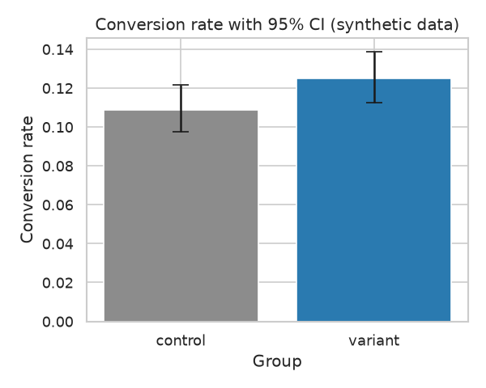
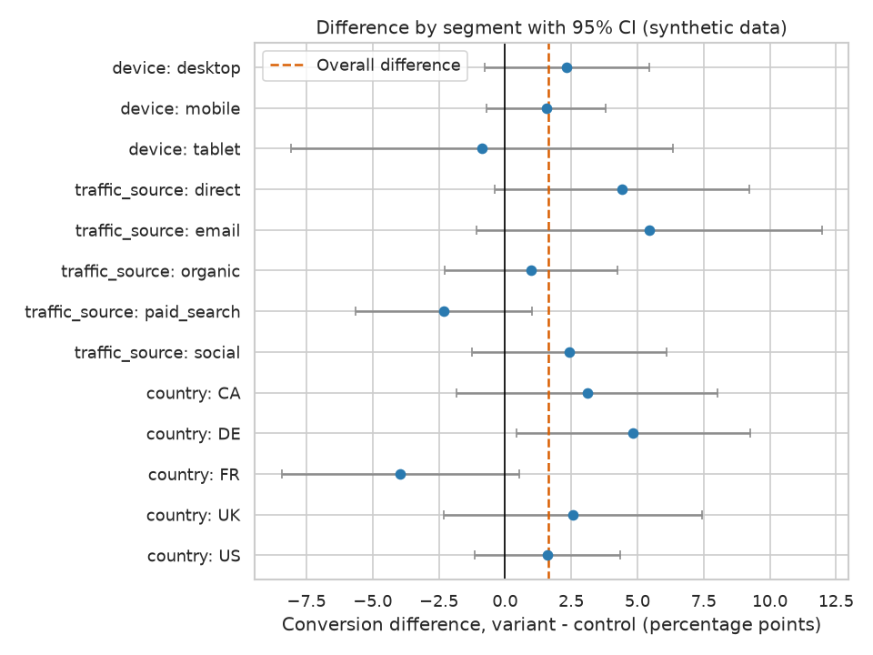
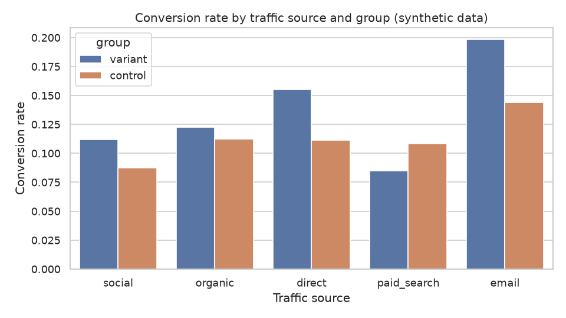

# Marketing A/B Test Analysis

Statistical analysis of a landing page A/B test: conversion, significance, power.

> **Note:** all data in this project is **synthetic**. It is generated by `src/data_generator.py` with a fixed random seed and does not describe real users or a real company.

## Business question

Does the redesigned landing page (variant) convert visitors into buyers better than the current page (control), and is the observed difference large enough, and measured precisely enough, to justify rolling out the new page?

## Goal

- Estimate the conversion rate of each group and the uplift of the variant over control.
- Test whether the difference is statistically significant and quantify it with confidence intervals.
- Check the experiment's statistical power and the sample size that would be needed to detect a given effect.
- Look at secondary metrics (revenue per visitor, average order value) and segment differences (device, traffic source, country).

## Plan of the work

1. **Data generation**: build a synthetic dataset of landing page visitors and their orders (`src/data_generator.py`).
2. **EDA**: data quality checks, group balance (sample ratio), distributions of features and metrics (`src/eda.py`).
3. **Analysis / model**: two-proportion z-test, chi-square test, confidence intervals, effect size, power and sample size analysis, a logistic regression adjusting for covariates, and segment breakdowns (`src/analysis.py`, helpers in `src/utils.py`).
4. **SQL**: queries that reproduce the key metrics (conversion by group, revenue per visitor, segment breakdowns) from the CSV tables (`sql/queries.sql`, `src/run_sql.py`).
5. **Tests**: pytest tests for the data generator and the analysis functions (`tests/`).

## Dataset (synthetic)

Two CSV tables are written to `data/`:

| Table | Grain | Rows |
|-------|-------|------|
| `users.csv` | one row per visitor in the experiment | 5000 |
| `orders.csv` | one row per order (converted visitors only) | 584 in the generated run |

See `data_description.md` for every column, its type, meaning and value range.

## How to run

From the project root:

```bash
pip install -r requirements.txt
python src/data_generator.py
python src/eda.py
python src/analysis.py
python src/run_sql.py
python -m pytest -q
```

`data_generator.py` creates `data/users.csv` and `data/orders.csv`. `eda.py`, `analysis.py` and `run_sql.py` read them and must be run after the generator. `analysis.py` writes charts to `figures/` and a metrics summary to `reports/metrics.json`.

## Exploratory data analysis

`src/eda.py` loads both CSV tables and prints to the console:

- shape, dtypes, missing values and duplicate rows for each table;
- integrity checks (unique IDs, converted users match users with orders);
- descriptive statistics for numeric columns;
- aggregations: group balance (sample ratio), conversion rate by group, revenue per visitor and average order value by group, covariate balance between groups (device, traffic source, country, engagement), and conversion rate by device and traffic source for each group.

It also saves four PNG charts to `figures/` (created automatically):

- `conversion_by_group.png`: conversion rate by group;
- `conversion_by_source.png`: conversion rate by traffic source and group;
- `order_value_distribution.png`: order value distribution by group (buyers only);
- `daily_visitors.png`: daily visitors by group.

All numbers come from the script's output at run time; nothing in this EDA is a statement about real users, since the data is synthetic.

## Method

`src/analysis.py` answers the business question with the following steps. The statistical functions live in `src/utils.py` so they can be unit tested.

1. **Sample ratio check**: chi-square goodness-of-fit test of the group sizes against the intended 50/50 split, to detect broken randomization.
2. **Conversion comparison**: conversion rate per group with Wilson 95% confidence intervals; absolute difference (percentage points) with a Wald 95% CI; relative uplift with a log risk-ratio CI; a pooled two-proportion z-test and a chi-square test of independence (equivalent without continuity correction); Cohen's h as the effect size. Significance is judged at alpha = 0.05.
3. **Power and sample size**: the minimum detectable conversion rate at 80% power for the realized group size, the post-hoc power at the observed effect (shown for information only, since it merely restates the p-value), and the visitors per group required to detect relative lifts of 5%, 10%, 15% and 20% over the control baseline.
4. **Secondary metrics**: revenue per visitor (non-buyers count as 0) compared with Welch's t-test and a percentile bootstrap CI of the difference (seed 42); average order value among buyers is reported descriptively.
5. **Adjusted estimate**: a logistic regression of conversion on the variant flag plus device, traffic source, country, returning status, page views and time on page, reported as the variant odds ratio with a 95% CI.
6. **Segment breakdowns**: the variant-vs-control difference within each device, traffic source and country, with Holm-adjusted p-values. These are exploratory because each segment has fewer visitors and therefore lower power.

Because this is a randomized experiment analysed with inferential statistics rather than a predictive model, no train/test split is used.

### Outputs

- Console report with labelled results for each step.
- `figures/analysis_conversion_ci.png`: conversion rate per group with 95% confidence intervals.
- `figures/analysis_segment_differences.png`: forest plot of the conversion difference by segment.
- `reports/metrics.json`: all key metrics (conversion, tests, power, revenue, regression, segments).

## Results

All numbers below are copied from the output of `python src/analysis.py` and `python src/eda.py` on the synthetic dataset (5000 visitors, 584 orders).

### Conversion

| Group | Visitors | Buyers | Conversion rate | 95% CI (Wilson) |
|-------|----------|--------|-----------------|-----------------|
| Control | 2545 | 277 | 0.1088 | 0.0973 to 0.1215 |
| Variant | 2455 | 307 | 0.1251 | 0.1125 to 0.1387 |

- Absolute difference: 1.62 pp (95% CI -0.16 to 3.40 pp).
- Relative uplift: 14.9% (95% CI -1.4% to 33.8%).
- Two-proportion z-test: z = 1.784, p-value = 0.0744. Chi-square test: chi2 = 3.183, p-value = 0.0744.
- Cohen's h: 0.0505.
- Verdict at alpha = 0.05: the difference is **not** statistically significant.
- Sample ratio check: group sizes are 2545 vs 2455, SRM p-value = 0.2031, so no sign of broken randomization.



### Power and sample size

- Minimum detectable variant rate at 80% power with n = 2455 per group: 0.1350 (absolute lift 2.61 pp, relative 24.0%).
- Post-hoc power at the observed effect: 0.430 (informational only; it restates the p-value).

| Relative lift over control | Required visitors per group (80% power, alpha = 0.05) |
|----------------------------|-------------------------------------------------------|
| 5% | 52529 |
| 10% | 13407 |
| 15% | 6078 |
| 20% | 3485 |

### Secondary metrics

- Revenue per visitor: control 9.50, variant 10.39; difference 0.89 (bootstrap 95% CI -1.06 to 2.76); Welch t-test t = 0.888, p-value = 0.3743.
- Average order value (buyers only): control 87.32, variant 83.09.
- Adjusted logistic regression: variant odds ratio 1.157 (95% CI 0.973 to 1.377), p-value = 0.0992.

### Segments (exploratory)

Segment differences in conversion (variant minus control) range from -3.94 pp (country: FR) to +5.45 pp (traffic source: email). After Holm adjustment, no segment has a p-value below 0.05 (the smallest is 0.3 or higher in the output: country: DE has p = 0.0315 unadjusted and p_holm = 0.4097).





## Conclusions

- The variant has a higher observed conversion rate (0.1251 vs 0.1088), but the difference is not statistically significant at alpha = 0.05 (p = 0.0744), and the 95% CI of the difference (-0.16 to 3.40 pp) includes zero.
- The adjusted logistic regression points the same way as the raw test: odds ratio 1.157 with a CI (0.973 to 1.377) that includes 1.
- Revenue per visitor is higher for the variant (10.39 vs 9.50), but the difference is also not significant (p = 0.3743). Average order value is lower for the variant (83.09 vs 87.32), though this was only described, not tested.
- The experiment was underpowered for an effect of this size: the minimum detectable relative lift at 80% power is 24.0%, while the observed lift is 14.9%. Post-hoc power is 0.430.
- No segment shows a significant difference after Holm adjustment, so the data gives no support for claims that the variant works better or worse in a particular device, source or country.
- Based on these numbers alone, the data does not allow a conclusion that the new page is better. The result is inconclusive rather than evidence of no effect.

## Limitations & next steps

### Limitations

- The data is **synthetic**, so conclusions describe the simulation, not real customer behavior.
- With 5000 visitors the experiment can only detect fairly large effects (about 24.0% relative lift at 80% power).
- Segment-level results are exploratory, have few visitors per segment and are subject to multiple-comparison noise.
- Only a single test period was analysed (14 days of visits in the SQL output), so novelty effects or weekday patterns are not assessed.

### Next steps

- Plan a larger experiment: for example about 6078 visitors per group to detect a 15% relative lift, or 3485 per group for 20%, at 80% power.
- Define the primary metric and the minimum effect worth acting on before the test starts.
- Test the average order value difference formally, and consider revenue per visitor as a primary metric if it matters to the business.
- Treat the segment patterns (for example paid search being negative and email being positive) as hypotheses to confirm in a new test, not as findings.

## SQL analysis

`sql/queries.sql` contains 8 commented queries in the SQLite dialect. Each query is preceded by a comment line starting with `-- Q<n>:` that states the question it answers.

| Query | Question |
|-------|----------|
| Q1 | Visitors, buyers and conversion rate by group |
| Q2 | Revenue per visitor and average order value by group (`LEFT JOIN` of users and orders) |
| Q3 | Conversion by device and group, with the difference in percentage points |
| Q4 | Conversion by traffic source and group, sorted by the difference |
| Q5 | Country mix within each group (covariate balance check, subquery join) |
| Q6 | Daily visitors, buyers and conversion rate |
| Q7 | Orders and order value by number of items and group |
| Q8 | Days between visit and order by group (`julianday`) |

`src/run_sql.py` loads both CSV files into an in-memory SQLite database with `pandas.to_sql`, splits `queries.sql` into statements, runs each one and prints the question followed by the first rows of the result (at most 10). It uses only the standard library `sqlite3` module plus pandas, needs no database server and writes no files.

```bash
python src/run_sql.py
```

Notes:

- The queries only describe the data (descriptive metrics); significance tests and confidence intervals are in `src/analysis.py`.
- `queries.sql` is split on the semicolon character, so comments and strings in it must not contain semicolons.
- All numbers come from the output at run time, and the data is synthetic.

## Tests

The `tests/` folder contains pytest tests that run in a few seconds:

- `tests/test_data_generator.py`: columns, row counts, value ranges, consistency between users and orders, and reproducibility with a fixed seed.
- `tests/test_utils.py`: the statistical helpers in `src/utils.py` (z-test vs chi-square, confidence intervals, power and sample size, revenue preparation, segment breakdown, Holm adjustment).

The tests generate small datasets in memory, so they do not need the CSV files, the figures or the other scripts to be run first. Run them from the project root:

```bash
python -m pytest -q
```

## Project structure

```
marketing-ab-test-analysis/
├── README.md
├── requirements.txt
├── data_description.md
├── data/            # generated CSV files
├── figures/         # PNG charts produced by src/eda.py and src/analysis.py
├── reports/         # metrics.json produced by src/analysis.py
├── src/             # Python scripts (data_generator, eda, analysis, utils, run_sql)
├── sql/             # SQL queries (queries.sql)
└── tests/           # pytest tests (test_data_generator.py, test_utils.py)
```

---

*This is a training project that uses synthetic data generated by AI.*
