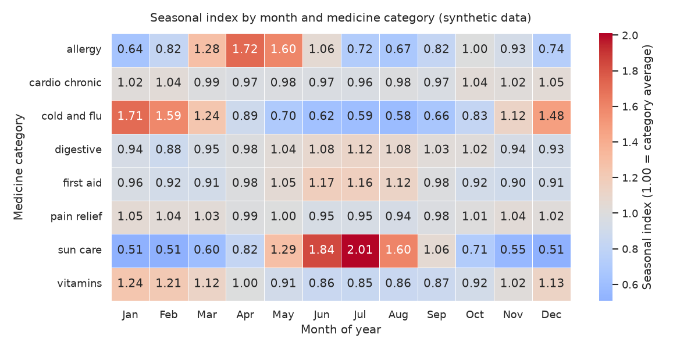
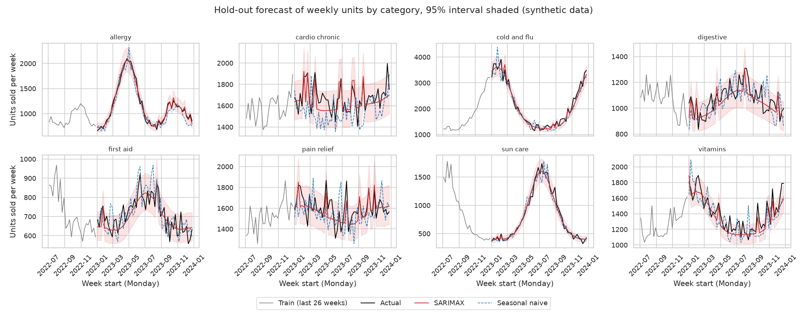
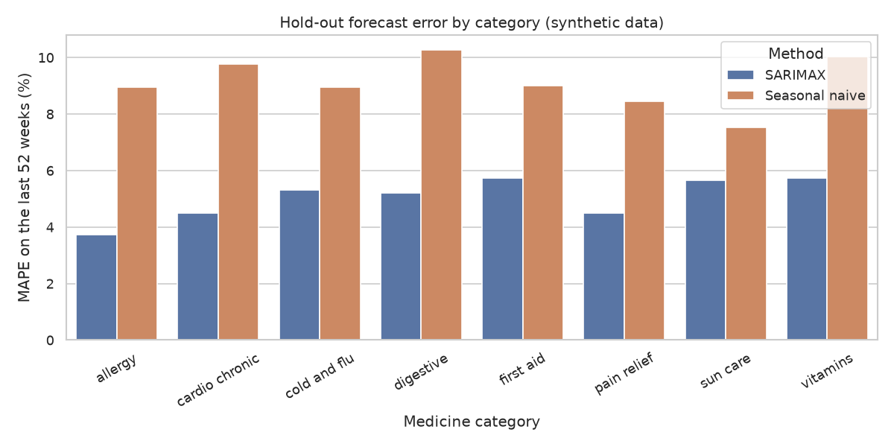

# Pharmacy Sales Seasonality

Seasonal patterns of medicine categories and a forecast with SARIMAX.

> **Note:** All data in this project is **synthetic**. It is generated by `src/data_generator.py` with a fixed random seed. It does not describe any real pharmacy, chain or patient.

## Business question

Which medicine categories follow a strong seasonal pattern, and how far ahead can a pharmacy chain plan its stock and promotions if it forecasts weekly demand per category?

## Goal

- Quantify and compare the seasonality of several medicine categories (peak timing, amplitude).
- Build a weekly forecast of units sold per category with SARIMAX, using seasonality and exogenous drivers (promotions, temperature).
- Check forecast quality against a simple baseline on a hold-out period.

## Plan of the work

1. **Data generation** (`src/data_generator.py`): create synthetic weekly sales per category, plus a category reference table.
2. **EDA** (`src/eda.py`): data quality checks, trends, seasonal profiles by category, the effect of promotions and temperature.
3. **Analysis / model** (`src/analysis.py`, helpers in `src/utils.py`): seasonal decomposition, then SARIMAX per category, with a time-based train/test split and a naive seasonal baseline.
4. **SQL** (`sql/queries.sql`, `src/run_sql.py`): aggregation queries (monthly totals, seasonal index, year-over-year growth) run on an in-memory SQLite database.
5. **Tests** (`tests/`): pytest checks for the data generator and the helper functions.

## Dataset (synthetic)

Two CSV tables are written to `data/`:

| File | Rows | Description |
|------|------|-------------|
| `categories.csv` | 8 | Reference table: one row per medicine category. |
| `weekly_sales.csv` | 2080 | One row per week and category (260 weeks x 8 categories), starting 2019-01-07. |

Sales are built from a base level, a yearly trend, a category-specific seasonal curve, a promotion uplift and random noise. Full column descriptions are in [data_description.md](data_description.md).

## How to run

Install the dependencies (Python 3.11):

```bash
pip install -r requirements.txt
```

Run the steps from the project root, in this order:

```bash
python src/data_generator.py   # creates data/*.csv (seed 42, reproducible)
python src/eda.py              # data checks, aggregations, 3 charts in figures/
python src/analysis.py         # seasonality + SARIMAX forecast, charts, reports/metrics.json
python src/run_sql.py          # runs sql/queries.sql on an in-memory SQLite database
python -m pytest -q            # unit tests (data generator and helper functions)
```

## Tests

Run the tests from the project root:

```bash
python -m pytest -q
```

The tests live in `tests/` and add `src/` to `sys.path` themselves, so no installation step is needed. They are fast (a few seconds) and do not depend on the CSV files or figures:

- `tests/test_data_generator.py` generates the synthetic data in memory (seed 42) and checks column names, row counts (8 categories, 2080 sales rows, 260 weeks per category), key uniqueness, value ranges (non-negative units, positive prices, binary promo flag, temperature limits, revenue = units x price), consecutive Monday dates and reproducibility.
- `tests/test_utils.py` checks the helpers in `src/utils.py`: time-based split, seasonal naive baseline, forecast metrics, interval coverage, exogenous feature matrix, temperature climatology and the seasonal profile on a clean synthetic cycle.

The last run reported `13 passed`.

## Exploratory data analysis

`src/eda.py` loads both CSV files and:

- prints shape, dtypes, missing values and duplicate checks for each table, plus integrity checks on the sales table (key uniqueness, date range, weeks per category, non-negative units, positive prices, Monday week starts);
- prints descriptive statistics of the numeric columns;
- prints five aggregations: totals per category, yearly units per category, a monthly seasonal index, seasonality strength (peak month and peak-to-trough ratio) and the promo vs non-promo comparison, together with the correlation of units with temperature;
- saves three charts to `figures/`: `weekly_units_by_category.png`, `seasonal_index_heatmap.png` and `promo_and_temperature.png`.

The promo comparison in the EDA is a raw ratio mixed with seasonality, which is why the model below includes promotions as an exogenous variable.

## SQL analysis

`sql/queries.sql` holds seven commented queries in the SQLite dialect. Each query is preceded by a comment line of the form `-- Q<n>: question`. `src/run_sql.py` loads both CSV files into an in-memory SQLite database with `pandas.to_sql` (dates are stored as `YYYY-MM-DD` text), splits the file into statements, runs each of them and prints the question and the first rows of the result. No database file is created.

| Query | Question |
|-------|----------|
| Q1 | Total units, revenue and revenue rank per category (join with `categories`). |
| Q2 | Monthly totals and seasonal index for `cold_and_flu`. |
| Q3 | Peak month, trough month and peak-to-trough ratio of the monthly index for every category. |
| Q4 | Year-over-year growth of average weekly units per category (`LAG` window function). |
| Q5 | Promo uplift measured within the same category and month, which removes most of the seasonal effect. |
| Q6 | Average weekly units across temperature bands. |
| Q7 | Share of yearly revenue per category. |

The queries use window functions and CTEs, so they need SQLite 3.25 or newer (bundled with current Python 3.11 builds). Run `python src/run_sql.py` to see all results; selected numbers are quoted in the Results section below. As everywhere in this project, they describe synthetic data.

## Method

`src/analysis.py` works on each of the 8 categories separately.

**Split.** The split is time-based: the last 52 weeks are the hold-out test set and all earlier weeks (208) are used for training. A random split would leak future information into training, so no random split is used (the only random element is the data generator, seed 42).

**Seasonality measurement (training period).** The weekly series is log-transformed and decomposed additively (`statsmodels` `seasonal_decompose`, period 52). From the result the script reports:
- *strength*: `1 - Var(residual) / Var(seasonal + residual)`, floored at 0 (0 = no seasonality, 1 = fully seasonal);
- *peak-to-trough ratio*: highest over lowest seasonal factor;
- the calendar months with the highest and lowest seasonal component.

**Forecast model.** SARIMAX is fitted on `log(units_sold)`, so seasonal and promotion effects are multiplicative. A 52-period seasonal ARIMA is impractical on five years of weekly data, so the yearly cycle is modelled with Fourier terms (3 sin/cos harmonics) passed as exogenous regressors. The other regressors are the promotion flag, average temperature and a linear time term for the trend. The error process is ARMA(1,1). Forecasts are transformed back with `exp`; 95% prediction intervals are produced the same way.

**Realistic exogenous inputs.** Promotions are planned in advance, so the real promo flags are used for the hold-out period. Future temperature is not known, so the hold-out period uses the average temperature of the same ISO week in the training data (climatology) instead of the actual values.

**Baseline.** Seasonal naive: the forecast for each week is the value of the same week one year earlier (the last 52 training weeks repeated).

**Metrics.** MAE, RMSE and MAPE on the hold-out, per category and averaged over categories, plus the share of actual values inside the 95% interval. The estimated promotion uplift (from the model coefficient) is also printed per category.

## Outputs

Running `python src/analysis.py` prints the seasonality table, the accuracy table and a summary, and writes:

- `figures/forecast_vs_actual.png`: hold-out forecast, baseline and actuals for every category;
- `figures/forecast_error_comparison.png`: MAPE of SARIMAX vs the baseline per category;
- `reports/metrics.json`: settings, summary, seasonality and per-category metrics.

## Results

All numbers below are copied from the program output (`src/eda.py`, `src/analysis.py`, `src/run_sql.py` and `reports/metrics.json`) on the **synthetic** data (seed 42). They show how the method behaves on data with known patterns, not how a real pharmacy would perform.

### Seasonality by category

The raw monthly index from the EDA (1.00 = category average) gives this ranking by peak-to-trough ratio:

| Category | Peak month | Trough month | Peak-to-trough | Pattern |
|----------|-----------:|-------------:|---------------:|---------|
| sun_care | 7 | 1 | 3.96 | summer peak |
| cold_and_flu | 1 | 8 | 2.94 | winter peak |
| allergy | 4 | 1 | 2.70 | spring peak |
| vitamins | 1 | 7 | 1.45 | mild winter peak |
| first_aid | 6 | 11 | 1.30 | weak summer peak |
| digestive | 7 | 2 | 1.27 | weak summer peak |
| pain_relief | 1 | 8 | 1.11 | almost flat |
| cardio_chronic | 12 | 7 | 1.09 | flat with upward trend |

The decomposition of the training period (log scale, period 52) gives the seasonality strength (0 = none, 1 = fully seasonal):

| Category | Strength | Peak-to-trough (seasonal factor) | Peak month | Trough month |
|----------|---------:|---------------------------------:|-----------:|-------------:|
| sun_care | 0.985 | 4.61 | Jul | Dec |
| cold_and_flu | 0.979 | 3.24 | Jan | Aug |
| allergy | 0.963 | 3.05 | Apr | Jan |
| vitamins | 0.841 | 1.63 | Jan | Jul |
| first_aid | 0.691 | 1.39 | Jul | Nov |
| digestive | 0.611 | 1.41 | Jul | Feb |
| pain_relief | 0.382 | 1.23 | Nov | Aug |
| cardio_chronic | 0.230 | 1.18 | Jan | Sep |

The two tables use different methods (raw monthly index vs a decomposition of the training years on the log scale), so the exact ratios and the peak/trough months of the weak categories (for example `pain_relief`, `sun_care` trough) differ slightly.



Correlation of weekly units with temperature (EDA): `cold_and_flu` -0.92, `sun_care` 0.88, `vitamins` -0.80, `digestive` 0.64, `first_aid` 0.64, `allergy` 0.08.

### Forecast accuracy (hold-out: last 52 weeks)

Summary over the 8 categories (`reports/metrics.json`):

| Metric | SARIMAX | Seasonal naive baseline |
|--------|--------:|------------------------:|
| Mean MAPE, % | 5.04 | 9.12 |
| Mean RMSE, units | 83.85 | 153.40 |

- SARIMAX beats the baseline on MAPE in **8 of 8** categories.
- Mean coverage of the 95% prediction interval is **0.913** (target 0.95).

Per-category values for the first five categories in the metrics file (the remaining three are in `reports/metrics.json` after running the script):

| Category | MAPE model, % | MAPE baseline, % | Interval coverage | Estimated promo uplift, % |
|----------|--------------:|-----------------:|------------------:|--------------------------:|
| allergy | 3.73 | 8.94 | 1.000 | 13.66 |
| cardio_chronic | 4.48 | 9.77 | 0.942 | 16.87 |
| cold_and_flu | 5.31 | 8.95 | 0.865 | 13.92 |
| digestive | 5.21 | 10.27 | 0.942 | 16.11 |
| first_aid | 5.72 | 9.01 | 0.885 | 16.06 |





### Promotions, growth and revenue

- Raw promo vs non-promo ratio of average weekly units (EDA, mixed with seasonality): from 1.12 to 1.16 across categories.
- Promo uplift within the same category and month (SQL Q5): from 10.9% (`cold_and_flu`) to 18.5% (`allergy`).
- Units grew between 2019 and 2023 for `allergy` (50311 to 60400) and `cardio_chronic` (70511 to 86858); `first_aid` stayed close to flat (37107 to 36786).
- Year-over-year growth of average weekly units for `cardio_chronic` in 2023: 7.80% (SQL Q4).
- `cardio_chronic` has the largest share of yearly revenue: 27.1% in 2019 and 27.9% in 2020 (SQL Q7).

## Conclusions

These conclusions are limited to the synthetic data and the numbers above.

- **Three categories are strongly seasonal.** `sun_care`, `cold_and_flu` and `allergy` have seasonality strength of 0.963 or higher and raw peak-to-trough ratios of 2.70 to 3.96. Their peaks fall in summer, winter and spring, respectively. `cardio_chronic` (strength 0.230) and `pain_relief` (0.382) are the least seasonal.
- **Temperature moves with seasonality in the strong categories.** The correlation with temperature is -0.92 for `cold_and_flu` and 0.88 for `sun_care`. This is a correlation in the generated data and does not prove a causal link.
- **A one-year-ahead weekly forecast was more accurate than the naive seasonal baseline on this hold-out.** Mean MAPE was 5.04% vs 9.12%, and the model won in all 8 categories. This is a single hold-out year.
- **The prediction intervals are somewhat too narrow.** Mean coverage is 0.913 against the 95% target, and it is lowest among the visible categories for `cold_and_flu` (0.865) and `first_aid` (0.885). Safety stock based on these intervals would be slightly optimistic.
- **Promotions raise units in every category.** The model estimates 13.66% to 16.87% for the five categories shown, and the within-month SQL comparison gives 10.9% to 18.5% for all eight. The estimates differ between methods, so they should be read as a range.
- **Cardio and chronic products drive revenue**, with 27.1% of 2019 revenue, even though their seasonal pattern is weak.

## Limitations & next steps

- **The data is synthetic.** It was generated with known seasonal curves, a stable yearly shape and simple noise. Real demand has epidemics, supply problems, price changes and shifting habits, so accuracy on real data would likely be lower. The results show how the method works, not real pharmacy performance.
- One hold-out year only; no rolling-origin cross-validation yet.
- SARIMAX orders and the number of Fourier terms are fixed, not tuned per category.
- Future temperature in the hold-out is replaced by training-period climatology, so the model does not see real weather extremes.
- Prediction interval coverage (0.913) is below the nominal 95%; the intervals are not calibrated.
- The SQL queries group weeks by the calendar month and year of their Monday start date, so a week that spans two months is counted in the month where it starts.
- The tests cover the data generator and the helper functions only; the SARIMAX fitting in `src/analysis.py` is not unit-tested.
- The analysis run prints many `statsmodels` warnings (inferred weekly frequency, deprecated `extrapolate_trend='freq'`). They do not change the results but should be cleaned up, for example by passing an explicit weekly index frequency and using `extrapolate_trend='period'`.

Next steps:

1. Add rolling-origin cross-validation over several hold-out windows.
2. Tune the number of Fourier terms and the ARMA order per category (for example by AIC).
3. Compare with other models, such as exponential smoothing with seasonality or gradient boosting with calendar features.
4. Calibrate the prediction intervals, for example with empirical residual quantiles.
5. Add shocks (an epidemic wave, a stock-out) to the data generator to test how robust the forecast is.

---

*This is a training project that uses synthetic data generated by AI.*
