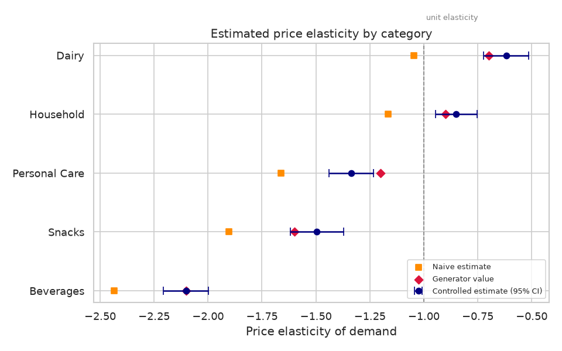
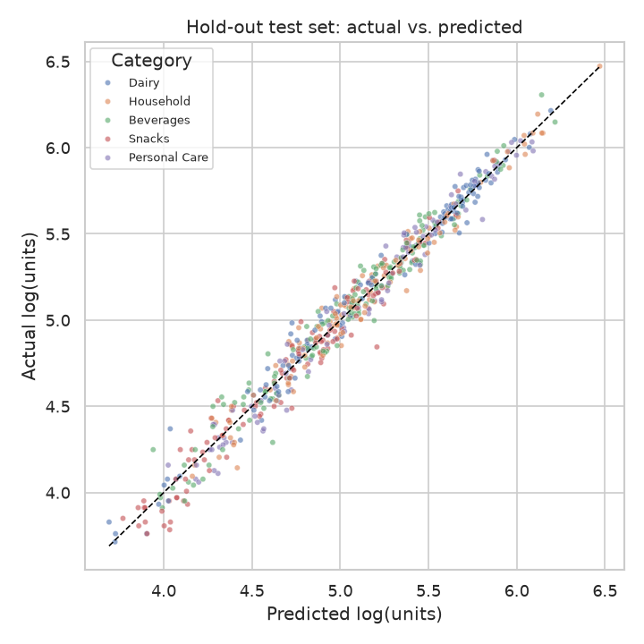
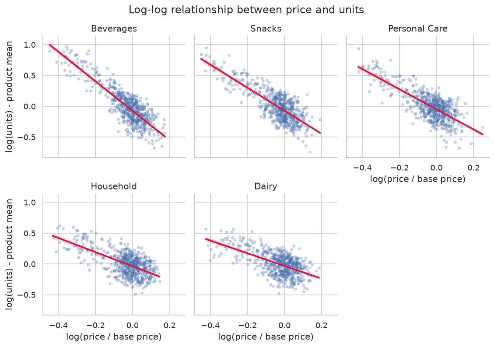

# Price Elasticity Estimation

Log-log regression to estimate price elasticity for product categories.

> **Note:** All data in this project is **synthetic**. It is generated by `src/data_generator.py` and does not describe any real company, product or customer.

## Business question

By how much does demand fall (or rise) when the price of a product category changes by 1%? Which categories are price sensitive (elastic) and which are not (inelastic)?

## Goal

Estimate the price elasticity of demand for each product category with a log-log regression, while controlling for promotions, seasonality and competitor prices. The estimates should help decide where price changes or discounts are likely to increase revenue.

## Plan of the work

1. **Data generation** – build a synthetic weekly sales dataset (products and weekly sales) with a fixed random seed.
2. **EDA** – check distributions, missing values, price and units relationships per category, promotion effects and seasonality.
3. **Analysis / model** – fit log-log regressions (overall and per category) with statsmodels, add controls (promo, holiday, competitor price, seasonality, product fixed effects), check out-of-sample fit and compare the estimates with the elasticities used in the generator.
4. **SQL** – aggregate queries on the same tables (revenue and average price by category, promo vs. non-promo weeks, and more).
5. **Tests** – pytest checks for the data generator (columns, row counts, value ranges, reproducibility) and for the modelling helpers.

## Dataset (synthetic)

Two CSV tables are written to `data/`:

| File | Grain | Description |
|------|-------|-------------|
| `products.csv` | one row per product | category, brand tier and regular base price |
| `weekly_sales.csv` | one row per product per week | price, competitor price, promotion flag, units sold, revenue |

The generator produces 60 products and 3,120 product-week rows. The full column list and value ranges are in [data_description.md](data_description.md).

## Exploratory data analysis

`src/eda.py` loads both CSV files and joins them on `product_id`. When run, it:

- prints the shape, data types, missing values, duplicate count and descriptive statistics of each table;
- prints five aggregations: sales summary and revenue share by category, promo vs. non-promo weeks by category, holiday vs. regular weeks, brand tier summary, and the raw correlation between log price ratio and centered log units per category;
- saves three charts to `figures/`:
  - `log_log_by_category.png` – log price ratio vs. centered log units with a fitted line, one panel per category;
  - `price_ratio_by_promo.png` – price relative to base price in promo and non-promo weeks;
  - `weekly_seasonality.png` – average weekly units per category as an index, with holiday weeks highlighted.

The correlations printed in the EDA are raw, uncontrolled associations (promotions, seasonality and competitor prices are not yet accounted for). They are not elasticity estimates; those come from the regression step.

## Method

`src/analysis.py` estimates elasticity with constant-elasticity (log-log) regressions. Reusable helpers (feature preparation, model fitting, metrics) live in `src/utils.py`.

**Model.** For product *i* in week *t*:

```
log(units_it) = a_i + e * log(price_it / base_price_i)
                + b1 * log(competitor_price_it / base_price_i)
                + b2 * is_promo + b3 * is_holiday_week
                + b4 * sin(2*pi*week/52) + b5 * cos(2*pi*week/52) + error
```

- The coefficient `e` on the log price ratio is the price elasticity.
- `a_i` are product fixed effects, which remove differences in demand level between products.
- The controls handle the cross-price effect, promotion lift (promotions are correlated with price), the holiday uplift and smooth yearly seasonality.
- Standard errors are heteroskedasticity-robust (HC1). Rows with zero units are dropped because the log is undefined; their number is printed.

**Steps in the script.**

1. *Pooled models* – one elasticity for all categories, in a naive version (price and product fixed effects only) and a controlled version.
2. *Per-category models* – the same two specifications fitted separately for each category. The controlled estimate is the main result; the naive estimate shows how much omitting the controls changes the answer.
3. *Comparison with the generator* – because the data is synthetic, the per-category elasticities used to generate it (`CATEGORY_ELASTICITY` in `src/data_generator.py`) are compared with the estimates, including whether each value lies inside the 95% confidence interval. The generator also adds a small product-level deviation around each category value, so exact equality is not expected.
4. *Business reading* – each category is labelled elastic (|e| > 1) or inelastic (|e| <= 1), and the revenue change implied by a 10% price cut is computed as `(0.9 ** (1 + e) - 1)`. This assumes constant elasticity and unchanged competitor prices and promotions.
5. *Hold-out check* – an 80/20 random split (`random_state=42`). Per-category controlled models are fitted on the training part and scored on the test part (RMSE, MAE and R² on log units), next to a baseline that predicts each product's mean log units.

**Outputs.**

- Console report with all key metrics, clearly labelled.
- `figures/elasticity_estimates.png` – controlled estimates with 95% confidence intervals, naive estimates and generator values by category.
- `figures/holdout_actual_vs_predicted.png` – actual vs. predicted log units on the test split.
- `reports/metrics.json` – pooled and per-category results and hold-out metrics.

The numbers from one run are listed in the [Results](#results) section below.

## SQL analysis

`sql/queries.sql` holds eight commented queries (SQLite dialect) over the same two tables. Each query is preceded by a `-- Q<n>:` comment that states the question it answers.

| Query | Question |
|-------|----------|
| Q1 | Revenue, average price and revenue share by category |
| Q2 | Discount depth and average units in promo vs. non-promo weeks, per category |
| Q3 | Raw promo uplift in average units per category (product-level ratios) |
| Q4 | Brand tier summary: base price, average units, revenue |
| Q5 | Holiday vs. regular weeks: average units per category |
| Q6 | Top 10 products by revenue, with overall and within-category rank |
| Q7 | Monthly revenue with the change vs. the previous month |
| Q8 | Average units by price-ratio bucket within each category |

`src/run_sql.py` loads `data/products.csv` and `data/weekly_sales.csv` into an in-memory SQLite database with `pandas.to_sql`, splits `queries.sql` into statements on semicolons (so comments in the SQL file must not contain semicolons), runs each statement and prints its description and the first 10 result rows. No database file is created.

The SQL results are descriptive, uncontrolled aggregations. They help to understand the data but are not elasticity estimates, which come from the regression step.

## Results

All numbers below come from the program output of a single run with the fixed seed (42) on the **synthetic** dataset. All 3,120 rows had positive units, so no rows were dropped.

### Descriptive findings (uncontrolled)

- Household (31.66%) and Personal Care (29.84%) generate the largest revenue shares; Snacks (10.41%) the smallest.
- In promo weeks the average price ratio is about 0.79 to 0.81, against about 1.00 in non-promo weeks. Average units are higher in promo weeks in every category, for example Beverages 285.9 vs. 160.0 and Snacks 215.3 vs. 122.9.
- Holiday weeks have higher average units than regular weeks in every category. The ratio ranges from 1.05 (Beverages) to 1.19 (Dairy).
- The raw correlation between log price ratio and centered log units is negative in every category, from -0.592 (Dairy) to -0.857 (Beverages).

These are raw associations, not elasticity estimates.

### Pooled elasticity

| Model | Elasticity | SE | 95% CI | R² |
|-------|-----------|----|--------|----|
| Naive (price + product fixed effects) | -1.649 | 0.033 | [-1.713, -1.585] | 0.918 |
| Controlled | -1.300 | 0.033 | [-1.365, -1.236] | 0.966 |

### Elasticity by category

The generator value is the elasticity used to create the synthetic data.

| Category | Generator value | Naive | Controlled | SE | 95% CI (controlled) | Generator value in CI | Type |
|----------|-----------------|-------|------------|----|---------------------|-----------------------|------|
| Beverages | -2.1 | -2.434 | -2.102 | 0.053 | [-2.206, -1.998] | True | elastic |
| Snacks | -1.6 | -1.903 | -1.495 | 0.063 | [-1.619, -1.372] | True | elastic |
| Personal Care | -1.2 | -1.661 | -1.336 | 0.053 | [-1.439, -1.233] | False | elastic |
| Household | -0.9 | -1.165 | -0.850 | 0.049 | [-0.947, -0.754] | True | inelastic |
| Dairy | -0.7 | -1.047 | -0.619 | 0.053 | [-0.723, -0.514] | True | inelastic |

Mean absolute error vs. the generator value: naive 0.342, controlled 0.075.



### Implied revenue effect of a 10% price cut

Computed from the controlled estimates, assuming constant elasticity and no change in competitor prices or promotions.

| Category | Controlled elasticity | Type | Revenue change |
|----------|-----------------------|------|----------------|
| Beverages | -2.102 | elastic | +12.314% |
| Snacks | -1.495 | elastic | +5.357% |
| Personal Care | -1.336 | elastic | +3.603% |
| Household | -0.850 | inelastic | -1.565% |
| Dairy | -0.619 | inelastic | -3.939% |

### Hold-out evaluation

80/20 split (`random_state=42`): 2,496 training rows and 624 test rows. Metrics are on log units.

| Model | RMSE | MAE | R² |
|-------|------|-----|----|
| Controlled per-category model | 0.089 | 0.069 | 0.974 |
| Product-mean baseline | 0.241 | 0.187 | 0.809 |



### Raw log-log relationship



## Conclusions

- **Controls matter.** Omitting promotions, holidays, competitor price and seasonality makes demand look more price sensitive in every category. The pooled elasticity is -1.649 in the naive model and -1.300 in the controlled one, and the mean absolute error vs. the generator value drops from 0.342 to 0.075.
- **Categories differ.** The controlled estimates run from -2.102 (Beverages) to -0.619 (Dairy). A single pooled value of -1.300 would hide this spread.
- **Elastic vs. inelastic.** Beverages, Snacks and Personal Care are classified as elastic (|e| > 1). Household and Dairy are classified as inelastic.
- **Implied pricing direction.** Under the constant-elasticity assumption, a 10% price cut raises revenue in the three elastic categories (largest in Beverages, +12.314%) and lowers it in Household (-1.565%) and Dairy (-3.939%).
- **Recovery of the generator values.** The 95% interval contains the generator value in four of five categories. Personal Care is the exception: the estimate is -1.336, the interval is [-1.439, -1.233] and the generator value is -1.2. The generator adds a product-level deviation around each category value, which may contribute, but this was not tested separately.
- **Out-of-sample fit.** On the 20% hold-out, the controlled model reaches R² = 0.974 and RMSE = 0.089 on log units, against R² = 0.809 and RMSE = 0.241 for the product-mean baseline.

## Limitations & next steps

**Limitations**

- **The data is synthetic.** It is generated by this project's own code, so the results say nothing about any real market. The generator's demand process closely matches the model form, which makes this a best-case test of the method.
- Elasticity is assumed constant over the whole price range, and the revenue effects assume that competitor prices and promotions do not react to a price change.
- Price endogeneity (prices set in response to expected demand), stockouts and changing assortments are not present in the data and are not handled.
- Each category has 12 products over 52 weeks. The hold-out split is random by row, so the same products and weeks appear in both train and test parts. This is not a test of forecasting future weeks or new products.
- Weeks with zero sales would be excluded from the log model. This did not occur in this run.

**Next steps**

- Use a time-based hold-out (train on early weeks, test on later weeks) and a hold-out of whole products.
- Add instrumental-variable or other identification checks on data with endogenous prices.
- Allow elasticity to vary by brand tier or between promo and non-promo weeks.
- Test non-constant elasticity, for example with a quadratic term in log price.
- Add price-change scenarios with confidence intervals for the implied revenue effect.

## Tests

The tests live in `tests/` and run in a few seconds. They generate their own data in memory, so they need neither the CSV files in `data/` nor any figures.

| File | What it checks |
|------|----------------|
| `tests/test_data_generator.py` | Column names, row counts, value ranges, promo and holiday flags, revenue = price x units, and reproducibility for a fixed seed |
| `tests/test_utils.py` | Feature preparation, model formula, pooled elasticity sign and interval, metrics, elasticity classification and implied revenue change |
| `tests/test_prepare_data.py` | Edge cases: zero-unit rows dropped, unmatched products rejected, structure of the extracted price effect |

Run them from the project root:

```bash
python -m pytest -q
```

## Project structure

```
price-elasticity-estimation/
├── README.md
├── requirements.txt
├── data_description.md
├── data/            # created by the generator
├── figures/         # created by the EDA and analysis scripts
├── reports/         # metrics.json, created by the analysis script
├── sql/
│   └── queries.sql
├── src/
│   ├── data_generator.py
│   ├── eda.py
│   ├── utils.py
│   ├── analysis.py
│   └── run_sql.py
└── tests/
    ├── test_data_generator.py
    ├── test_prepare_data.py
    └── test_utils.py
```

## How to run

**Requirements:** Python 3.11 and the packages listed in `requirements.txt`. Run all commands from the project root, the folder that contains `README.md`.

```bash
pip install -r requirements.txt
python src/data_generator.py
python src/eda.py
python src/analysis.py
python src/run_sql.py
python -m pytest -q
```

Run `src/data_generator.py` first. The EDA, analysis and SQL scripts read the CSV files in `data/` and stop with a message if they are missing. Running the generator again overwrites both CSV files with identical content, because the seed is fixed.

All scripts are non-interactive. The generator writes `data/products.csv` and `data/weekly_sales.csv`; its random seed is fixed (42), so repeated runs produce identical files. The EDA script prints its report and writes PNG charts to `figures/`. The analysis script prints the model results, writes two more charts to `figures/` and saves `reports/metrics.json`. The SQL script prints the result of each query in `sql/queries.sql`. The tests do not require the other scripts to have been run first.

---

*This is a training project that uses synthetic data generated by AI.*
