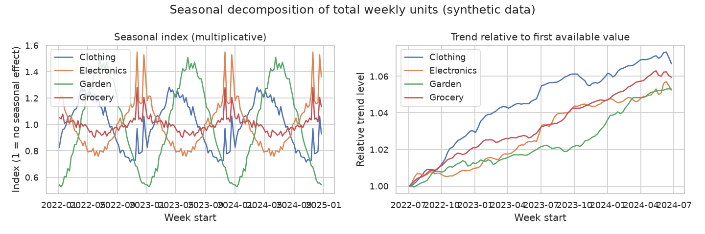
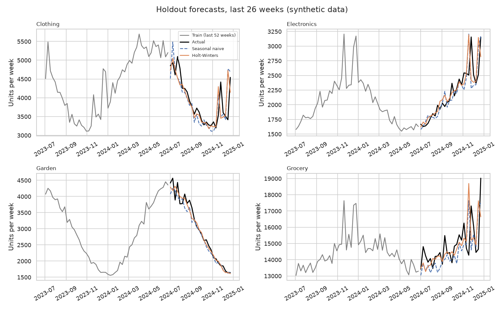
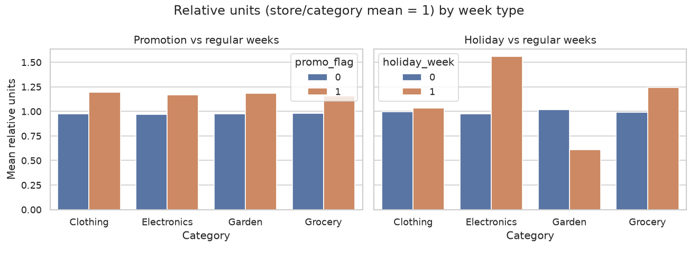

# Retail Sales Forecasting

Weekly sales forecasting with seasonal decomposition and Holt-Winters.

> **Note:** All data in this project is **synthetic**. It is generated by `src/data_generator.py` with a fixed random seed and does not describe any real company.

## Business question

How many units will each product category sell in each store over the coming weeks, so that inventory and staffing can be planned ahead of seasonal peaks and holidays?

## Goal

Build a reproducible weekly forecasting workflow that:

1. Explains the structure of the sales series (trend, yearly seasonality, holiday and promotion effects).
2. Produces forecasts with Holt-Winters exponential smoothing.
3. Compares the forecasts with simple baselines on a held-out period.

## Plan of the work

1. **Data generation** (done): create synthetic stores and weekly sales tables.
2. **EDA** (done): check data quality, plot sales over time, compare categories and stores, look at promotion and holiday effects.
3. **Analysis / model** (done): seasonal decomposition (trend, seasonal, residual) and Holt-Winters forecasting, evaluated against naive and seasonal-naive baselines on a time-based holdout.
4. **SQL** (done): aggregation queries (monthly revenue, store and category rankings, promotion uplift).
5. **Tests** (done): pytest checks for the data generator and the helper functions in `src/utils.py`.
6. **Results and conclusions** (done): see the sections below.

## Dataset (synthetic)

Two CSV tables are written to `data/`:

- `stores.csv`: one row per store (store ID, region, size, opening year). 6 rows.
- `weekly_sales.csv`: one row per week, store and category, with units sold, price, promotion and holiday flags, and revenue. 3,744 rows covering 156 weeks (2022-01-03 to 2024-12-23).

The sales are built from a base level per store and category, a gentle growth trend, category-specific yearly seasonality, holiday uplifts (Christmas and Black Friday weeks), random promotions and multiplicative noise. See `data_description.md` for every column.

## Exploratory data analysis

`src/eda.py` loads both CSV files and:

- prints the shape, data types, missing values, duplicate and key checks, and gaps between weeks;
- prints descriptive statistics for units, price and revenue, plus the share of promotion and holiday rows;
- prints five aggregations: totals by category, revenue by store with region and size, revenue by year and category, a raw promotion comparison, and the holiday-week effect;
- saves four charts to `figures/`:
  - `weekly_units_by_category.png`: total weekly units per category over time;
  - `seasonality_heatmap.png`: average relative units by month and category;
  - `promo_holiday_effect.png`: relative units in promotion and holiday weeks versus regular weeks;
  - `revenue_by_store.png`: total revenue per store, colored by region.

"Relative units" means units divided by the average of the same store and category, so categories and stores of different sizes can be compared. The raw promotion comparison does not adjust for seasonality, so it is only a rough indication.

## Method

`src/analysis.py` works on one weekly series per product category: total units sold across all stores (156 weeks, four series). Reusable logic (series preparation, time split, forecast functions, error metrics, decomposition strength) lives in `src/utils.py`.

1. **Seasonal decomposition.** A multiplicative decomposition with a 52-week period splits each series into trend, seasonal index and residual. A strength score between 0 and 1 is computed for the seasonal and trend components as `max(0, 1 - Var(residual) / Var(component + residual))` on log values. Higher means the component explains more of the variation.
2. **Time-based holdout.** The last 26 weeks are held out as the test set and all models are fitted on the earlier 130 weeks only. No random split is used, because shuffling would leak future information into training.
3. **Models compared.**
   - *Naive*: repeats the last observed week.
   - *Seasonal naive*: uses the value from the same week one year earlier.
   - *Holt-Winters*: exponential smoothing from `statsmodels` with a damped additive trend and multiplicative yearly seasonality (52 weeks), parameters estimated on the training data.
4. **Metrics.** MAE, RMSE and MAPE on the holdout for each category and model, the mean across categories, and the best model per category by RMSE.

Outputs:

- `figures/decomposition_seasonal.png`: seasonal index and relative trend per category;
- `figures/forecast_vs_actual.png`: actuals and forecasts on the holdout period;
- `reports/metrics.json`: configuration, decomposition strengths, holdout metrics and best model per category.

## SQL analysis

`sql/queries.sql` contains eight queries in the SQLite dialect. Each query is preceded by a comment line of the form `-- Q<n>: question`. `src/run_sql.py` loads both CSV files into an in-memory SQLite database (`pandas.to_sql`), splits the file into statements, runs each one and prints the question and the first rows of the result. No database file is created.

| Query | Question |
|---|---|
| Q1 | Total units and revenue per month |
| Q2 | Yearly revenue per category and growth versus the previous year (`LAG` window function) |
| Q3 | Store ranking by revenue, with revenue per square meter (`RANK`, join with `stores`) |
| Q4 | Top revenue category in each store (CTE and `RANK`) |
| Q5 | Promotion uplift per category, relative to the store and category average |
| Q6 | Average weekly units in holiday versus regular weeks, by category |
| Q7 | Share of each category in regional revenue (window `SUM`) |
| Q8 | The five weeks with the highest total revenue and their holiday and promotion flags |

Dates are stored as `YYYY-MM-DD` text so that SQLite functions such as `strftime` work. The promotion and holiday comparisons are not adjusted for seasonality beyond the relative-units scaling, so they are descriptive only. Window functions need SQLite 3.25 or newer, which is included with current Python 3.11 builds.

## Results

All numbers below come from the script output and `reports/metrics.json` of the latest run on the synthetic data.

### Seasonal decomposition (period = 52 weeks)

| Category | Seasonal strength | Trend strength |
|---|---|---|
| Clothing | 0.960 | 0.223 |
| Electronics | 0.960 | 0.204 |
| Garden | 0.993 | 0.175 |
| Grocery | 0.881 | 0.302 |



### Holdout evaluation (train 130 weeks, test 26 weeks: 2024-07-01 to 2024-12-23)

| Category | Model | MAE | RMSE | MAPE % |
|---|---|---|---|---|
| Clothing | naive | 1292.08 | 1420.74 | 35.93 |
| Clothing | seasonal_naive | 277.96 | 407.40 | 7.04 |
| Clothing | holt_winters | 234.32 | 397.15 | 5.90 |
| Electronics | naive | 560.54 | 694.57 | 23.09 |
| Electronics | seasonal_naive | 158.46 | 266.91 | 6.62 |
| Electronics | holt_winters | 153.04 | 256.47 | 6.30 |
| Garden | naive | 1409.88 | 1676.75 | 64.28 |
| Garden | seasonal_naive | 152.35 | 212.39 | 4.50 |
| Garden | holt_winters | 129.02 | 176.17 | 3.91 |
| Grocery | naive | 1544.42 | 1962.38 | 9.88 |
| Grocery | seasonal_naive | 920.92 | 1247.62 | 6.07 |
| Grocery | holt_winters | 845.02 | 1322.33 | 5.55 |

Mean error across the four categories:

| Model | MAE | RMSE | MAPE % |
|---|---|---|---|
| holt_winters | 340.35 | 538.03 | 5.41 |
| naive | 1201.73 | 1438.61 | 33.30 |
| seasonal_naive | 377.42 | 533.58 | 6.06 |

Best model per category by RMSE: Holt-Winters for Clothing, Electronics and Garden; seasonal naive for Grocery.



### Promotion and holiday effects

- Raw promotion comparison (EDA, mean units per row, not adjusted for seasonality): uplift of 12.80% (Clothing), 24.13% (Electronics), 16.60% (Garden) and 16.84% (Grocery).
- Promotion uplift relative to the store and category average (SQL Q5): 22.2% (Clothing), 21.7% (Garden), 20.4% (Electronics) and 18.4% (Grocery).
- Units in holiday weeks relative to the store and category mean (EDA): Clothing 1.035, Electronics 1.558, Garden 0.608, Grocery 1.244. Regular weeks are between 0.974 and 1.018.
- The five weeks with the highest total revenue (SQL Q8) are all holiday weeks; the highest is 2024-12-23 with revenue of 830,290.06.



### Other descriptive results

- Electronics has the highest revenue (55,185,609.44) but Grocery has the most units (2,214,561).
- Store S06 has the highest revenue (21,325,603.85); S01 has the highest revenue per square meter (8443.35) and the lowest total revenue (8,409,574.72).
- Electronics is the top revenue category in all six stores (Q4).
- Yearly revenue growth per category (Q2) is between 1.56% and 4.56%.

## Conclusions

- **The series are strongly seasonal.** Seasonal strength is between 0.881 and 0.993 in every category, while trend strength is between 0.175 and 0.302. The yearly pattern explains much more of the variation than the trend does.
- **Seasonality-aware models clearly beat the naive baseline.** The mean MAPE is 33.30% for naive, 6.06% for seasonal naive and 5.41% for Holt-Winters.
- **Holt-Winters is best on average MAE and MAPE, but the gain over seasonal naive is small.** Mean MAE is 340.35 versus 377.42 and mean MAPE is 5.41% versus 6.06%. On mean RMSE seasonal naive is slightly lower (533.58 versus 538.03).
- **The best model depends on the category.** Holt-Winters has the lowest RMSE for Clothing, Electronics and Garden. For Grocery, seasonal naive has the lower RMSE (1247.62 versus 1322.33), while Holt-Winters has the lower MAE (845.02 versus 920.92) and MAPE (5.55% versus 6.07%).
- **Holiday effects differ by category.** Electronics (1.558) and Grocery (1.244) are well above their average in holiday weeks, Clothing is close to it (1.035) and Garden is clearly below (0.608).
- **Promotion weeks have higher units in every category.** The relative uplift is between 18.4% and 22.2% (Q5). The raw comparison gives a different range (12.80% to 24.13%) and a different order of categories, which shows that seasonality affects the raw numbers.
- **Growth is gentle.** Yearly revenue grows by 1.56% to 4.56% per category, in line with the low trend strength.

## Limitations & next steps

**Limitations**

- **The data is synthetic.** It is generated by this project's own code, so the seasonality, holiday and promotion effects reflect how the generator was written. The results do not say how real retail sales behave, and the conclusions about model performance cannot be transferred to real data without testing.
- The series are aggregated over stores, so the forecasts are category-level and not store-level.
- Holt-Winters has no explicit holiday or promotion regressors. The holdout metrics are not broken down by holiday weeks, so the effect of holidays on forecast error was not measured.
- With three years of history (130 training weeks), the 52-week seasonal pattern is estimated from only two to three cycles.
- There is a single holdout split of 26 weeks, so the differences between Holt-Winters and seasonal naive may not be stable across other periods.
- The promotion and holiday comparisons are descriptive and are not causal estimates.

**Next steps**

- Use rolling-origin (time series) cross-validation to check whether the small gaps between Holt-Winters and seasonal naive hold.
- Add models with holiday and promotion regressors (for example SARIMAX from `statsmodels`) and report errors separately for holiday weeks.
- Forecast at store and category level and compare it with the category-level forecasts.
- Add prediction intervals to support inventory and staffing decisions.
- Repeat the workflow on real sales data, if available.

## Tests

The `tests/` folder contains pytest checks that run in a few seconds (13 tests pass in the latest run):

- `tests/test_data_generator.py`: column names, row counts, value ranges, Monday-based weekly dates, revenue consistency, reproducibility with the fixed seed and holiday-week flags. The data is generated in memory, so no CSV files are needed.
- `tests/test_utils.py`: weekly series preparation, the time-based split, naive, seasonal-naive and Holt-Winters forecasts (on small hand-made series), error metrics with known values and the bounds of the decomposition strength.

The tests do not depend on figures or on files created by the other scripts.

## How to run

From the project root:

```bash
pip install -r requirements.txt
python src/data_generator.py
python src/eda.py
python src/analysis.py
python src/run_sql.py
python -m pytest -q
```

The generator creates the `data/` folder if needed and overwrites the CSV files on each run (seed 42, so the output is identical every time). The EDA script creates the `figures/` folder and overwrites the PNG files on each run. The analysis script creates `reports/`, and overwrites its charts and `metrics.json` on each run. The SQL script only reads the CSV files and prints results to the console. The tests only read the code in `src/` and write nothing to the project folders.

---

*This is a training project that uses synthetic data generated by AI.*
