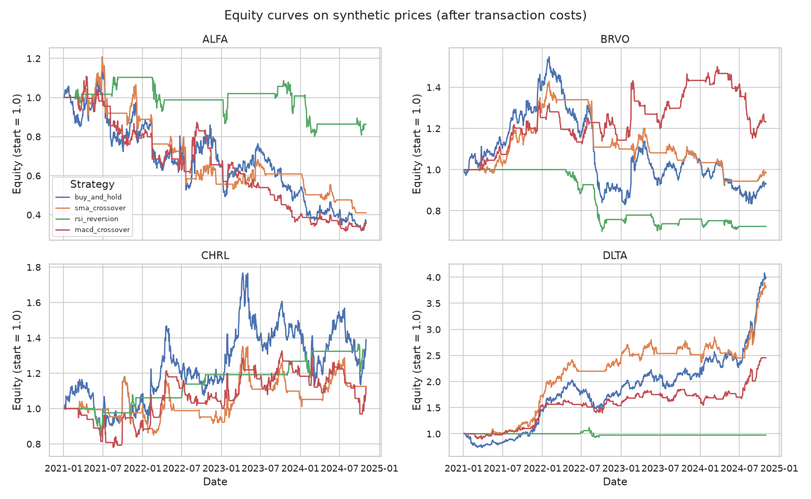
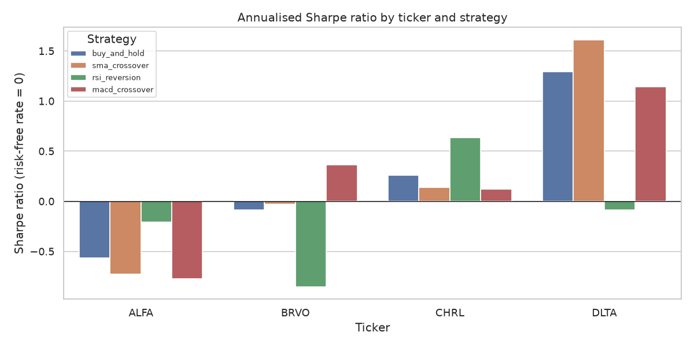
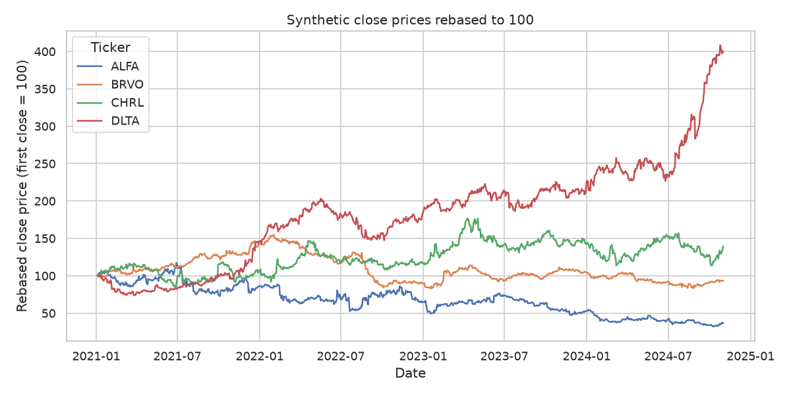

# Stock Technical Indicators

Moving averages, RSI and MACD on simulated daily prices with a simple backtest.

## Business question

Do common technical indicators (moving-average crossovers, RSI thresholds, MACD signal crossovers) give trading signals that beat a plain buy-and-hold position, after accounting for risk and drawdown?

## Goal

Build a reproducible pipeline that:

1. generates realistic **synthetic** daily OHLCV price data for several fictional stocks,
2. computes simple and exponential moving averages, RSI and MACD,
3. turns the indicators into rule-based trading signals,
4. backtests those signals and compares them with buy-and-hold.

## Plan of the work

1. **Data generation** (`src/data_generator.py`): simulate prices with a geometric random walk, fat-tailed returns and calm/stressed volatility regimes.
2. **EDA** (`src/eda.py`): price and return distributions, volatility regimes, volume vs. absolute returns, data quality checks.
3. **Analysis / model** (`src/analysis.py`, helpers in `src/utils.py`): compute SMA/EMA, RSI and MACD; define signals; run a simple backtest (returns, Sharpe ratio, max drawdown, number of trades) against buy-and-hold.
4. **SQL** (`sql/queries.sql`, `src/run_sql.py`): load the tables into SQLite and answer questions with queries, for example the monthly return per ticker and the most volatile periods.
5. **Tests** (`tests/`): pytest checks for the data generator (schema, row counts, reproducibility, price consistency) and for the indicator, signal and backtest functions in `src/utils.py`.

## Dataset (synthetic)

All data is **synthetic**. It is generated by this project's own code with a fixed random seed (42) and does not represent real markets or real companies. The ticker symbols are fictional.

Two tables are written to `data/`:

- `tickers.csv`: one row per fictional stock (sector, assumed drift and volatility, starting price).
- `prices.csv`: daily OHLCV data, 4 tickers x 1000 business days = 4000 rows.

See `data_description.md` for every column.

## How to run

From the project root:

```bash
pip install -r requirements.txt
python src/data_generator.py
python src/eda.py
python src/analysis.py
python src/run_sql.py
```

The first command creates `data/tickers.csv` and `data/prices.csv`. Running it again with the same seed reproduces identical files. The second command runs the exploratory analysis, the third runs the indicator backtest and the fourth runs the SQL queries (all three need the data files to exist).

## Tests

From the project root:

```bash
python -m pytest -q
```

The tests live in `tests/` and run in a few seconds. They do not read data files or figures (the last run reported 14 passed):

- `tests/test_data_generator.py`: column names, row counts (4 tickers x 1000 days), no duplicates or missing values, OHLC consistency, positive prices, volume and regime value ranges, ticker parameter ranges and reproducibility with the fixed seed.
- `tests/test_utils.py`: known values for SMA and EMA, RSI extremes (100 for a steadily rising series, 0 for a falling one) and range, MACD columns and histogram, binary positions that stay flat during indicator warm-up, the one-day lag and transaction cost in the backtest, trade counting, maximum drawdown and Sharpe ratio edge cases.

## Exploratory data analysis

`src/eda.py` loads the two CSV files and prints its results to the console. It does the following:

- **Overview:** shape, dtypes and missing values for both tables.
- **Data quality checks:** duplicate (date, ticker) rows, OHLC ordering violations, non-positive prices and volumes.
- **Descriptive statistics:** count, mean, std, quartiles and extremes for prices, volume and daily log returns.
- **Aggregations:**
  1. per-ticker summary (price range, total return, realised vs. assumed volatility, average volume),
  2. realised volatility and volume by calm/stressed regime,
  3. monthly log return summary per ticker,
  4. skewness and excess kurtosis of daily returns (to check for fat tails),
  5. correlation of daily returns between tickers, plus the correlation of volume with absolute returns.

It also saves three charts to `figures/` (created automatically):

- `close_prices.png`: close prices rebased to 100 for each ticker.
- `return_distribution.png`: histograms of daily log returns by ticker and boxplots by volatility regime.
- `volume_vs_abs_return.png`: scatter plot of volume against absolute daily return.

## Method: indicators and backtest

`src/utils.py` holds the reusable, testable logic and `src/analysis.py` runs the comparison.

**Indicators**

- SMA and EMA (rolling mean and exponentially weighted mean of the close).
- RSI with Wilder smoothing, 14-day window.
- MACD: EMA(12) minus EMA(26), a 9-day EMA signal line and the histogram.

**Strategies** (long or flat only, no shorting, decided at the daily close)

| Strategy | Rule |
|---|---|
| `buy_and_hold` | Always long (benchmark) |
| `sma_crossover` | Long while SMA(20) is above SMA(50) |
| `rsi_reversion` | Enter long when RSI(14) < 30, exit when RSI(14) > 50 |
| `macd_crossover` | Long while the MACD line is above its signal line |

**Backtest rules**

- A position decided at the close of day *t* earns the return of day *t+1* (one-day lag, so there is no look-ahead bias).
- Every position change costs 0.1% of traded value.
- Indicator warm-up days are spent flat.
- The Sharpe ratio is annualised with 252 days and a zero risk-free rate.
- Parameters are standard defaults chosen in advance and are not tuned on the data, so no train/test split is used.

**Metrics** reported per ticker and strategy: total return, annualised return, annualised volatility, Sharpe ratio, maximum drawdown, number of trades (entries) and share of time in the market.

**Outputs**

- Console tables with all metrics and a summary of how many tickers each strategy beats buy-and-hold on (Sharpe, total return, drawdown).
- `figures/equity_curves.png`: equity curves of all strategies, one panel per ticker.
- `figures/sharpe_by_strategy.png`: Sharpe ratio by ticker and strategy.
- `reports/metrics.json`: parameters, all metrics and the summary versus buy-and-hold.

## SQL analysis

`sql/queries.sql` contains 8 commented queries in the SQLite dialect. Each query is preceded by a comment line of the form `-- Q<n>: <question>`. `src/run_sql.py` loads `data/tickers.csv` and `data/prices.csv` into an in-memory SQLite database with `pandas.to_sql`, splits the file into statements, runs each one and prints the question together with the first 10 rows of the result.

| Query | Question |
|---|---|
| Q1 | Price range, total return and average volume per ticker, with sector |
| Q2 | Monthly return per ticker (month-end close vs. previous month-end close) |
| Q3 | The most volatile ticker-months (highest mean absolute daily return) |
| Q4 | Calm vs. stressed regime: size of moves and trading volume |
| Q5 | The 10 largest one-day price moves and their regime |
| Q6 | Share of days each ticker closes above its 20-day SMA |
| Q7 | Maximum drawdown per ticker and the date of the trough |
| Q8 | Volume on large-move days (above 3% absolute return) vs. normal days |

The queries use CTEs, joins, window functions (`LAG`, running `MAX`, moving `AVG`) and conditional aggregation. Daily returns in SQL are simple returns (close / previous close - 1), so the numbers differ slightly from the log returns used in the Python scripts. The results are printed to the console only.

## Results

All numbers below come from the actual output of the scripts on the **synthetic** data (seed 42). They describe simulated prices, not real markets.

### Data characteristics (from `src/eda.py`)

| Ticker | Sector | Total return | Annualised volatility | Excess kurtosis |
|---|---|---|---|---|
| ALFA | Technology | -0.6353 | 0.4492 | 7.5711 |
| BRVO | Utilities | -0.0668 | 0.2026 | 9.0283 |
| CHRL | Energy | 0.3927 | 0.3233 | 4.9027 |
| DLTA | Healthcare | 2.9933 | 0.2703 | 3.7181 |

- Data quality checks found no duplicates, no OHLC ordering violations, no non-positive prices and no volumes below 1.
- Daily returns are fat-tailed (positive excess kurtosis for every ticker).
- Stressed days have roughly double the daily volatility of calm days. For example, ALFA has 0.0203 on calm days vs. 0.0448 on stressed days.
- Correlations of daily returns between tickers are close to zero (between -0.0460 and 0.0408).
- Volume and absolute return are correlated at 0.6914.

### Backtest versus buy-and-hold (from `src/analysis.py`)

Sharpe ratio (annualised, zero risk-free rate, 0.10% cost per position change):

| Ticker | buy_and_hold | sma_crossover | rsi_reversion | macd_crossover |
|---|---|---|---|---|
| ALFA | -0.5667 | -0.7287 | -0.2104 | -0.7758 |
| BRVO | -0.0873 | -0.0267 | -0.8536 | 0.3611 |
| CHRL | 0.2575 | 0.1361 | 0.6323 | 0.1191 |
| DLTA | 1.2908 | 1.6120 | -0.0879 | 1.1434 |

Summary across the 4 tickers:

| Strategy | Tickers with higher Sharpe than buy-and-hold | Tickers with higher total return | Tickers with smaller drawdown | Mean Sharpe | Mean max drawdown | Mean trades |
|---|---|---|---|---|---|---|
| buy_and_hold | - | - | - | 0.2236 | -0.456 | 1 |
| sma_crossover | 2 of 4 | 2 of 4 | 4 of 4 | 0.2482 | -0.3611 | 9.75 |
| rsi_reversion | 2 of 4 | 1 of 4 | 4 of 4 | -0.1299 | -0.2249 | 6.0 |
| macd_crossover | 1 of 4 | 1 of 4 | 4 of 4 | 0.2119 | -0.3455 | 37.75 |

Selected total returns: DLTA buy-and-hold 2.9893 vs. sma_crossover 2.8139, macd_crossover 1.4555 and rsi_reversion -0.0262. ALFA buy-and-hold -0.6357 vs. rsi_reversion -0.1371.







### SQL highlights (from `src/run_sql.py`)

- Q6: share of days closing above the 20-day SMA is 0.6514 for DLTA, 0.5015 for CHRL, 0.4893 for BRVO and 0.4353 for ALFA.
- Q7: maximum drawdown of the close is -0.7281 for ALFA (trough 2024-10-10), -0.4639 for BRVO, -0.3580 for CHRL and -0.2740 for DLTA.
- Q8: average volume is higher on large-move days than on normal days for every ticker (for example ALFA 4178240 vs. 2488351).

## Conclusions

- **No strategy clearly beats buy-and-hold.** Mean Sharpe is 0.2482 for `sma_crossover` and 0.2119 for `macd_crossover`, against 0.2236 for buy-and-hold. The SMA difference is small and rests on only 4 tickers, so it is not evidence of a real edge. `rsi_reversion` has a negative mean Sharpe (-0.1299).
- **Results depend heavily on the ticker.** `macd_crossover` has the best Sharpe on BRVO (0.3611 vs. -0.0873), but it is the weakest or close to the weakest strategy on ALFA, CHRL and DLTA. `rsi_reversion` has the best Sharpe on CHRL (0.6323) and the worst on BRVO (-0.8536).
- **All three strategies reduce maximum drawdown on all 4 tickers** (mean -0.3611, -0.2249 and -0.3455 vs. -0.456 for buy-and-hold). They also spend much less time in the market (for example 0.046 for `rsi_reversion` on DLTA vs. 0.999), so a smaller drawdown goes together with giving up exposure. On DLTA, `rsi_reversion` was in the market only 4.6% of the time and returned -0.0262, against 2.9893 for buy-and-hold.
- **Buy-and-hold wins on total return when the asset trends up strongly.** On DLTA (total return 2.9933 in the EDA), no strategy beat buy-and-hold on total return.
- **Trading frequency differs a lot.** `macd_crossover` made 33 to 43 trades per ticker, against 7 to 12 for `sma_crossover` on three tickers and 2 to 8 for `rsi_reversion`, so it is the strategy most exposed to transaction costs.

## Limitations & next steps

**Limitations**

- The data is **synthetic**: a random walk with a small drift, fat-tailed returns and volatility regimes. There is no genuine technical pattern to exploit by construction, so the results say nothing about real markets or real companies.
- Only 4 fictional tickers and 1000 business days each were used, and a single random seed (42). Differences between strategies are small relative to the ticker-to-ticker spread and are noisy.
- Strategies are long or flat only, with one fixed parameter set each and a flat 0.10% cost. There is no slippage, no shorting and no position sizing.
- No statistical tests or confidence intervals are computed, so none of the differences above are tested for significance.

**Next steps**

- Repeat the backtest over many seeds and more tickers, and report the distribution of Sharpe differences against buy-and-hold.
- Add a bootstrap or permutation test for the Sharpe differences.
- Test sensitivity to the parameters (windows, RSI thresholds) and to the transaction cost, using a train/test split once parameters are tuned.
- Generate data with an explicit trend or mean-reversion component, to check whether the indicators can detect a pattern that is known to exist.
- Add short positions and volatility-based position sizing.

---

*This is a training project that uses synthetic data generated by AI.*
