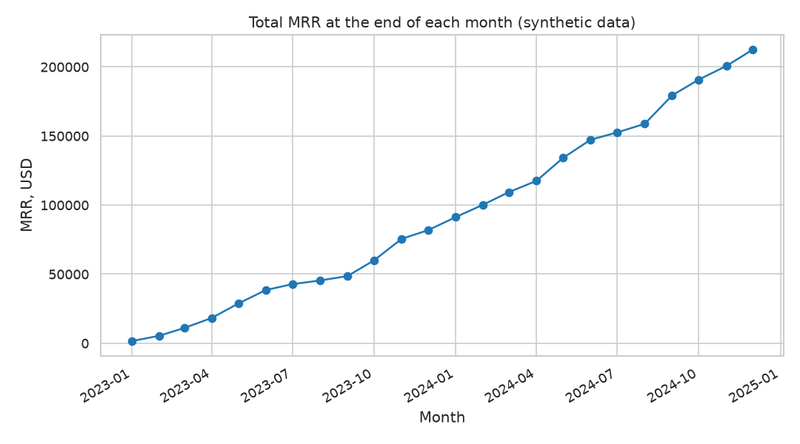
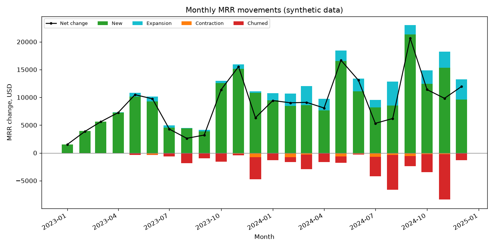
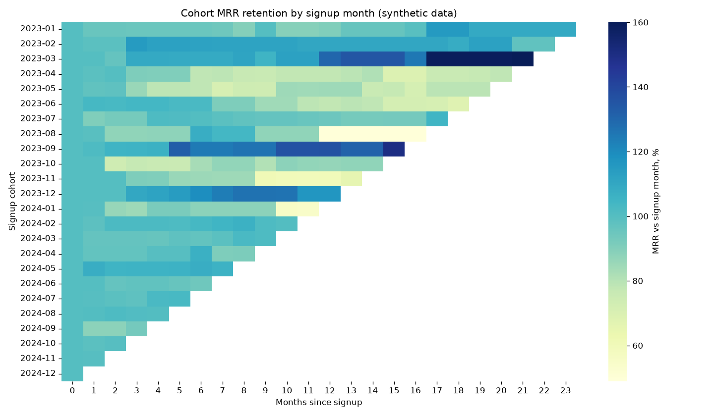

# Subscription Revenue Metrics

## Business question
How healthy is the recurring revenue of a SaaS business? Specifically: how much of the monthly recurring revenue (MRR) is gained from new customers and expansion, how much is lost to churn and contraction, and how do revenue cohorts behave over time?

## Goal
Build a reproducible analysis pipeline that turns raw subscription events into the core SaaS revenue metrics:

- MRR and its monthly movements (new, expansion, contraction, churned)
- Customer churn rate and revenue churn rate
- Net revenue retention (NRR) and gross revenue retention (GRR)
- Cohort revenue by signup month

## Plan of the work
This is a **learning project in development**. Current implementation status:

1. **Data generation** (✓ Complete): create a synthetic dataset with a fixed seed.
2. **EDA** (✓ Complete): check data quality, distributions of plans, channels and MRR changes, and customer growth over time.
3. **Analysis** (✓ Complete): monthly MRR bridge, churn and retention rates, segment comparison, cohort revenue and charts (`src/analysis.py`, `src/utils.py`).
4. **SQL** (✓ Complete): the key metrics (MRR bridge, churn, retention, cohorts) reproduced with SQLite queries on the same tables (`sql/queries.sql`, `src/run_sql.py`).
5. **Tests** (✓ Complete): pytest checks for the data generator and the metric calculations (`tests/test_data_generator.py`, `tests/test_utils.py`).
6. **Results and conclusions** (✓ Complete): key numbers, figures, conclusions and limitations are summarised below.

## Dataset (synthetic)
All data is **synthetic** and generated by `src/data_generator.py` with numpy (seed 42). It does not describe a real company. Two tables are saved to `data/`:

- `customers.csv`: one row per customer (signup date, country, acquisition channel, company size, initial plan).
- `subscription_events.csv`: one row per revenue event (new, expansion, contraction, churn) with MRR before and after the event.

The simulated period covers 24 months, from 2023-01 to 2024-12. See `data_description.md` for all columns.

## Exploratory data analysis
`src/eda.py` loads the two CSV files and prints its findings to the console:

- shape, dtypes, missing values and descriptive statistics for both tables
- data quality checks: duplicate IDs, orphan events, `mrr_change` reconciliation, one `new` event per customer, sign of `mrr_change` versus event type, and `new` events matching the signup date
- five aggregations: events and MRR change by event type, customer mix by plan / channel / company size, monthly MRR movements with end-of-month MRR, churned share and starting MRR by acquisition channel, and average starting MRR by initial plan and company size

It also saves four PNG charts to `figures/`:

- `mrr_over_time.png`: total MRR at the end of each month
- `new_customers_per_month.png`: customer growth over time
- `mrr_change_by_event_type.png`: size of MRR changes by event type (log scale)
- `churn_share_by_channel.png`: share of churned customers by acquisition channel

## Method
The analysis is descriptive (no predictive model, so no train/test split). Reusable functions live in `src/utils.py`; `src/analysis.py` calls them, prints the results and saves the outputs.

1. **MRR bridge.** `mrr_change` is summed by event type and calendar month. Closing MRR is the cumulative sum of all movements, and opening MRR is the previous month's closing MRR. So for each month: opening + new + expansion + contraction + churned = closing. Contraction and churned MRR are negative.
2. **Reconciliation check.** The bridge is compared with an independent calculation: a customer x month matrix of month-end MRR. Closing MRR must equal the column sums of that matrix. The result is printed and stored as `bridge_reconciles`.
3. **Monthly rates**, using the opening position of each month as the base:
   - customer churn rate = churned customers / customers active at the start of the month
   - revenue churn rate = churned MRR / opening MRR
   - GRR = (opening + contraction + churned) / opening MRR
   - NRR = (opening + expansion + contraction + churned) / opening MRR

   Overall figures are opening-MRR weighted over all months with a non-zero opening MRR (the first month is excluded). They are monthly rates, not annualised. In this data a customer has no expansion, contraction or churn event in its signup month, so NRR is not mixed with new customers.
4. **Segment comparison.** The same bridge and retention metrics are computed separately for initial plan, acquisition channel and company size. Segment attributes are fixed at signup.
5. **Cohort revenue.** Customers are grouped by signup month. For each cohort, month-end MRR is tracked by months since signup. Retention is the cohort MRR as a percentage of its MRR in the signup month. Pooled retention at month k uses only cohorts that have reached month k. Recent cohorts have short histories, so late offsets rest on few cohorts.

All figures come from the program output; none are hard-coded here. Because the data is synthetic, the results describe the simulation rules in `data_generator.py`, not a real business.

## Outputs of the analysis
- Console: MRR bridge table, monthly rates, overall retention, period totals, segment tables and pooled cohort retention.
- `figures/mrr_bridge_monthly.png`: stacked monthly MRR movements (new, expansion, contraction, churned) with the net change line.
- `figures/cohort_mrr_retention.png`: heatmap of cohort MRR retention by months since signup.
- `reports/metrics.json`: overall monthly retention, period totals, segment metrics and pooled cohort retention.

## SQL
The same metrics can be reproduced in SQL. `src/run_sql.py` loads both CSV files into an in-memory SQLite database (`pandas.to_sql`, dates stored as `YYYY-MM-DD` text), reads `sql/queries.sql`, splits it into statements, runs each one and prints its description and the first rows of the result. Nothing is written to disk.

`sql/queries.sql` contains seven queries, each preceded by a `-- Q<n>:` comment with the question:

1. Q1: monthly MRR bridge (opening, new, expansion, contraction, churned, closing) using window functions.
2. Q2: monthly customer churn rate, revenue churn rate, GRR and NRR.
3. Q3: churned customers and churned MRR by acquisition channel.
4. Q4: opening-MRR weighted monthly GRR and NRR by initial plan, using a month x segment grid.
5. Q5: cohort MRR at signup and retention 3, 6 and 12 months later (NULL for offsets a cohort has not reached).
6. Q6: top 10 customers by current MRR.
7. Q7: average months from signup to churn by initial plan.

The definitions are the same as in the Method section, so the SQL results for Q1, Q2 and Q4 can be compared with the Python output of `src/analysis.py`. The queries use window functions, which need SQLite 3.25 or later (bundled with Python 3.11).

## Tests
The `tests/` folder holds pytest checks. They call the generator and the functions in `src/utils.py` directly, so they need neither the CSV files nor the figures, and they run in a few seconds.

- `tests/test_data_generator.py`: column names, row counts, allowed category values, date range, MRR and seat ranges, `mrr_change` consistency, one `new` event per customer on the signup date, churn as the last event, and reproducibility with the fixed seed.
- `tests/test_utils.py`: a small hand-made dataset with known answers checks the MRR bridge, the reconciliation check (including a deliberately broken bridge), monthly and overall rates, segment retention and cohort revenue. One more test checks that the bridge reconciles on the generated data.

Run them from the project root:

```bash
python -m pytest -q
```

## Results
All numbers below come from the program output (`src/data_generator.py`, `src/analysis.py`, `src/run_sql.py`) and `reports/metrics.json`. The data is synthetic, so they describe the simulation, not a real company.

### Dataset size
- 700 customers and 1,175 events: 700 new, 212 expansion, 84 contraction and 179 churn events.
- The MRR bridge reconciles with the independent customer x month matrix (`bridge_reconciles` = true).

### Period totals (USD, 2023-01 to 2024-12)
| Metric | Value |
|---|---|
| New MRR | 226,496 |
| Expansion MRR | 33,221 |
| Contraction MRR | -5,926 |
| Churned MRR | -41,230 |
| Final MRR (2024-12) | 212,561 |
| Final active customers | 521 |

Total MRR grew from 1,537 at the end of 2023-01 to 212,561 at the end of 2024-12.





### Overall monthly retention (opening-MRR weighted, 23 months used, not annualised)
| Metric | Value |
|---|---|
| Net revenue retention (NRR) | 0.9932 |
| Gross revenue retention (GRR) | 0.9769 |
| Customer churn rate | 0.0323 |
| Revenue churn rate | 0.0202 |

### Segments (average monthly rates)
By initial plan:

| Plan | NRR | GRR | Customer churn | Revenue churn | Customers | Final MRR |
|---|---|---|---|---|---|---|
| Enterprise | 1.0042 | 0.9908 | 0.0068 | 0.0058 | 76 | 117,225 |
| Growth | 0.9806 | 0.9646 | 0.0281 | 0.0337 | 238 | 73,792 |
| Starter | 0.9828 | 0.9519 | 0.0413 | 0.0434 | 386 | 21,544 |

By acquisition channel:

| Channel | NRR | GRR | Customer churn | Churned share of customers (%) |
|---|---|---|---|---|
| organic | 0.9942 | 0.9769 | 0.0346 | 28.89 |
| outbound_sales | 0.9956 | 0.9812 | 0.0218 | 19.59 |
| paid_ads | 0.9870 | 0.9699 | 0.0419 | 30.77 |
| referral | 0.9974 | 0.9832 | 0.0224 | 15.94 |

By company size:

| Size | NRR | GRR | Final MRR |
|---|---|---|---|
| large | 0.9957 | 0.9783 | 127,640 |
| medium | 0.9912 | 0.9778 | 67,448 |
| small | 0.9845 | 0.9641 | 17,473 |

The SQL query Q7 gives the average months from signup to churn by initial plan: Enterprise 8.13 (5 churned customers), Growth 7.11 (52) and Starter 6.14 (122).

### Cohort MRR retention (pooled over cohorts that reached the offset)
| Months since signup | Retention |
|---|---|
| 1 | 98.80% |
| 3 | 96.12% |
| 6 | 97.71% |
| 12 | 88.53% |



## Conclusions
These conclusions are supported only by the numbers above and apply to the synthetic dataset.

- **Growth comes mainly from new customers.** Over the period, new MRR (226,496) is far larger than expansion MRR (33,221), while churned (-41,230) and contraction (-5,926) MRR together remove less than the new and expansion MRR add. Final MRR is 212,561.
- **The base shrinks slightly each month without new sales.** Overall monthly NRR is 0.9932 (below 1) and GRR is 0.9769, so expansion does not fully offset churn and contraction on average.
- **Churn is the larger loss.** Churned MRR (-41,230) is about seven times contraction MRR in absolute terms (-5,926 in total), and the monthly revenue churn rate is 0.0202.
- **Plan matters most.** Enterprise is the only plan with average monthly NRR above 1 (1.0042), with a customer churn rate of 0.0068 against 0.0413 for Starter. Enterprise also holds 117,225 of the 212,561 final MRR with only 76 of the 700 customers. Churned customers also stay longest on Enterprise (8.13 months on average) and shortest on Starter (6.14).
- **Channel differences exist.** Referral has the highest NRR (0.9974) and the lowest churned share (15.94%), while paid_ads has the lowest NRR (0.9870) and the highest churned share (30.77%).
- **Small companies retain worst.** Small has the lowest NRR (0.9845) and GRR (0.9641) among company sizes, and the smallest final MRR (17,473).
- **Cohort retention is not a smooth curve.** Pooled retention is 98.80% at month 1, 96.12% at month 3, 97.71% at month 6 and 88.53% at month 12. The rise from month 3 to month 6 is likely because each offset pools a different set of cohorts and because expansion offsets churn in some cohorts. Individual cohorts vary widely, for example the 2023-08 cohort is at 48.9% at month 12 while 2023-09 is at 136.5%.
- **Monthly values are volatile.** For example, NRR was 0.9710 in 2024-11 and 1.0115 in 2024-12, so single months should not be over-interpreted.

## Limitations & next steps
**Limitations**
- The data is **synthetic**, generated by `src/data_generator.py` with a fixed seed. Results reflect the simulation rules (such as higher churn for cheaper plans), not real customer behavior, and must not be used to draw conclusions about a real business.
- The segment differences are descriptive. No significance tests or confidence intervals were computed, so some small gaps (for example between organic and outbound_sales GRR) may be noise.
- Rates are monthly averages and are not annualised. The first month is excluded from the weighted averages because its opening MRR is zero (23 months used; 22 for the large segment).
- Pooled cohort retention at late offsets (such as month 12) rests on fewer cohorts, and the individual cohorts are small, which makes them noisy.
- Segment attributes are fixed at signup, and there is no pricing, currency, discount, reactivation or billing-failure logic in the data.
- Customer-level analysis (for example lifetime value) was not built.

**Next steps**
- Annualise the retention rates and compare them with common SaaS benchmarks, stating clearly the assumptions.
- Add confidence intervals (for example bootstrap) for segment and cohort metrics.
- Add a survival analysis (Kaplan-Meier) of time to churn by plan and channel.
- Estimate customer lifetime value and payback by channel.
- Extend the generator with reactivations, discounts and multiple currencies, and add tests for them.
- Re-run the pipeline on real, anonymised subscription data, if available.

## How to run
From the project root:

```bash
pip install -r requirements.txt
python src/data_generator.py
python src/eda.py
python src/analysis.py
python src/run_sql.py
python -m pytest -q
```

The generator creates the `data/` folder and writes two CSV files:
- `customers.csv`: 700 rows (one per customer)
- `subscription_events.csv`: 1,175 rows, sorted by event date

The EDA script reads these files, prints the summaries and writes charts to `figures/`. The analysis script writes two more charts to `figures/` and the metrics summary to `reports/`. The SQL script prints the query results to the console. The tests are independent of the generated files. All scripts run non-interactively, require no network access, and need Python 3.11 or later.

---

*This is a training project that uses synthetic data generated by AI.*
