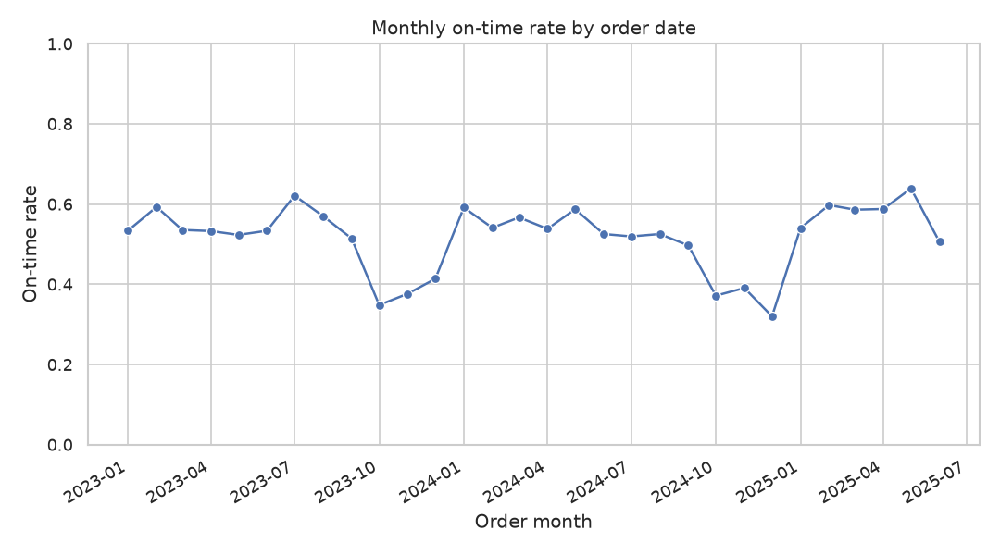
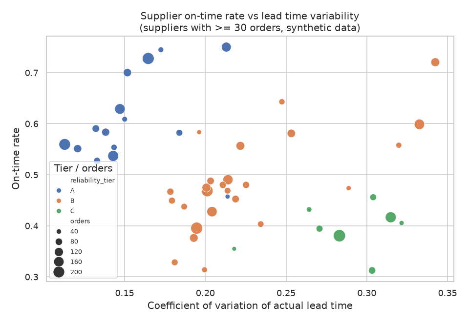
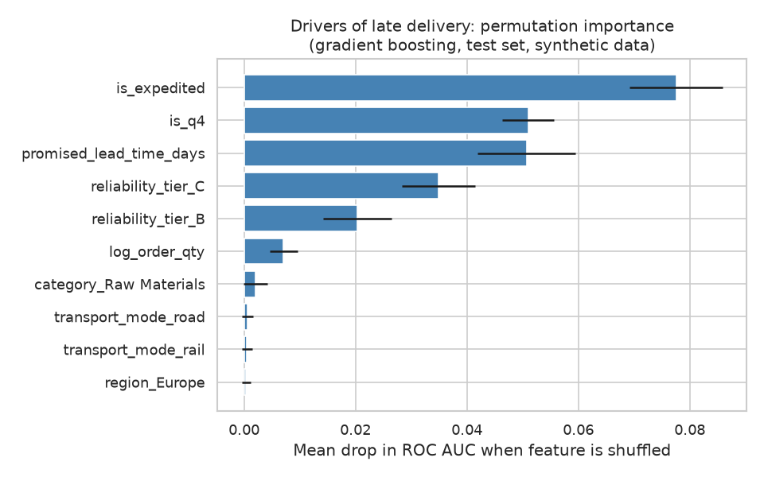

# Supply Chain Lead Times

Supplier lead time variability and on-time delivery KPIs.

> **Note:** All data in this project is **synthetic**. It is generated by `src/data_generator.py` with a fixed random seed and does not describe any real company, supplier or shipment.

## Business question

Which suppliers and shipment conditions drive lead time variability and late deliveries, and how reliable is the supply base against its promised delivery dates?

## Goal

Quantify on-time delivery performance and lead time variability by supplier, country, category, transport mode and season, and identify the factors that best explain late deliveries. The findings should help procurement teams decide where to adjust safety stock, renegotiate lead times or diversify suppliers.

## Plan of the work

1. **Data generation**: build a synthetic supplier master table and a purchase order table with promised and actual delivery dates (done).
2. **EDA**: data quality checks, distributions of lead time and delay, and on-time rate by segment and over time (done).
3. **Analysis / model**: supplier KPIs (on-time rate, mean and standard deviation of lead time, coefficient of variation), statistical comparisons between segments, and models of late delivery and delay (implemented in `src/analysis.py`).
4. **SQL**: KPI queries (on-time rate by supplier, monthly trend, supplier ranking) over the same tables (implemented in `sql/queries.sql`, run by `src/run_sql.py`).
5. **Tests**: pytest checks for data generation (columns, row counts, keys, date logic, value ranges) and for the helper functions in `src/utils.py` (implemented in `tests/`).

## Dataset (synthetic)

The generator writes two CSV tables to `data/`:

| Table | Rows | Description |
|---|---|---|
| `suppliers.csv` | 60 | Supplier master data: country, region, category, transport mode, reliability tier, contractual lead time |
| `purchase_orders.csv` | 5000 | Purchase orders from 2023-01-01 to 2025-06-30 with promised and actual delivery dates, quantity, price and on-time flag |

Lead times depend on geography and transport mode, supplier reliability tier, a mild Q4 seasonal slowdown, expedited orders, and occasional random disruptions. Full column definitions and valid ranges are in [data_description.md](data_description.md).

## How to run

Requirements: Python 3.11 and the packages listed in `requirements.txt`.

```bash
python -m venv .venv                 # optional, but recommended
source .venv/bin/activate            # on Windows: .venv\Scripts\activate
pip install -r requirements.txt
python src/data_generator.py   # 1. creates data/suppliers.csv and data/purchase_orders.csv
python src/eda.py              # 2. reads data/, creates figures/
python src/analysis.py         # 3. reads data/, creates figures/ and reports/
python src/run_sql.py          # 4. runs sql/queries.sql on the CSV data and prints results
python -m pytest -q            # 5. runs the tests (see "Tests" below)
```

Run the steps in this order: `eda.py`, `analysis.py` and `run_sql.py` read the CSV files written by the generator. The `data/`, `figures/` and `reports/` folders are created automatically if they are missing. Re-running a script overwrites its previous output files.

The generator uses a fixed seed (42), so running it again produces the same data. The scripts resolve paths from their own location, so they work from the project root or any other working directory.

All scripts are non-interactive: they ask for no input, need no network access and do not open plot windows. Charts are saved as PNG files.

## Tests

Run the tests from the project root:

```bash
python -m pytest -q
```

The tests live in `tests/` and are fast (a few seconds). They do not read or write `data/`, `figures/` or `reports/`, so they can be run before or after the other scripts.

- `tests/test_data_generator.py`: calls the generator functions with the project seed and checks column names, row counts, unique keys, supplier references, date logic (`promised_date`, `delivery_date`, `delay_days`, `on_time`), value ranges and reproducibility.
- `tests/test_utils.py`: checks the functions in `src/utils.py` on small hand-made tables: coefficient of variation, segment and supplier KPIs, chi-square and Kruskal-Wallis wrappers, feature preparation, and classification, regression and baseline metrics.

Each test file adds `src/` to `sys.path`, so the modules can be imported without installing the project.

## EDA

`src/eda.py` loads both CSV files from `data/` and:

- prints shape, data types, missing values and duplicate counts for each table;
- runs integrity checks (unique keys, no orphan supplier ids, `delay_days` and `on_time` consistent with the dates);
- prints descriptive statistics of lead times, delay, quantity, price and order value, plus the overall on-time rate;
- prints aggregations of on-time rate, delay and lead time mean/standard deviation by reliability tier, transport mode, region, category, order quarter and expedited flag, and lists the suppliers with the lowest on-time rates;
- saves four charts to `figures/`:
  - `delay_distribution.png`: histogram of delay days;
  - `on_time_by_mode_tier.png`: on-time rate by transport mode and reliability tier;
  - `monthly_on_time_rate.png`: monthly on-time rate trend;
  - `lead_time_by_region.png`: actual lead time boxplots by region.

## Method

`src/analysis.py` merges orders with supplier attributes and runs the following steps. Reusable logic (KPI functions, statistical test wrappers, feature preparation, metric functions) lives in `src/utils.py`, which `analysis.py` imports from the same `src/` folder.

1. **KPIs.** For each supplier, country and reliability tier it computes the number of orders, on-time rate (share of orders with `delay_days <= 0`), mean delay, and the mean, standard deviation and coefficient of variation (CV = std / mean) of actual lead time. Suppliers with at least 30 orders are ranked, and the Spearman correlation between supplier lead time CV and on-time rate is reported.
2. **Statistical tests.** Chi-square tests of independence between the on-time flag and reliability tier, transport mode, region, category and season (Q4 vs the rest of the year), plus a Kruskal-Wallis test of delay days across reliability tiers.
3. **Late delivery models.** The target is a late delivery (`on_time == 0`). Features are promised lead time, expedited flag, log order quantity, a Q4 flag, and one-hot encoded transport mode, reliability tier, region and category. The data is split 75/25 into train and test sets with `random_state=42`, stratified on the target. Two classifiers are fitted:
   - logistic regression on standardised features (odds ratios are per 1 standard deviation of a feature);
   - gradient boosting, whose drivers are ranked with permutation importance on the test set (drop in ROC AUC).

   Test metrics are ROC AUC, accuracy, precision, recall and F1, compared against a majority-class accuracy baseline.
4. **Delay regression.** A linear regression of `delay_days` on the same features, evaluated on the same test set with MAE, RMSE and R², compared with a baseline that always predicts the training mean delay.

Caveats: the data is synthetic, so the drivers found simply reflect the rules written into the generator. Reliability tier is a generator-level attribute and in real data it would have to be estimated from history. Feature importance describes association in this dataset, not causal effects.

## SQL

`sql/queries.sql` holds eight commented queries in the SQLite dialect. Each query is preceded by a `-- Q<n>:` comment line that states the business question:

| Query | Question |
|---|---|
| Q1 | On-time rate by reliability tier and transport mode |
| Q2 | Lowest on-time suppliers with at least 30 orders, ranked with `RANK()` |
| Q3 | Monthly on-time rate with a 3-month moving average (window function) |
| Q4 | Lead time mean, standard deviation and CV by country |
| Q5 | On-time rate for orders placed in Q4 vs the rest of the year |
| Q6 | Expedited vs standard orders |
| Q7 | Suppliers that perform worst relative to their own tier average (CTEs) |
| Q8 | Share of order value delivered late, by category |

`src/run_sql.py` loads both CSV files into an in-memory SQLite database with `pandas.to_sql` (dates stay as `YYYY-MM-DD` text), splits `queries.sql` into statements on semicolons, runs each one and prints its description and the first rows of the result. Nothing is written to disk. Because SQLite has no standard deviation function, Q4 computes the population standard deviation from averages, so it can differ slightly from the sample standard deviation reported by `analysis.py`.

## Outputs

- Console output with all labelled metrics, tables and test results.
- `figures/` from `eda.py`: the four EDA charts listed above.
- `figures/supplier_otd_vs_variability.png`: supplier on-time rate vs lead time CV, coloured by tier.
- `figures/late_delivery_feature_importance.png`: permutation importance of the drivers of late delivery.
- `reports/metrics.json`: summary of KPIs, test results and model metrics.
- Console output of `run_sql.py` with the result of each SQL query.

## Results

All numbers below come from the program output of a run with seed 42 on the synthetic data (5000 orders, 60 suppliers). Re-running the scripts reproduces them.

### Overall delivery performance

- Overall on-time rate: **0.515**; mean delay: **1.53 days**.
- Expedited share of orders: **0.085**.
- 48 suppliers have at least 30 orders and are ranked.

### On-time rate by segment

| Segment | On-time rate | Mean delay (days) |
|---|---|---|
| Reliability tier A | 0.621 | 0.122 |
| Reliability tier B | 0.484 | 1.551 |
| Reliability tier C | 0.395 | 4.351 |
| Transport: road | 0.587 | 0.606 |
| Transport: rail | 0.574 | 0.687 |
| Transport: air | 0.497 | 1.337 |
| Transport: sea | 0.467 | 2.236 |
| Region: North America | 0.636 | 0.407 |
| Region: Europe | 0.510 | 0.999 |
| Region: Asia | 0.466 | 2.268 |
| Orders placed in Q1-Q3 | 0.553 | 1.19 |
| Orders placed in Q4 | 0.371 | 2.83 |
| Standard orders | 0.478 | 2.076 |
| Expedited orders | 0.917 | -4.348 |

By category, the on-time rate ranges from **0.623** (Raw Materials) to **0.471** (MRO); Packaging is **0.476**. The share of order value delivered late is highest for Packaging (**0.565**) and lowest for Raw Materials (**0.311**).

### Suppliers

- Lowest on-time rates (at least 30 orders): S004 (0.312, China, tier C, mean delay 7.200 days), S002 (0.314, Turkey, tier B) and S021 (0.328, Vietnam, tier B).
- Highest on-time rates: S026 (0.750, Mexico, tier A), S029 (0.745, Mexico, tier A) and S052 (0.728, USA, tier A).
- Spearman correlation between supplier lead time CV and on-time rate (n=48): **rho = -0.301, p = 0.03793**.
- Lead time CV by country ranges from **0.453** (USA) to **0.222** (India), while the lead time standard deviation is largest for China (**10.04** days) and Vietnam (**9.61** days) and smallest for USA (**2.88** days).
- Lead time CV by tier: A 0.602, B 0.622, C 0.537.

### Statistical tests

All tests reject independence or equality at very small p-values:

| Test | Statistic | p-value |
|---|---|---|
| Chi-square, on-time vs reliability tier | 131.94 | 2.238e-29 |
| Chi-square, on-time vs transport mode | 61.55 | 2.738e-13 |
| Chi-square, on-time vs region | 91.69 | 1.231e-20 |
| Chi-square, on-time vs category | 49.50 | 4.599e-10 |
| Chi-square, on-time vs season (Q4 vs rest) | 108.84 | 1.762e-25 |
| Kruskal-Wallis, delay days by tier | H = 140.48 | 3.134e-31 |

### Models

Test set of 1250 orders, majority-class accuracy baseline **0.515**.

| Model (target: late delivery) | ROC AUC | Accuracy | Precision | Recall | F1 |
|---|---|---|---|---|---|
| Logistic regression | 0.700 | 0.650 | 0.624 | 0.696 | 0.658 |
| Gradient boosting | 0.707 | 0.655 | 0.634 | 0.683 | 0.658 |

- Logistic regression odds ratios per 1 SD: reliability tier C **1.459**, tier B **1.373**, Q4 flag **1.370**, promised lead time **1.140**, expedited **0.498**, region North America **0.799**.
- Permutation importance (ROC AUC drop) of gradient boosting: `is_expedited` **0.0776**, `is_q4` **0.0510**, `promised_lead_time_days` **0.0507**, `reliability_tier_C` **0.0349**, `reliability_tier_B` **0.0203**.

| Delay regression (test set) | MAE | RMSE | R² |
|---|---|---|---|
| Linear regression | 3.598 | 6.037 | 0.144 |
| Mean-only baseline | 3.980 | 6.526 | -0.000 |

### Figures

On-time rate over time (monthly trend from `eda.py`):



Supplier on-time rate vs lead time variability (CV), coloured by reliability tier:



Permutation importance of the drivers of late delivery (gradient boosting):



## Conclusions

These conclusions apply to the synthetic dataset only and are limited to what the numbers above show.

- **The supply base is unreliable against promised dates.** Only 0.515 of orders arrive on or before the promised date, with a mean delay of 1.53 days.
- **Reliability tier separates suppliers clearly.** The on-time rate falls from 0.621 (A) to 0.484 (B) and 0.395 (C), and mean delay rises from 0.122 to 4.351 days. Tier is significant in both the chi-square and Kruskal-Wallis tests.
- **Orders placed in Q4 are much more often late.** The on-time rate is 0.371 in Q4 against 0.553 in Q1-Q3. Q4 is also among the top drivers in both models, so safety stock or earlier ordering for Q4 looks worth considering.
- **Expedited orders are the strongest single signal.** Their on-time rate is 0.917 against 0.478 for standard orders, and `is_expedited` has the largest permutation importance (0.0776). Expedited orders are only 0.085 of volume, and this is an association, not proof that expediting itself causes on-time delivery.
- **Long routes perform worse.** Sea (0.467) and Asia (0.466) have the lowest on-time rates and the highest mean delays. The raw road figure (0.587) and its adjusted odds ratio (1.095 per SD) point in different directions, so transport mode and region are entangled and should not be read separately.
- **Variability depends on the metric used.** In absolute terms, long-haul countries (China, Vietnam) have the largest lead time standard deviations. In relative terms (CV), the USA is the highest (0.453) and India the lowest (0.222). Across suppliers, higher CV goes with a lower on-time rate, but the correlation is only weak to moderate (rho = -0.301, p = 0.03793). The tier CVs (A 0.602, B 0.622, C 0.537) do not rise steadily with worse tiers.
- **Individual suppliers stand out.** S004 (0.312 on-time, mean delay 7.200 days) and S002 (0.314) are the weakest ranked suppliers, making them natural candidates for renegotiation or diversification. Q7 shows S002, S025 and S021 as the furthest below their own tier average (gaps of -0.170, -0.164 and -0.155).
- **Packaging is the weakest category by value.** Its late value share is 0.565, while Raw Materials is 0.311.
- **Late deliveries are only partly predictable.** Both classifiers reach about 0.70 ROC AUC and accuracy of 0.650-0.655 against a 0.515 baseline. The delay regression explains only R² = 0.144 of delay variance, which beats the mean baseline (MAE 3.598 vs 3.980) but leaves most of it unexplained.

## Limitations & next steps

**Limitations**

- The data is **synthetic**. The drivers found (tier, Q4, expedited, geography) reflect rules written into `src/data_generator.py`, so the results say nothing about real suppliers or logistics networks.
- Reliability tier is a generator attribute. In practice it would have to be estimated from past performance, which risks leakage when evaluated on the same history.
- Model and importance results show association, not causation. Features such as region and transport mode are correlated, which makes single coefficients hard to interpret.
- Model performance is modest (ROC AUC around 0.70) and was measured on a single 75/25 split with no cross-validation or hyperparameter tuning.
- Supplier rankings for suppliers with only 30 or so orders rest on small samples, and no confidence intervals are reported.
- The Q4 effect is defined on the order quarter, and only about two and a half years of data are covered, so the seasonal pattern cannot be separated from year-to-year effects.

**Next steps**

- Add bootstrap confidence intervals for supplier on-time rates and rank suppliers with a shrinkage or Bayesian estimate.
- Use cross-validation and a time-based split (train on earlier orders, test on later ones) to check that the models hold up over time.
- Fit a multivariable model that accounts for region and transport mode together, or add an interaction term, to separate their effects.
- Translate the delay distribution into safety stock levels per supplier or country, using the lead time standard deviation.
- Replace the generator-level tier with a tier estimated from the first part of the history, then validate it on later orders.
- Repeat the analysis on real purchase order data, if available.

---

*This is a training project that uses synthetic data generated by AI.*
