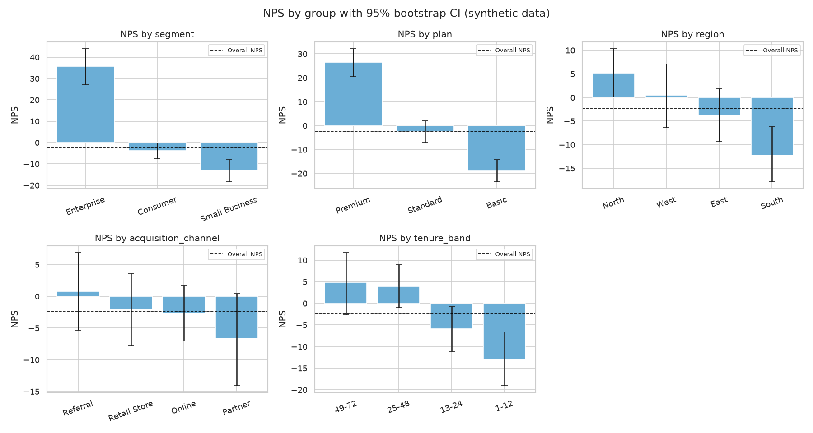
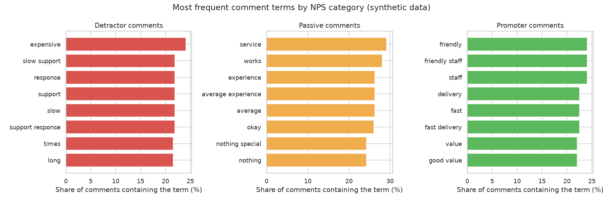
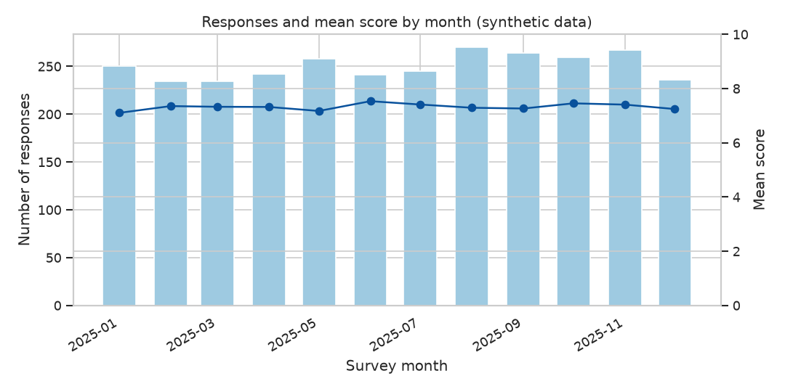

# Customer Survey NPS Analysis

## Business question
Which customer segments are the most loyal, and which are the least? What do customers say in their comments that explains their scores? The answers should show where to focus efforts to improve customer experience.

## Goal
Calculate the Net Promoter Score (NPS) for the whole customer base, compare it across segments (customer segment, plan, region, acquisition channel, tenure), test whether the differences are statistically meaningful, and find the keywords and phrases that appear most often in promoter, passive and detractor comments.

## Plan of the work
1. **Data generation** (`src/data_generator.py`): build a reproducible synthetic dataset of customers and survey responses.
2. **EDA** (`src/eda.py`): check data quality (missing values, duplicates, ranges), look at the score distribution, response rates and comment coverage.
3. **Analysis** (`src/analysis.py`, helpers in `src/utils.py`):
   - NPS calculation (% promoters minus % detractors) overall and over time.
   - Segment comparison with bootstrap confidence intervals and significance tests.
   - Text keyword frequency by NPS category (promoter, passive, detractor).
4. **SQL** (`sql/queries.sql`, `src/run_sql.py`): queries for overall NPS, NPS by segment, plan, channel, month and tenure band, response rate and comment keywords.
5. **Tests** (`tests/`): pytest checks for the data generator and for the helper functions in `src/utils.py`.

## Dataset (synthetic)
All data is **synthetic**. It is generated by `src/data_generator.py` with numpy (fixed seed 42) and does not describe real customers or real survey answers. Two tables are saved to `data/`:

- `customers.csv`: 4000 customers with segment, plan, region, acquisition channel and tenure.
- `survey_responses.csv`: 3000 survey responses (one per surveyed customer) with a 0-10 recommendation score, an NPS category and an optional free-text comment.

The `data/` folder does not need to exist beforehand; the generator creates it. See `data_description.md` for every column.

## Requirements
- Python 3.11
- Packages listed in `requirements.txt` (numpy, pandas, matplotlib, seaborn, scipy, pytest)
- The SQL step uses `sqlite3` from the Python standard library, so nothing extra is needed.

## How to run
From the project root (the folder that contains `src/`):

```bash
pip install -r requirements.txt
python src/data_generator.py
python src/eda.py
python src/analysis.py
python src/run_sql.py
python -m pytest -q
```

Expected console output of the generator (row and column counts):

```text
Saved customers.csv: 4000 rows, 7 columns
Saved survey_responses.csv: 3000 rows, 6 columns
Output folder: <path-to-project>/data
```

Re-running the generator overwrites both CSV files. Because the seed is fixed, the output is the same on every run.

Scripts run non-interactively: they do not prompt for input, open plot windows or access the network.

## Tests (`tests/`)
Run the test suite from the project root:

```bash
python -m pytest -q
```

- `tests/test_data_generator.py`: column names, row counts, value ranges (score 0-10, tenure 1-72, survey dates in 2025), category-to-score consistency, key uniqueness, the share of missing comments and reproducibility with the fixed seed.
- `tests/test_utils.py`: NPS calculation (known values, empty input, invalid scores), bootstrap confidence intervals, tenure bands, group comparison and keyword extraction.

The tests build the synthetic tables in memory, so they do not need the files in `data/` or `figures/`, and they do not write any files. The last run reported 14 passed tests in 1.62 s.

## Exploratory data analysis (`src/eda.py`)
The EDA script reads both CSV files from `data/` (run the generator first) and prints its findings to the console. It does the following:

- **Data quality:** shape, data types, missing values and duplicate rows for each table; uniqueness of keys, orphan `customer_id` values, score and date ranges, and whether `nps_category` matches `nps_score`.
- **Descriptive statistics:** summary statistics for tenure and score, and category shares of segment, plan, region and acquisition channel.
- **Aggregations:**
  1. NPS category distribution.
  2. Survey response rate by segment.
  3. Mean score and promoter / detractor shares by segment and plan.
  4. Mean score by region and acquisition channel.
  5. Comment coverage by NPS category.
- **Charts** saved to `figures/` (created automatically):
  - `score_distribution.png`: counts of each 0-10 score, colored by category.
  - `category_share_by_group.png`: category shares by segment and plan.
  - `monthly_responses_and_score.png`: responses and mean score per month.
  - `score_by_tenure.png`: score distribution by tenure band.

## Method (`src/analysis.py`)
The script joins responses to customer attributes (one response per customer) and prints every result with a label. Reusable functions live in `src/utils.py` so they can be unit tested.

1. **NPS definition.** NPS = % promoters (scores 9-10) minus % detractors (scores 0-6), on a scale from -100 to 100. Passives (7-8) count in the base but not in the numerator.
2. **Uncertainty.** Each NPS value gets a 95% percentile bootstrap confidence interval (2000 resamples of the responses, fixed seed 42). This is done for the whole base and for every group.
3. **Segment comparison.** NPS, category shares and mean score are computed by segment, plan, region, acquisition channel and tenure band (1-12, 13-24, 25-48, 49-72 months). For each dimension two tests check whether groups differ:
   - chi-square test of independence between group and NPS category;
   - Kruskal-Wallis test on the raw 0-10 scores (no normality assumption).

   Because five dimensions are tested, a Bonferroni-adjusted p-value (p multiplied by 5, capped at 1) is reported as well. The gap between the best and worst group of each dimension is given with a bootstrap CI; since those two groups are chosen after looking at the data, that interval is optimistic and should be read as descriptive.
4. **Time trend.** NPS and response counts per survey month. Months have fewer responses than the whole base, so month-to-month swings can be noise.
5. **Comment keywords.** Comments are lowercased and split into words; a short stop word list is removed. Unigrams and bigrams (adjacent word pairs) are counted once per comment. For each NPS category the script reports the terms that appear in the largest share of that category's comments. Only responses with a comment are used, and no sentiment model is involved.

### Outputs
- Console tables: overall NPS, monthly NPS, group tables with test results, keyword tables.
- `figures/nps_by_group.png`: NPS by group with 95% CI error bars for each dimension, with the overall NPS as a reference line.
- `figures/keywords_by_category.png`: most frequent comment terms for promoters, passives and detractors.
- `reports/metrics.json`: all computed metrics (overall NPS and CI, monthly NPS, group tables, test statistics, keyword counts). The folder is created automatically. Numbers appear only after the script has been run.

## SQL analysis (`sql/queries.sql`, `src/run_sql.py`)
The same questions can be answered directly with SQL. `src/run_sql.py` loads both CSV files into an in-memory SQLite database (`pandas.DataFrame.to_sql`), so no database file is created and no server is needed. It then splits `sql/queries.sql` into statements, runs each one and prints the description of the query with the first 10 rows of the result.

Run it from the project root after generating the data:

```bash
python src/run_sql.py
```

Each query is preceded by a comment line of the form `-- Q<n>: question`, which the script prints as the heading. The queries use the SQLite dialect:

| Query | Question |
|---|---|
| Q1 | Overall NPS and category counts |
| Q2 | Survey response rate by segment (LEFT JOIN of customers to responses) |
| Q3 | NPS by customer segment |
| Q4 | NPS by plan and by acquisition channel (UNION ALL) |
| Q5 | NPS by survey month (`strftime`) |
| Q6 | NPS by tenure band (CASE expression) |
| Q7 | Lowest-NPS segment and plan combinations with at least 30 responses |
| Q8 | Share of comments per NPS category that mention selected keywords (LIKE) |

Notes:
- NPS in SQL is `100 * (promoters - detractors) / responses`, the same definition as in `src/utils.py`.
- The SQL queries give point estimates only. Confidence intervals and significance tests are in `src/analysis.py`.
- Keyword matching with `LIKE` is a simple substring check, so it is less flexible than the unigram and bigram counts in the Python analysis.
- Semicolons separate statements, so do not use them inside comments in `queries.sql`.

## Results
All numbers below come from the program output of the scripts in this project and describe **synthetic data**, not real customers.

### Overall NPS
- 3000 responses from 4000 customers. The mean score is 7.32.
- Category shares: 30.8% promoters, 36.0% passives, 33.2% detractors.
- **Overall NPS = -2.4** (95% bootstrap CI -5.1 to 0.4). The interval includes 0.

### NPS by customer segment
| Segment | Responses | NPS | 95% CI |
|---|---|---|---|
| Enterprise | 311 | 35.7 | 27.0 to 44.1 |
| Consumer | 1825 | -3.8 | -7.5 to -0.2 |
| Small Business | 864 | -13.1 | -18.4 to -7.9 |

Chi-square test of segment against NPS category: chi2 = 92.74, p = 3.4e-19. Kruskal-Wallis on scores: H = 102.38, p = 5.9e-23.

### NPS by plan
| Plan | Responses | Mean score | Promoters % | Detractors % | NPS |
|---|---|---|---|---|---|
| Premium | 676 | 8.05 | 47.04 | 20.56 | 26.5 |
| Standard | 1154 | 7.34 | 30.24 | 32.84 | -2.6 |
| Basic | 1170 | 6.88 | 21.97 | 40.85 | -18.9 |

The lowest segment and plan combination with at least 30 responses is Small Business on the Basic plan (204 responses, NPS -35.8), followed by Consumer on Basic (953 responses, NPS -15.4). Small Business on Premium has an NPS of 10.3 (214 responses).

### Region, acquisition channel and tenure
| Dimension | Best group (NPS) | Worst group (NPS) | Gap (95% bootstrap CI) | Chi-square p (Bonferroni) |
|---|---|---|---|---|
| Acquisition channel | Referral (0.8) | Partner (-6.6) | 7.4 (-2.6 to 16.8) | 0.6975 (1) |
| Tenure band | 49-72 months (4.9) | 1-12 months (-12.9) | 17.8 (8.1 to 27.2) | 0.0004652 (0.002326) |

- Region: the best-worst gap is North minus South = 17.3 NPS points (95% bootstrap CI 9.8 to 24.8). Kruskal-Wallis on scores gives H = 18.02, p = 0.0004366 (Bonferroni p = 0.002183). Mean scores are 7.50 in the North and 7.09 in the South.
- Acquisition channel: Kruskal-Wallis p = 0.6254, so there is no evidence of a difference between channels.
- Tenure: NPS by band is 1-12 months -12.9, 13-24 months -5.9, 25-48 months 4.0 and 49-72 months 4.9. Kruskal-Wallis H = 28.72, p = 2.568e-06 (Bonferroni p = 1.284e-05).
- The best-worst gap CIs are optimistic because the two groups were chosen after looking at the data.

### Time trend
Monthly NPS (about 234 to 270 responses per month) ranges from -12.4 in January to 5.4 in October, and is -8.9 in December. These values come from far fewer responses than the whole base, so no clear trend should be read into them.

### Comment keywords
2097 of 3000 responses (69.9%) have a comment. Coverage is similar across categories (68.4% detractors, 71.9% passives, 69.3% promoters).

| Category | Most frequent terms (share of that category's comments) |
|---|---|
| Detractor | expensive (24.1%), slow support (21.9%), long wait times (21.6%) |
| Passive | service (29.1%), works (28.1%), average experience (26.3%), nothing special (24.2%) |
| Promoter | friendly staff (24.1%), fast delivery (22.5%), good value (22.0%) |

The SQL keyword query (Q8) agrees with this. "expensive" appears in 24.1% of detractor comments and in 0.0% of promoter comments. "easy to use" appears in 21.7% of promoter comments and in 0.0% of detractor comments.

### Figures
NPS by group with 95% confidence intervals and the overall NPS as a reference line:



Most frequent comment terms by NPS category:



Responses and mean score per month:



## Conclusions
- The overall NPS is -2.4 and its CI (-5.1 to 0.4) includes 0, so the base as a whole is roughly balanced between promoters (30.8%) and detractors (33.2%).
- Enterprise customers are the most loyal segment (NPS 35.7, CI 27.0 to 44.1). Small Business is the least loyal (NPS -13.1, CI -18.4 to -7.9). The CIs of these two segments do not overlap, and the segment differences are statistically significant.
- Plan shows a similar pattern: Premium has an NPS of 26.5 and Basic -18.9. The weakest group found is Small Business on the Basic plan (NPS -35.8, 204 responses).
- Newer customers are less loyal. NPS is -12.9 in the first 12 months and about 4 to 5 after 24 months, and the tenure differences are significant after Bonferroni adjustment.
- Region differs significantly on the score (North has the highest mean score, 7.50, and South the lowest, 7.09), but the differences in mean score are small. Acquisition channel shows no significant difference (p = 0.6975).
- Detractor comments mention price (expensive), slow support and long wait times. Promoter comments mention friendly staff, fast delivery and good value. Passive comments are neutral (average experience, nothing special). These terms describe what customers write, and the data cannot show that they cause the scores.
- Monthly NPS moves between -12.4 and 5.4. With roughly 250 responses per month, the data does not support claims about a trend.

## Limitations & next steps
**Limitations**
- The data is **synthetic**. Group differences and comment wording were built into the generator, so the findings illustrate the method and are not evidence about real customers or markets.
- Groups are analysed one dimension at a time. Overlapping effects (for example enterprise customers mostly on premium plans, or newer customers on basic plans) are not separated, so the effect of each factor on its own is unknown.
- Statistical significance does not imply practical importance. Check the NPS gap and the CI width, and remember that best-versus-worst CIs are optimistic.
- Keyword counts are plain word and word-pair frequencies. They do not handle negation, synonyms or sentiment, and only the 69.9% of respondents who left a comment are covered.
- Monthly NPS values rest on about 250 responses each and are noisy.

**Next steps**
- Fit a multivariable model (for example logistic regression for promoter versus not, or an ordinal model) with segment, plan, region, channel and tenure together, to separate overlapping effects.
- Add confidence intervals to the monthly NPS and test for a trend.
- Improve the text analysis with lemmatization, TF-IDF or topic grouping, and compare it with a simple sentiment baseline.
- Repeat the analysis on real survey data, if available, and check for non-response bias (30% of customers did not respond to the survey).

---

*This is a training project that uses synthetic data generated by AI.*
