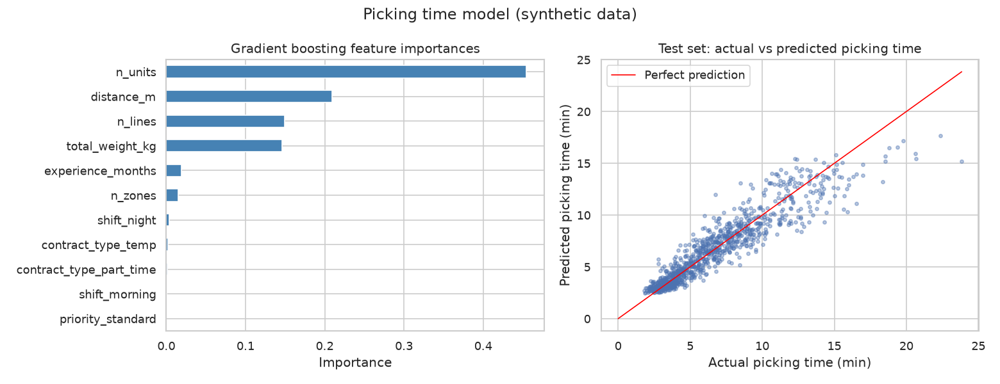
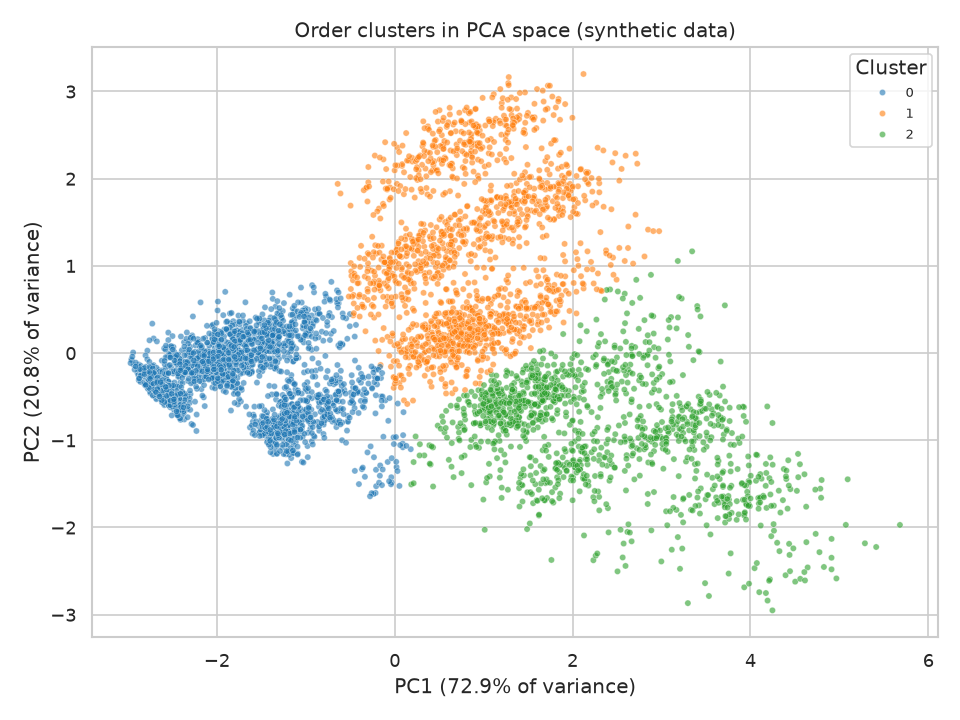
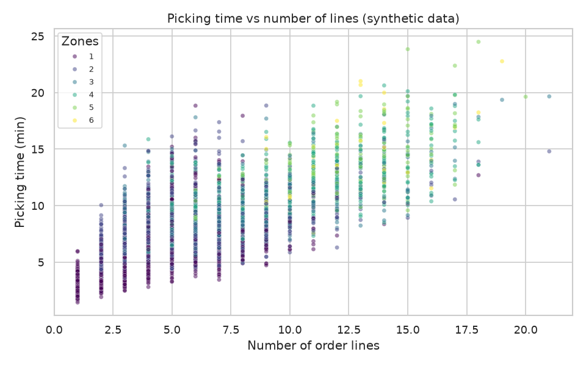

# Warehouse Order Picking

Picking time analysis and k-means clustering of order profiles.

> **Note:** All data in this project is **synthetic**. It is generated by `src/data_generator.py` with a fixed random seed. It does not describe any real warehouse.

## Business question

Which kinds of orders take the longest to pick, and which factors (order size, weight, number of zones visited, picker experience, shift) drive picking time? Can orders be grouped into a few distinct profiles that the warehouse could plan staffing and routing around?

## Goal

- Understand what drives picking time per order.
- Segment orders into interpretable profiles with k-means clustering.
- Provide a clear basis for planning decisions, such as batching small orders or assigning experienced pickers to complex orders.

## Plan of the work

1. **EDA**: check data quality, look at the distributions of the main variables, and examine relationships with picking time.
2. **Analysis / model**:
   - a regression model of picking time based on order characteristics;
   - k-means clustering of order profiles (scaled features, choice of k, cluster interpretation).
3. **SQL**: analytical queries on the order and picker tables (aggregations by shift, picker group, and so on).
4. **Tests**: pytest checks of the data generator (reproducibility, schema, value ranges) and of the helper functions in `src/utils.py`.

## Dataset (synthetic)

Two CSV tables are written to `data/`:

| Table | Rows | Description |
|-------|------|-------------|
| `pickers.csv` | 60 | One row per warehouse picker (experience, contract type). |
| `orders.csv` | 5000 | One row per picked order (size, weight, zones, distance, picking time). |

The orders come from four latent order profiles (small single-item orders, medium multi-line orders, bulk orders with many units, and multi-zone orders with many lines). The profile label is not stored in the data, so it has to be recovered by clustering. See `data_description.md` for every column.

## How to run

From the project root:

```bash
pip install -r requirements.txt
python src/data_generator.py
python src/eda.py
python src/analysis.py
python src/run_sql.py
python -m pytest -q
```

The generator creates the `data/` folder if needed and writes `data/pickers.csv` and `data/orders.csv`. It runs non-interactively and gives the same output on every run (seed 42). Run the generator before the EDA, analysis and SQL scripts.

## Exploratory data analysis

`src/eda.py` loads both CSV files from `data/` and:

- prints the shape, data types, missing values and duplicate count of each table;
- prints descriptive statistics and skewness of the numeric order columns;
- prints aggregations of picking time by shift, priority, contract type, number of zones and picker experience band, plus the correlation of each numeric column with picking time;
- saves four charts to `figures/`:
  - `pick_time_distribution.png`: histogram of picking time;
  - `pick_time_vs_lines.png`: picking time vs number of lines, colored by zones;
  - `pick_time_by_shift_contract.png`: box plots of picking time by shift and contract type;
  - `correlation_heatmap.png`: correlation matrix of the numeric order columns.

All figures and printed numbers come from the synthetic data and are produced when the script runs; run it to see the results.

## Method (analysis)

`src/analysis.py` joins orders with pickers and runs two analyses. Reusable logic (feature preparation, metrics, clustering helpers) lives in `src/utils.py`.

### 1. Regression of picking time

- **Features:** `n_lines`, `n_units`, `total_weight_kg`, `n_zones`, `distance_m`, picker `experience_months`, and one-hot encoded `shift`, `priority` and `contract_type`.
- **Split:** 80% train / 20% test with `random_state=42`.
- **Models:**
  - a baseline that always predicts the training mean;
  - linear regression on `log(1 + pick_time_min)` with standardized features (effects on time are roughly multiplicative, and standardized coefficients show relative driver strength);
  - gradient boosting (`GradientBoostingRegressor`) on the raw target, to capture non-linear effects.
- **Metrics:** MAE, RMSE and R² on the test set (in minutes for MAE and RMSE), plus 5-fold cross-validated R² on the training set. Linear model predictions are transformed back to minutes before computing metrics.
- **Interpretation:** standardized linear coefficients and gradient boosting feature importances are printed to show which factors matter most.

### 2. K-means clustering of order profiles

- **Features:** `n_lines`, `n_units`, `total_weight_kg`, `n_zones`, `distance_m`. Picking time and picker information are deliberately excluded, so clusters describe the order itself.
- **Preparation:** `n_lines`, `n_units` and `total_weight_kg` are right-skewed and are log-transformed; all features are then standardized.
- **Choice of k:** k-means is fitted for k = 3 to 8 and the k with the highest silhouette score is selected. The lower bound of 3 is a design choice, so the result is detailed enough to be useful for planning. Inertia is printed too for an elbow check.
- **Interpretation:** each cluster is summarized by size, share, mean order features and mean picking time. A PCA projection to two dimensions is used only for visualization.

### Outputs

- Printed, labelled metrics, coefficient and importance tables, k-selection scores and cluster profiles.
- `figures/regression_results.png`: gradient boosting feature importances and actual vs predicted picking time on the test set.
- `figures/cluster_profiles_pca.png`: clusters projected onto the first two principal components.
- `reports/metrics.json`: regression metrics, k-selection scores and cluster profiles.

Because the data is synthetic, the findings illustrate the method and do not describe a real warehouse.

## SQL analysis

`sql/queries.sql` holds eight analytical queries in the SQLite dialect over the `orders` and `pickers` tables. Each query is preceded by a comment line of the form `-- Q<n>: <question>`. The queries cover:

- Q1: orders and picking time by shift;
- Q2: picking time by priority and contract type (join with `pickers`);
- Q3: picking time and time per line by picker experience band (`CASE` expression);
- Q4: walking distance and picking time by number of zones;
- Q5: order size classes with their share of all orders (CTE and window function);
- Q6: monthly trend of picking time;
- Q7: the ten slowest pickers per line, with at least 50 orders (`HAVING`);
- Q8: the fastest picker within each contract type (CTEs and `ROW_NUMBER`).

`src/run_sql.py` loads both CSV files into an in-memory SQLite database with `pandas.to_sql`, splits `queries.sql` into statements on semicolons, runs each one and prints its description and the first rows of the result. Nothing is written to disk and no network access is needed.

```bash
python src/run_sql.py
```

Window functions require SQLite 3.25 or newer, which is included with Python 3.11.

## Tests

The `tests/` folder contains pytest checks that run in a few seconds. They generate the synthetic data in memory, so they do not need `data/` or `figures/` to exist.

- `tests/test_data_generator.py`: table columns, row counts, unique IDs, value ranges (lines, units, weight, zones, distance, picking time, dates), category values and reproducibility with a fixed seed.
- `tests/test_utils.py`: `load_merged` (using temporary CSV files), `build_regression_data`, `regression_metrics` (known values), `prepare_cluster_features` (scaling, input not modified), `choose_k`, `evaluate_k_range` and `profile_clusters`.

Run all tests from the project root:

```bash
python -m pytest -q
```

The last run reported 12 passed.

## Results

All numbers below come from the output of the scripts on the synthetic data (seed 42).

### Data quality and overall picture

- 5000 orders and 60 pickers; no missing values, no duplicate rows, and no orders without a matching picker.
- Picking time per order: mean 6.71 min, median 5.94 min, min 1.43 min, max 24.49 min (skewness 1.03, right-skewed).

### What goes with picking time (EDA)

Correlation with `pick_time_min`:

| Column | Correlation |
|--------|-------------|
| `n_lines` | 0.820 |
| `distance_m` | 0.788 |
| `n_zones` | 0.723 |
| `n_units` | 0.673 |
| `total_weight_kg` | 0.475 |

Mean picking time by number of zones visited: 4.42 min (1 zone, 2282 orders), 6.92 (2), 9.08 (3), 11.31 (4), 13.66 (5) and 14.24 (6 zones, 40 orders).

Mean picking time by order size class (Q5): 3.60 min for 1-2 lines (35.8% of orders), 6.98 for 3-6 lines (36.2%), 9.39 for 7-12 lines (22.3%) and 14.13 for 13+ lines (5.6%).

Differences by shift, contract type and experience are much smaller:

| Group | Mean picking time (min) |
|-------|-------------------------|
| Shift: night (999 orders) | 7.17 |
| Shift: morning (2222 orders) | 6.60 |
| Shift: afternoon (1779 orders) | 6.59 |
| Contract: temp (537 orders) | 7.03 |
| Contract: part_time (1632 orders) | 6.69 |
| Contract: full_time (2831 orders) | 6.66 |
| Experience 1-12 months (584 orders) | 7.01 |
| Experience 13-36 months | 6.65 |
| Experience 37-72 months | 6.71 |
| Experience 73-120 months | 6.65 |

Express orders averaged 6.61 min and standard orders 6.74 min.

### Regression

Test-set metrics (1000 test rows, 4000 train rows; MAE and RMSE in minutes):

| Model | MAE | RMSE | R² | CV R² (train) |
|-------|-----|------|----|---------------|
| Baseline (mean) | 2.919 | 3.646 | -0.000 | n/a |
| Linear, log target | 1.074 | 1.551 | 0.819 | 0.854 |
| Gradient boosting | 0.932 | 1.323 | 0.868 | 0.869 |

Largest drivers:

- Linear model (standardized coefficients on log(1 + time)): `n_lines` 0.166, `distance_m` 0.136, `n_units` 0.101, `total_weight_kg` 0.084, `n_zones` 0.051. The remaining coefficients (shift, contract type, priority, experience) lie between -0.016 and 0.023 in absolute value.
- Gradient boosting importances: `n_units` 0.454, `distance_m` 0.209, `n_lines` 0.149, `total_weight_kg` 0.146. `experience_months` 0.019, `n_zones` 0.015, all others at most 0.003.



### Clustering

Silhouette scores for k = 3 to 8: 0.489, 0.485, 0.465, 0.396, 0.419, 0.419. The highest is at k = 3, which was selected (k = 4 is very close at 0.485).

| Cluster | Orders | Share % | Lines | Units | Weight kg | Zones | Distance m | Pick time min |
|---------|--------|---------|-------|-------|-----------|-------|------------|---------------|
| 0 | 2293 | 45.86 | 2.01 | 2.61 | 1.63 | 1.27 | 72.16 | 3.79 |
| 1 | 1518 | 30.36 | 5.75 | 31.37 | 54.27 | 1.67 | 100.73 | 7.97 |
| 2 | 1189 | 23.78 | 9.29 | 21.30 | 20.31 | 3.71 | 187.39 | 10.74 |



### Picking time vs order size



### SQL highlights

- Total picking hours by shift (Q1): morning 244.6, afternoon 195.3, night 119.4.
- Monthly mean picking time (Q6): 6.55 min (2025-01), 6.86 (2025-02), 6.74 (2025-03).
- Mean minutes per line by experience band (Q3): 1.90 (1-12 months), 1.89 (13-36), 1.73 (37-72), 1.75 (73-120).
- Fastest picker per line within each contract type (Q8): P006 full_time (1.36), P049 part_time (1.53), P043 temp (1.88).

## Conclusions

- Order size and routing dominate picking time. Lines, distance, zones and units all correlate strongly with picking time (0.673 to 0.820), and mean time rises from 3.60 min for 1-2 line orders to 14.13 min for 13+ line orders.
- The models can predict picking time well from order features alone: gradient boosting reaches R² 0.868 (MAE 0.932 min) against a baseline MAE of 2.919 min, and the log-linear model reaches R² 0.819.
- Shift, contract type, priority and experience have comparatively small effects. Night shift (7.17 min vs about 6.6) and temp contracts (7.03 vs about 6.7) are somewhat slower, and the least experienced band (1-12 months) is slower per line (1.90 vs 1.73 to 1.75 for 37+ months). These gaps are small next to the effect of order size, and the model coefficients and importances for these factors are close to zero.
- The feature rankings depend on the model: the linear model puts `n_lines` first, gradient boosting puts `n_units` first, and `n_zones` has a high correlation (0.723) but a small model weight (0.051 linear, 0.015 boosting). The order-size features are strongly related to each other, so the ranking among them should not be over-interpreted.
- K-means gives three profiles by silhouette: small, low-distance orders (45.86% of orders, 3.79 min), heavy bulk-type orders with many units and the highest weight (30.36%, 7.97 min), and multi-zone, long-distance orders (23.78%, 10.74 min, the slowest). The multi-zone cluster is a candidate for experienced pickers or route planning, and the small-order cluster is a candidate for batching. This is a planning suggestion based on the profile means, not a tested intervention.

## Limitations & next steps

- **Synthetic data:** every table is generated by the project's own code, so the strength of the relationships (for example the high R²) reflects how the generator was written, not a real warehouse. Conclusions illustrate the method and must not be transferred to real operations.
- **Number of profiles:** the data was generated from four latent profiles, but silhouette selects k = 3 (k = 4 scores 0.485 vs 0.489). The three clusters may merge some of the original profiles. This was not checked here, for example by comparing against the generator's profile labels.
- **Correlated features:** lines, units, weight, zones and distance are correlated, so single coefficients and importances are hard to interpret. Next steps could include variance inflation checks or permutation importance.
- **Short period:** the orders span only three months (2025-01 to 2025-03), so seasonality and long-term trends cannot be assessed.
- **Picker-level results:** the rankings in Q7 and Q8 are based on 60 pickers with a few dozen to about a hundred orders each; differences between neighbours are small and may be noise. A mixed-effects model with a picker random effect would be a better approach.
- **Experience and shift effects:** these were only examined with descriptive statistics and model coefficients, without significance tests or confidence intervals. Adding them would be a natural next step.
- **Other ideas:** tune the gradient boosting model, try other clustering methods (Gaussian mixture, hierarchical), and add a cost model to turn the profiles into staffing numbers.

---

*This is a training project that uses synthetic data generated by AI.*
