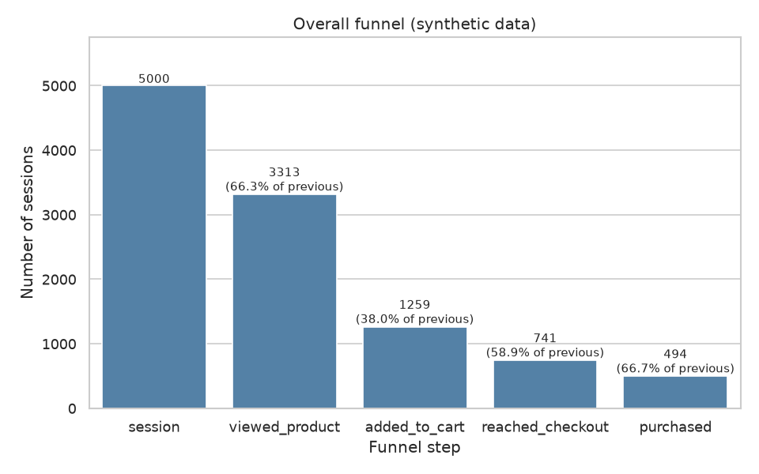
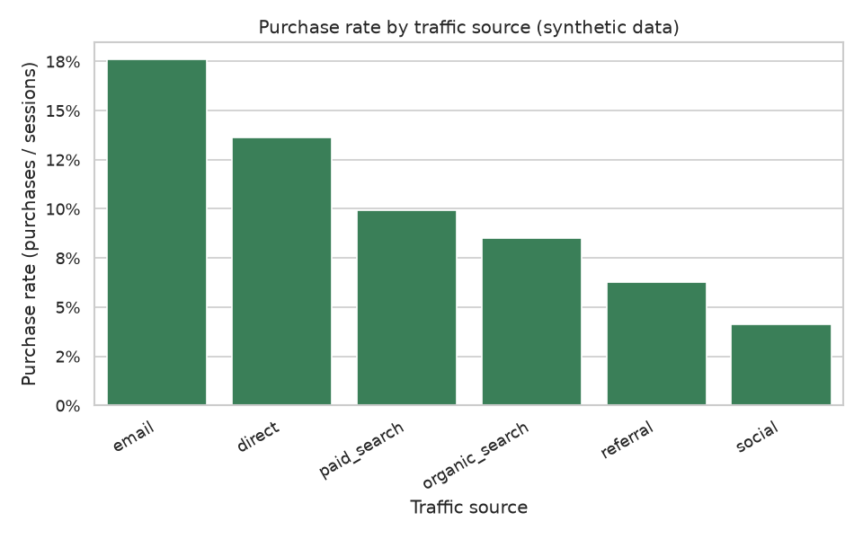
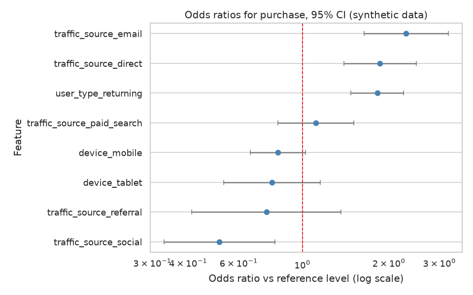

# Website Funnel Analysis

Session funnel, drop-off points and traffic source performance.

> **Note:** all data in this project is **synthetic**. It is generated by `src/data_generator.py` with a fixed random seed and does not describe any real website or company.

## Business question

Where do website visitors drop out of the purchase funnel, and which traffic sources, devices and user groups bring sessions that actually convert into orders?

## Goal

- Measure step-by-step conversion through the funnel: session, product view, add to cart, checkout, purchase.
- Locate the largest drop-off points.
- Compare traffic sources by conversion, revenue per session and (for paid channels) cost efficiency.
- Test whether observed differences between segments are statistically meaningful.

## Plan of the work

1. **Data generation** (done): build a synthetic sessions table and a traffic source cost table.
2. **EDA** (done): data quality checks, distributions, funnel counts and rates, segment breakdowns, charts.
3. **Analysis / model** (done): drop-off analysis per segment, statistical tests (chi-square, proportion tests), and a logistic regression of purchase probability on source, device and user type.
4. **SQL** (done): funnel and traffic source queries (conversion rates, revenue per session, cost per order) stored in `sql/`.
5. **Tests** (done): pytest checks for data generation (columns, row counts, value ranges, funnel nesting, reproducibility) and for the helper functions in `src/utils.py`, stored in `tests/`.
6. **Results and conclusions** (done): key numbers, charts, conclusions and limitations are summarised below.

## Dataset (synthetic)

Two CSV tables are written to `data/`:

| File | Rows | Description |
|------|------|-------------|
| `data/sessions.csv` | 5000 | One row per website session with funnel stage flags and order value |
| `data/traffic_sources.csv` | 6 | One row per traffic source with channel type and cost per session |

Full column descriptions are in [data_description.md](data_description.md).

## How to run

Requirements: Python 3.11 and the packages in `requirements.txt`. Run all commands from the project root:

```bash
pip install -r requirements.txt
python src/data_generator.py
python src/eda.py
python src/analysis.py
python src/run_sql.py
python -m pytest -q
```

The data generator is deterministic (seed 42) and creates the `data/` folder if needed. The EDA, analysis and SQL scripts read the CSV files, so run the generator first.

No script asks for input, so each command can run unattended. The table below shows what each script reads and writes. The `figures/` and `reports/` folders are created automatically when they are missing.

| Script | Reads | Writes |
|--------|-------|--------|
| `src/data_generator.py` | nothing | `data/sessions.csv`, `data/traffic_sources.csv` |
| `src/eda.py` | `data/` | four charts in `figures/` |
| `src/analysis.py` | `data/` | two charts in `figures/`, `reports/metrics.json` |
| `src/run_sql.py` | `data/` | nothing (in-memory database, results printed only) |
| `python -m pytest -q` | nothing | nothing |

## Tests

The tests in `tests/` run in a few seconds, do not need the CSV files or any figures, and write nothing to disk.

```bash
python -m pytest -q
```

| File | What it checks |
|------|----------------|
| `tests/test_data_generator.py` | Column names and row counts, category values, value ranges (duration, pages, dates), nested funnel steps, order value consistent with `purchased`, reproducibility with the fixed seed, and the traffic source table |
| `tests/test_utils.py` | Funnel transitions and segment step conversion on a small hand-made table, two-proportion and chi-square tests, the design matrix for the model, and classification and baseline metrics |

## EDA

`src/eda.py` explores the synthetic tables and does not modify them. It:

- prints shape, data types, missing values and duplicate counts for both tables;
- checks that the funnel steps are nested and shows the session date range;
- prints descriptive statistics for pages viewed, session duration and order value, plus category shares for source, device, country and user type;
- prints four aggregations: the overall funnel (counts, step conversion, drop-off), traffic source performance (funnel rates, revenue per session, average order value, cost, cost per order, net revenue), funnel by device and user type, and funnel by month;
- saves four charts to `figures/`:
  - `funnel_overall.png`: sessions at each funnel step with step conversion;
  - `purchase_rate_by_source.png`: purchase rate by traffic source;
  - `funnel_by_device.png`: share of sessions reaching each step, by device;
  - `order_value_distribution.png`: histogram of order values.

## Method

`src/analysis.py` answers the business question in three parts. Reusable logic (funnel calculations, statistical test wrappers, feature preparation, metric functions) lives in `src/utils.py`.

1. **Drop-off analysis.** For every funnel transition (session to product view, view to cart, cart to checkout, checkout to purchase) the script computes sessions entering, sessions lost and the drop-off rate. It reports both the transition with the highest drop-off rate and the one that loses the most sessions in absolute terms. Conditional step conversion (each step relative to the previous one) is also broken down by traffic source, device and user type.
2. **Statistical tests.** A chi-square test of independence (with Cramér's V as effect size) checks whether purchase is associated with traffic source, device, user type and country. Selected pairs (mobile vs desktop, returning vs new, and email, social and paid search vs organic search) are compared with two-proportion z-tests and a 95% confidence interval for the difference in purchase rate. Several tests are run and p-values are not corrected for multiple comparisons, so they should be read as exploratory.
3. **Logistic regression.** Purchase (0/1) is modelled from traffic source, device and user type, one-hot encoded with organic search, desktop and new users as reference levels. The data is split 80/20 with `train_test_split(random_state=42)`, stratified on the outcome. A scikit-learn model is evaluated on the held-out test set with ROC AUC, average precision, Brier score, log loss, and accuracy, precision, recall and F1 at two thresholds (0.5 and the training purchase rate). It is compared with a constant baseline that always predicts the training purchase rate. Because purchase is a rare outcome, threshold-free metrics (ROC AUC, Brier score, log loss) are the most informative. For interpretation, a statsmodels logistic regression fitted on the same training data provides odds ratios with 95% confidence intervals.

Only session-level categorical features are used. Engagement metrics such as pages viewed and session duration are excluded because they are recorded during the session and partly follow from how deep it went, which would leak the outcome.

### Outputs

- Charts in `figures/`:
  - `step_conversion_by_source.png`: heatmap of conditional step conversion by traffic source;
  - `odds_ratios.png`: forest plot of odds ratios for purchase with 95% confidence intervals.
- `reports/metrics.json`: funnel transitions, test results, split settings, test metrics, baseline metrics and odds ratios.

## Results

All numbers below are copied from the output of `src/eda.py`, `src/analysis.py` and `src/run_sql.py` (synthetic data, seed 42).

### Overall funnel (5000 sessions)

| Step | Sessions | Step conversion | Overall conversion | Drop-off |
|------|---------:|----------------:|-------------------:|---------:|
| session | 5000 | n/a | 1.000 | n/a |
| viewed_product | 3313 | 0.663 | 0.663 | 0.337 |
| added_to_cart | 1259 | 0.380 | 0.252 | 0.620 |
| reached_checkout | 741 | 0.589 | 0.148 | 0.411 |
| purchased | 494 | 0.667 | 0.099 | 0.333 |

The transition `viewed_product -> added_to_cart` has both the highest drop-off rate (0.620) and the most sessions lost (2054).



### Traffic sources

| Source | Channel | Sessions | Purchase rate | Revenue per session | Total cost | Cost per order | Net revenue |
|--------|---------|---------:|--------------:|--------------------:|-----------:|---------------:|------------:|
| email | owned | 472 | 0.176 | 12.820 | 47.20 | 0.569 | 6003.99 |
| direct | unpaid | 917 | 0.136 | 10.124 | 0.00 | 0.000 | 9283.72 |
| paid_search | paid | 1099 | 0.099 | 7.181 | 1318.80 | 12.099 | 6573.48 |
| organic_search | unpaid | 1547 | 0.085 | 6.057 | 0.00 | 0.000 | 9369.85 |
| referral | unpaid | 240 | 0.062 | 4.122 | 72.00 | 4.800 | 917.40 |
| social | paid | 725 | 0.041 | 2.727 | 471.25 | 15.708 | 1505.93 |



### Device and user type

| Segment | Sessions | Purchase rate | Revenue per session |
|---------|---------:|--------------:|--------------------:|
| desktop | 2237 | 0.114 | 8.454 |
| mobile | 2262 | 0.087 | 6.032 |
| tablet | 501 | 0.084 | 6.003 |
| returning | 1718 | 0.137 | 9.684 |
| new | 3282 | 0.079 | 5.767 |

Checkout to purchase conversion is 0.711 on desktop, 0.632 on mobile and 0.592 on tablet.

By month, the purchase rate was 0.110 in 2025-01, 0.105 in 2025-02 and 0.081 in 2025-03.

### Statistical tests

Chi-square tests of independence with purchase:

| Segment | chi2 | dof | p-value | Cramér's V |
|---------|-----:|----:|--------:|-----------:|
| traffic_source | 79.5173 | 5 | 0.0000 | 0.1261 |
| device | 11.1563 | 2 | 0.0038 | 0.0472 |
| user_type | 43.0700 | 1 | 0.0000 | 0.0928 |
| country | 6.1144 | 5 | 0.2953 | 0.0350 |

Two-proportion z-tests (difference in purchase rate, group 1 minus group 2):

| Comparison | Difference | 95% CI | p-value |
|------------|-----------:|--------|--------:|
| mobile vs desktop | -0.0278 | -0.0454 to -0.0102 | 0.0019 |
| returning vs new | 0.0588 | 0.0401 to 0.0775 | 0.0000 |
| email vs organic_search | 0.0905 | 0.0535 to 0.1276 | 0.0000 |
| social vs organic_search | -0.0439 | -0.0640 to -0.0238 | 0.0001 |
| paid_search vs organic_search | 0.0139 | -0.0086 to 0.0364 | 0.2222 |

### Logistic regression (test set, 1000 rows)

| Metric | Model | Constant baseline |
|--------|------:|------------------:|
| ROC AUC | 0.6837 | 0.5000 |
| Brier score | 0.0862 | 0.0892 |
| Log loss | 0.3061 | 0.3229 |
| Average precision | 0.1760 | n/a |

At threshold 0.5 the model predicts no purchases (precision 0.0000, recall 0.0000, accuracy 0.9010). At the training purchase rate threshold (0.0988) it reaches precision 0.1432, recall 0.6768 and F1 0.2363.

Odds ratios (training data; reference: organic_search, desktop, new):

| Term | Odds ratio | 95% CI | p-value |
|------|-----------:|--------|--------:|
| traffic_source_email | 2.295 | 1.638 to 3.217 | 0.000 |
| traffic_source_direct | 1.863 | 1.394 to 2.490 | 0.000 |
| user_type_returning | 1.822 | 1.475 to 2.252 | 0.000 |
| traffic_source_paid_search | 1.114 | 0.821 to 1.511 | 0.489 |
| device_mobile | 0.820 | 0.657 to 1.022 | 0.078 |
| device_tablet | 0.784 | 0.532 to 1.154 | 0.217 |
| traffic_source_referral | 0.749 | 0.411 to 1.363 | 0.344 |
| traffic_source_social | 0.514 | 0.330 to 0.800 | 0.003 |



## Conclusions

- **Biggest drop-off:** the step from product view to add to cart loses the most sessions (2054) and has the highest drop-off rate (0.620). Only 494 of 5000 sessions (0.099) end in a purchase.
- **Traffic sources differ clearly:** email has the highest purchase rate (0.176) and direct is second (0.136), while social has the lowest (0.041). The chi-square test links source to purchase (p = 0.0000, Cramér's V = 0.1261), the strongest association among the segments tested.
- **Paid channels:** social costs 15.708 per order and paid search 12.099, compared with 0.569 for email. Paid search does not differ significantly from organic search in purchase rate (difference 0.0139, 95% CI -0.0086 to 0.0364, p = 0.2222), whereas social is lower (difference -0.0439, p = 0.0001).
- **User type:** returning users purchase more often than new users (0.137 vs 0.079), and the odds ratio of 1.822 holds after controlling for source and device.
- **Device:** desktop has a higher purchase rate than mobile (0.114 vs 0.087), and the gap appears mostly late in the funnel: checkout to purchase is 0.711 on desktop and 0.632 on mobile, while the view-to-cart rates are similar (0.378 and 0.383). After adjusting for source and user type, the mobile odds ratio (0.820) has a confidence interval that includes 1.
- **Country:** no significant association with purchase (p = 0.2953).
- **Model:** the logistic regression beats the constant baseline slightly on Brier score and log loss, but its ROC AUC of 0.6837 shows only modest discrimination from these three categorical features.
- **Monthly trend:** the purchase rate fell from 0.110 in 2025-01 to 0.081 in 2025-03. This is only a descriptive observation; no test for a trend was run.

## Limitations & next steps

- **The data is synthetic.** It is generated from assumed conversion probabilities, so the findings illustrate the method and do not describe real customer behaviour. Effect sizes and rankings reflect the generator settings, not a real market.
- **Multiple comparisons:** several tests were run without p-value correction, so they are exploratory.
- **Observational association only:** differences between segments are not causal effects. For example, a lower rate for social sessions does not show that reducing social spend would raise profit.
- **Limited features and short window:** the model uses only source, device and user type, and the data covers just three months (2025-01 to 2025-03), so seasonality cannot be assessed.
- **Rare outcome:** with a purchase rate of about 10%, accuracy at the 0.5 threshold is misleading, and the model needs threshold-free metrics and a chosen operating threshold.
- **Cost model:** costs are a simple cost-per-session figure per source, not full marketing spend or margin.
- **Next steps:**
  - add cross-validation and interaction terms (for example source by device);
  - apply a multiple comparison correction;
  - test the monthly trend formally;
  - extend the cost analysis with margin and customer lifetime value;
  - repeat the analysis on real, anonymised session data.

## SQL

The funnel and traffic source questions are also answered in SQL (SQLite dialect) in `sql/queries.sql`. Each query is preceded by a comment line `-- Q<n>:` that states the question.

| Query | Question |
|-------|----------|
| Q1 | How many sessions reach each funnel step overall, and what share of all sessions is that? |
| Q2 | Where are the biggest drop-off points (step conversion, sessions lost, drop-off rate per transition)? |
| Q3 | How do traffic sources compare on purchase rate, revenue per session and average order value? |
| Q4 | What is the cost efficiency of each source (total cost, cost per order, net revenue)? Joins `traffic_sources`. |
| Q5 | How does the purchase rate differ by device and user type? |
| Q6 | How many checkouts turn into purchases on each device? |
| Q7 | How do sessions, purchase rate and revenue develop month by month? |
| Q8 | Within each device, how do traffic sources rank by purchase rate? (window function) |

`src/run_sql.py` loads both CSV files into an in-memory SQLite database with `pandas.to_sql`, splits `queries.sql` into statements, runs each one and prints its description and the first rows of the result. Nothing is written to disk. Because statements are split on the semicolon character, comments in `queries.sql` must not contain one.

```bash
python src/run_sql.py
```

The query results are printed at run time; the SQL numbers should agree with the pandas results from `src/eda.py` and `src/analysis.py`.

---

*This is a training project that uses synthetic data generated by AI.*
